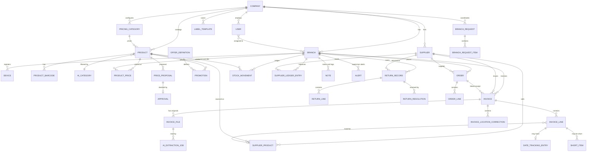

# Data model

## R3c P1 F2 — exact localhost reader fallback

Absent, null or blank `receiving.ai_reader_address` resolves to exactly `http://localhost:5191`, regardless of the app page's hostname. Reading that fallback does not rewrite retained configuration. A saved custom address, including a malformed restored value needing correction, remains authoritative and visible. Reset persists null; mode-only changes keep the saved address.

## R3c P1 F1 — explicit retained simulation provenance

An actual simulated upload records `simulated_reading: true` when its original is retained. This marker belongs to the invoice and survives a later change of company reading mode. New Live originals, manual attachments, imported readings and reopened posted records are not relabelled from current settings. Existing explicit simulated fallback retains the same marker.

## R3c P1 K8 — one paid/free product with exact source money

Keep three independent facts: exact paid paper amount, regular pricing unit cost and exact acquisition amount/physical coverage. Bonus's higher regular pricing cost is not the cost paid for every acquired physical unit. The private `InvoiceLine.free_case_group` retains immutable source members, source fingerprint, original/bound Product identity, paid/free quantities, genuine choice/answer basis, source-specific received/refused/later allocation and optional discrepancy note.

Grouped receipt lots and frozen return sources carry private exact acquisition amount/quantity and a source-specific claim budget separately from the rounded four-place display unit cost. Return creation reserves only remaining same-company/source physical units and cents. Split pickups/settlements use differences of cumulative rounded allocations; three one-unit claims on a two-cent/three-unit source sum to exactly two cents. Repeated requests/claims cannot enlarge the budget. Genuine physical recovery releases only its unspent coverage; supplier-held cancellation and already settled coverage do not create a second claim budget. Actual confirmed supplier credit remains the existing separately authorized financial fact.

Operational invoice/approval/purchase/return/History projections omit private source members, fingerprints and acquisition reservations, including selector/scalar audit paths. Non-deciding approval readers retain safe choice/receiver facts but omit paid amount, pricing unit cost and nested financial arithmetic. Cost-authorized invoice DTOs receive selected exact amount/short/refused facts; UI-only arithmetic helpers use those facts rather than multiplying Bonus pricing cost by all delivered units. Domain posting/return commands continue to derive arithmetic from the canonical private source, never from a DTO claim. Pending free-case questions do not display a generic false paper mismatch or an action that silently halves Bonus cost.

## R3c — foreground completion acknowledgement

The transient ready-notice controller retains an accepted-route witness. It acknowledges a completed invoice already on that accepted route only when the raw browser hash still agrees; a deferred Timesheets destination cannot clear a background notice early. Canonical reading/source/actor records and authority checks are unchanged.

## R3c K7 — truthful compact reading progress

Transient live-service stages are preparing, reading, finding and calculating. Actual elapsed time derives from the accepted attempt's started_at; the reading bar is indeterminate, with an estimated usually-about-a-minute caption and no invented percentage.

The finding stage calls a fresh protected inspectLiveInvoiceMatching query for the exact accepted target/attempt/source/version and current actor. It uses the final K1/K2 resolver and only posted actor-readable printed aliases; only aggregate counts leave the query, with no matching keys, source IDs, cost objects or business writes. Calculating surrounds the actual guarded importer/pricing work, where K6 printed terms still take precedence over defaults. Source/attempt/actor and cancellation checks remain before matching and final apply.

Bounded real paint yields let visible local phases render; hidden documents complete without waiting indefinitely for animation frames. Abort cleans up frames, timers and visibility listeners. Presentation stage/clock state is not persisted as approval, supplier, product or financial evidence.

## R3c K5 — app-level background reading

A live invoice read now belongs to an app-level `LiveInvoiceReadingService`, provided beneath `DemoProvider` and outside the routed `App` subtree. Leaving the receiving screen or switching the current invoice, handling location, reader address or reading mode preserves the already accepted request and its captured settings. Completion applies the existing guarded importer to only its saved invoice; it never switches the current invoice or route automatically. Cancel aborts the exact current attempt. A separately successful Discard retires the old transport without writing another Cancelled transition. Full reload still requires an explicit Read again.

The service continues checking real company/person/session/role/version authority at protected command/query boundaries. The existing source hash/content/version/attempt guards remain canonical. A replacement session cannot adopt a late answer. The ready notice contains only the permitted invoice reference, has explicit Dismiss and Open, and Open reauthorizes the exact saved target through the existing guarded navigation path. Pending Timesheets saves keep the notice until navigation is actually accepted. The toast uses the app's bottom toast edge so it does not cover New invoice.

The service registry, activity snapshots and ready notices are transient application state. Canonical original/attempt/source/version and guarded import records retain their existing shape. Ready and page Undo use measured footer/peer bounds, actual mobile layout viewport and physical RTL overflow correction. They clear genuine bottom controls, ignore the desktop sticky top strip, and preserve dialog-owned Undo. Observers/listeners and scheduled frames clean up on unmount.

## R3c K4 — editable receiving selling price

A receiving-price proposal retains canonical positive cent `price`, independent `calculated_price`, optional exact `entered_price` and `price_unit` (each/lb/kg), and the actual receiving editor/time. Weight input normalizes once using the configured factor and Decimal half-up cents while preserving the typed amount/unit. Posting and approval retain that editor even if somebody else posts. Approved charge and paper/stock/source evidence remain unchanged until the existing actual approval.

The buffered input queue, pending count and tentative returned action tokens are transient UI state. Keystrokes enter the protected serialized command queue immediately; only tokens returned by that input's own successful commands may chain. Stale external edits are rejected. A rejected repository commit restores the visible committed amount, retires tentative tokens and requires an explicit fresh review/retry. Invalid/stale proposals keep a linked selling_price issue and block confirmation/posting. Numeric margin/minimum data requires the existing pricing.margin_read permission; below-cost warnings use the receiver's permitted cost.

## R3c K3 — configured .49 to .99 and Use Lower

`CompanyConfig.rounding_bands.final_ending_adjustment` is optional/null or `{ source_endings, target_ending }`. The seed default is `["0.49"] → "0.99"`; target must exceed every unique valid source cent fraction. Null or empty sources disables it; explicit custom/disabled values survive. Missing legacy configuration resolves through a read-only effective default, without a persisted migration, backup write or repricing existing Products.

New calculations apply this Decimal adjustment once after category/band/special rounding. `PricingResult.rounded_up_from` retains the actual pre-adjustment price for the quiet explanation. TypeScript, both Python references and shared fixture cases agree. Historical approved/manual/Sale/posted prices remain unchanged.

Use Lower retains an attributed `InvoiceLine.receiving_price` proposal with independent calculated price. Its private pricing basis is separate from the mandatory action witness, which also binds current actor/session/location, lifecycle/attempt/source/current proposal and latest immutable price Activity. Set/reset reject stale and ABA actions; valid Discard/Undo restoration preserves the original receiver without reviving old actions. Posting creates individual manual-price approval with requested/calculated prices and the receiver; it does not change the current approved charge. Internal quote serialization stays outside public/audit views.

## R3c F3 — native picker before draft creation

Photo/PDF intake keeps its selected `File` objects and initiating actor/location/navigation witness in transient UI memory. Opening or cancelling the native picker does not allocate an invoice ID, retain a new invoice, write an activity or save a blob. Empty, invalid or stale selections are rejected before the initial protected creation transaction. The transaction rechecks the genuine company, user/session, authority/person version and concrete receiving location, then retains the prior workspace and creates the selected target with its actual creator.

Originals use the existing protected upload handles and ordered `original_pages`; bytes are retained before the target is presented as ready to read. Each asynchronous upload rechecks the current actor and exact target snapshot, and final attachment independently authorizes that target. A retained target can receive its originals without switching an unrelated current workspace. Creation audit records the entry source and selected-file count; transient `File` objects and navigation callbacks are not stored in business records. Storage failure retains the created draft for recovery rather than deleting it or claiming the original was saved.

## R3c F7 — truthful reading header

No new persisted data-model field. The processing header derives its title/caption from the existing invoice status/original availability, persisted `live_reading.phase` and actual transient activity for that invoice. It does not treat a persisted processing phase as proof that a request is active. Existing completed-reading provenance remains separate from current activity.

## R3c F4 — retained Discard, Cancelled and Undo

`DemoInvoice.status` adds `"cancelled"`; `cancellation?: { by_user_id: string; by: string; at: string; reason: string }` retains current actor/time/reason and is explicitly projected for authorized invoice reads. Cancelled invoices remain in the canonical invoice records and have a real counted list stage. The original files/pages, line/source evidence and earlier History remain retained. Posted invoices cannot be discarded; Cancelled records cannot be edited or posted.

Discard checks fresh invoice edit authority, exact target/version and genuine emptiness. Empty drafts use the attributed reason `Empty draft`; drafts with entered content require a reason. The existing reversible `Cancel invoice` Activity is displayed as **Discard invoice**. Its special inverse addresses one retained invoice ID, checks the exact current target, restores the trusted pre-discard content and rechecks current edit authority. Undo after opening another invoice restores only the discarded target and leaves the current workspace untouched. Version/attempt identity advance on Discard and recovery; an old reading response cannot resume. A genuinely manual live-reading phase stays manual so its existing narrow manual-entry authority survives Undo; processing recovery stays inactive until a person explicitly reads again.

## R3c K6 — missing-paper payment default

`CompanyConfig.receiving.default_payment_terms?: string | null` is seeded as `"Monthly"`. A missing legacy setting resolves from the seed without rewriting stored configuration; explicit null, blank or an unrecognized term disables the default. Recognized configured terms reuse the existing calendar/day-term parser.

`DemoInvoice.payment_terms_defaulted?: boolean` distinguishes a configured default from printed terms and the existing historical `payment_terms_inferred` marker. It is explicitly included in the protected invoice DTO. Reading preview and import share the same resolution: supplied effective reading terms win; otherwise use the configured default. Imported defaulted terms set `payment_terms_inferred = false`, calculate the due date through the existing calendar logic, and retain genuine printed due-date discrepancies/questions. A missing paper due date loses its AI question only when a valid due date is actually computed. No human `checked_fields` receipt is fabricated. `setInvoicePaymentTerms` clears both default/inferred markers and applies the existing due-date recalculation behavior.

## R3c K2 — Curated names and retained printed matching keys

`InvoiceLine.printed_description` retains the exact original AI/source description separately from a checked or edited clean product name. Shared per-source-index evidence feeds preview and import; checked-only extra rows cannot fabricate original printed text. Product names retain the individual size while carton counts remain pack data; new Each Products derive their unit size from the individual leaf rather than the whole carton.

Optional receiving `new_description_en/fa` reuses the existing Product description fields at genuine new-Product posting. For an existing Product, the line editor clearly retains extra text with this delivery and directs catalog changes through guarded Edit product.

A genuine accepted posted line can add `SupplierItemDefinition.printed_description_keys` entries `{ key, product_code, source_invoice_ids }` to its same-company, same-supplier binding. Old associations remain, ambiguous or archived identities do not become matches, and using a key requires readable posted source evidence. Importing or renaming a draft creates no Product or learned binding. Explicit purchase DTOs omit these internal keys; audit projections also remove recursive, selector, primitive and flattened-path matching provenance while retaining canonical inverse evidence and normal supplier fields.

## R3c K1 — Automatic repeat-delivery evidence

`InvoiceLine.known_delivery` retains a same/changed status, actual earlier-delivery date, precise field changes and internal source invoice/line identities plus a content fingerprint. Compare only a uniquely identified same-supplier Product against authorized effective posted purchase evidence, including corrections; a Product may still be pending approval. Canonical Decimal costs use the actual case/unit/per-lb basis. Changed printed codes, packs, conflicting paper costs and independent quantity/date/arithmetic questions remain review evidence.

An Each/weight dimension change is an explicit unit question. Numeric costs in unlike dimensions are neither equal evidence nor a meaningful historical delta; current AI cost questions and printed/paper arithmetic remain independent.

Automatic confirmation clears only equality-proven comparable questions and sets the ordinary confirmed state without creating human `checked_fields` receipts. Actual edits invalidate the evidence; projections also check its fingerprint. Public invoice DTOs deliberately select status/date/changes, reauthorize the source and omit internal identities/fingerprints. Cost changes require invoice cost visibility; protected History/sales projections redact the private evidence. Preview uses the genuine actor and actual proposed location, without granting Settings/import authority to a live uploader.

## R2g Tier 1 — Existing records, explicit provenance

Weight-parent `unit_size` may be blank; ordinary Each products and package children retain their size constraints. Existing stored text is preserved. This does not change canonical weight units, costs, package codes/barcodes or Decimal conversion precision.

Inline invoice charges keep the existing signed amount, description, taxable and reading-check fields. Guarded draft/review mutations retain original files and audit before/after; no product receipt or posted repair record is inferred. Only a currently line-derived draft subtotal may be recomputed from complete line/charge evidence. Current printed/human provenance, unknown amounts and posted money remain authoritative; a legacy `calculated_from_lines` marker alone cannot overwrite a subsequent human subtotal.

Dialog feedback identity and `UndoToast.dialog_scope` are transient UI state for one open dialog instance. They never enter canonical business JSON, History, requests, exports or stored invoice reading provenance. They do not grant authority or extend Undo eligibility.

## R2c Groups 2–6 — Read contracts and atomic decisions (2026-10-26)

- Shared `SelectOption` derives public `searchTerms`, optional short selected text and explicit `placeholder` metadata. Placeholder is semantic, independent of stored empty values. Normalized matching/highlight ranges, local search text, popup placement and `DataTable.recordDetails` are presentation state, not new price/stock/business records. Record-details mode leaves omitted facts on the authorized full record. Product search allowlists names/code/barcode; supplier search adds retained public name aliases.
- Supplier directory read state distinguishes pending, successful empty, filtered empty and error. Supplier rows stay company shared while their delivery/financial aggregates are independently scoped. Profile incomplete derives from actual missing profile fields, not the internal compatibility approval status. Payables statement routes use the stable authorized supplier ID, supporting legacy same-company names; list scroll/filter state is keyed to the current person/company/location and captured before route replacement. No new ledger or supplier balance is created by navigation.
- `approvalProductEditRead` supplies the shared ProductEditor an authorized product DTO, current source cost/proposed price/category/minimum/manual review and a fingerprint of proposal, product/price/supplier/date/pricing/tax inputs. `editAndApproveProduct` rechecks both approvals.decide and catalog.edit with fresh authority and pending company/location/source state. It validates a cloned candidate, calls the genuine product/date/supplier/approval operations, then publishes the candidate only on complete success. One nonreversible Edit and approve product Activity retains before/after, reason/acknowledgment, scope/manual choice and the underlying operation evidence. Standard decision Undo remains its existing separate contract.
- The edited supplier-item code is explicit metadata (`supplier_item_code_inferred = false`), retaining old source-key associations and immutable purchase-line evidence. Sold-by type, exact source cost/money basis, invoice originals, ledger/physical receipts and prior approval/decision evidence are preserved. Category recalculation, below-minimum checks, manual rule/keep, margin-review linkage, price-scope/task creation, barcode and stale snapshots use the existing guarded domain operations. Approval-board minimum margin is an authorized financial read value, never a public config leak.
- Invoice batch preview retains expected snapshots and selected eligible IDs. Select-all omits individual-review-only rows; one command validates before applying the selected batch, with no partial subset on failure. The dialog/table replaces presentation only; original rejected/resubmitted links and immutable decisions remain.
- `NotificationRecord.dismissed_at` is retained personal soft dismissal alongside read_at; event_key stays canonical for deduplication. Clear all marks only currently readable records of the fresh recipient, preserving business sources and other recipients. `notificationReadable` rechecks company/recipient/current role/locations and source status before projection, excluding handled/cancelled tasks, resolved escalations and exact decided pending approvals.
- `NotificationReadDTO.group_key` is an internal equality token, never displayed or parsed as authority. Source-backed price grouping uses kind, same-company product, genuine task/version source activity and effective boundary; no-source fallback uses task/version or exact notification ID, without copying a raw event key or recipient payload. Only already permitted projected records enter groups; any unread member makes the group unread. Private costs/margins, credentials, recipient IDs and source decision payloads stay excluded from the public projection.
- `openNotificationGroup` resolves current readable members, marks this person's group read and reconstructs its destination from canonical IDs, preferring a current eligible branch. `clearAllNotifications` and mark-read use current-authority commands. UI request/actor/location/route/menu intent prevents adopting a stale asynchronous destination; stored href text cannot grant navigation. No production HTTP/push endpoint or new money/task-completion model is introduced.

## R2d timesheet records and protected views (2026-10-26)

- `CompanyConfig.modules.timesheets` is required after additive migration; legacy input may omit it. Optional legacy `config.timesheets` becomes configured `departments[]` with unique stable key, `name_en`, `name_fa` and nonnegative integer order. Configuration drives screens, reads, print and retained captions; a removed department does not delete evidence.
- `TimesheetStaff`: id, company_id, identical canonical `branch`/`branch_id`, English/optional Persian name, usual_department_key, optional app_person_id, active/archived status, version and actual created/updated actor/time. A linked app person must currently be active, same-company and branch-permitted; the relationship confers no login or data access.
- `TimesheetDay`: id, company_id, branch/branch_id, local `YYYY-MM-DD` date, Notes, version and created/updated actor/time. One retained day per company/branch/date.
- `TimesheetRow`: id, company/branch/branch_id, day_id/date, department_key and retained EN/FA department captions, staff_id and retained name captions, normalized `HH:mm` In/Out or empty, version and created/updated actor/time. Optional removed_at/removed_by_user_id soft-remove it. Multiple rows per staff/day support split shifts. Current configured/staff captions win in reads; snapshots preserve historical fallback.
- Hours are derived, not persisted input: integer minutes, overnight, on_shift and nullable out_missing/long_shift warning. An earlier Out adds 1440 minutes; equal endpoints are zero. Missing endpoints contribute zero completed minutes. Week/day/department/staff totals sum these integers; displayed decimal CSV hours use Decimal and four places.
- Domain commands (`add/edit/archiveTimesheetStaff`, `add/patch/removeTimesheetRow`, `saveTimesheetNotes`) validate fresh authority, company, concrete permitted location, relationships and expected versions inside the existing canonical transaction. Add-new-staff plus first row is atomic. Meaningful changes append attributed before/after Activity; retained rows/staff are never physically deleted. Read/export/History functions independently enforce `timesheets.read`; scoped shell projections expose only matching company/location records and valid day/staff relationships. Cashier receives the narrow timesheet audit family, without broad money or History grants.
- `readTimesheetDay` and `readTimesheetWeek` return configured departments, retained removed-department sections, active/archive-safe captions, rows and computed totals; week starts Monday. `exportTimesheetCsv` makes a fresh protected day/week read and returns an actual UTF-8 BOM/CRLF CSV with quoted/formula-safe `staff,department,date,in,out,hours`. No financial export capability is inferred.
- `onShiftNow` derives unique staff from valid nonremoved In/no-Out rows at a concrete branch, with local clock-in no later than now, including past unclosed days. Aggregate selection has no implicit branch and returns no combined count.
- `prototype_r2d_timesheet_schema = 1` marks additive initialization. Existing-store migration archives/verifies exact private source JSON/hash and checks the unchanged canonical revision before writing defaults/empty arrays; concurrent revision changes retry. Explicit module false, custom settings and existing records survive. Fresh/reset fictional source is separate (`seed/timesheets-demo.json`); Empty store retains migration/demo markers and cannot repopulate on reload.

All of these records remain in the private local IndexedDB repository; no deployed server endpoint, cross-device synchronization, wage calculation or payroll payment record is introduced.

## R2c import normalization metadata (2026-10-26)

Imported delivery inference retains `imported_received_alternative` for an unqualified handwritten morning/afternoon choice. Display and input use 24-hour company-local time; stored instants remain UTC. Quiet `calculated_fields` and `calculated_from_lines` provenance are separate from genuine reading checks and checker receipts. Normalization retains exact printed descriptions, code/name swap evidence and source pack/money basis; computed four-place unit costs never replace original paper totals. Unknown imported pack defaults to one plus a review check. The typed preview exposes only supported check evidence, not internal charge-calculation objects.

## R2b import provenance and corrections (2026-10-25)

Header, line and other-charge `checked_fields` maps store canonical field names with `{ checked_by_user_id, checked_at }`. Editing acknowledges matching aliases; whole-line confirmation acknowledges the line's remaining checks. Not on the invoice keeps the value empty, saves that receipt and records `absent_on_invoice: true` in History. Absence is not a fabricated field value or extra receipt property.

Imported invoices retain `imported_received_source: "handwriting" | "invoice_date" | "unresolved"` and `payment_terms_inferred`. Source notes, original bytes/SHA-256s and action timestamps stay separate from delivery time. `invoice_received_corrections` is append-only: `{ id, company_id, invoice_id, from_received_at, to_received_at, source: "handwriting", reason, by, actor_user_id, at }`. Apply the linked from→to chain for effective Received, supplier Last delivery and received-movement display/sort; never rewrite the posted source or original physical event.

Lines retain `supplier_item_code_inferred` when a missing printed code is filled from the clean name; carry it into supplier-item delivery history. `reading_product_match` records product code, basis (`supplier_code`, `supplier_description`, `barcode`, `catalog_name` or `other_supplier_description`), `earlier_delivery` and `requires_check`. The retained source invoice ID is evidence only and is omitted from the public invoice DTO. Same-supplier aliases survive a catalog rename; cross-supplier fallback requires review. Supplier website is optional, like the other profile contacts.

For a fractional case converted to exact whole units, `converted_case_cost_before_tax` and `converted_case_units_per_case` retain the exact source basis. Decimal line totals, correction deltas and ledger calculations use it rather than multiplying a rounded four-place unit cost. Meaningful product/unit/pack/cost changes or validated explicit cost reentry invalidate it; corrections never accept client-supplied conversion metadata. Posted financial/source/physical evidence remains immutable; reasoned corrections stage locally, preview canonical old→new fields and impacts, then append a linked version and the displayed delta once.

Invoice lists and counts use the same company/role/location-scoped workspace-plus-saved selector, de-duplicated by invoice ID. Posted cells, notes and original viewing use authorized read DTOs rather than exposing hidden costs, margins, notes or source handles.

## R2 supplier profiles and corrected approvals (2026-10-21)

Supplier records retain the internal confirmed status for compatibility; it now means Active immediately on creation. Profile incomplete is derived from missing phone, email, representative, representative phone, payment terms or address and is never a posting guard. Supplier notes default empty; source invoice provenance is displayed separately. A versioned, backup-verified supplier migration activates legacy proposed suppliers and records History. Old supplier approvals remain historical only. Persist normalized supplier-name distinction pairs per company so a dismissed similar-name warning does not recur for that pair. Profile-completion notifications are scoped to Owner/Manager and resolve after completion.

InvoiceLine may have a stable id; newly imported/added lines receive one. Retained older lines support their original index as a route fallback. Delivery evidence exposes the source line identity; links use #invoices?id=…&line=…. review_changed_after_confirmation marks the single edited confirmed line. Reserved `calculated:subtotal`, `calculated:tax` and `calculated:final_total` confidence keys identify derived paper amounts until Totals acknowledgment. Ordinary blank optional fields are quiet; explicitly AI-flagged empty optional fields remain actionable until edited, confirmed or acknowledged absent.

Approval gains pricing_category and optional resubmitted_from_id/resubmitted_as_id links. Full staged product editing recalculates the pending category against configured Decimal pricing rules and commits the metadata/price decision atomically with before/after audit; the guarded category helper remains part of that operation. Resubmitting creates a new pending record, leaving the rejected record immutable apart from its forward link. Batch decisions affect only explicitly selected requests under ordinary authority, location, preview and pricing checks. Import/posted History stores invoice identity and counts so its list can show a meaningful invoice item without flattening the entire recorded invoice into hundreds of changes.

## R1 imported reading contract (2026-10-21)

The local file envelope has `format: "super-arzon-invoice-readings"`, `version: 1`, `reading_schema: "invoice-reading-v2"`, `exported_at`, and `invoices`. Each export invoice contains ordered base64 image pages, `original_sha256`, AI reading/statuses/source/models, optional partially populated `checked_answer`, and `reading_cost_usd`. It is an input format, not a second business invoice model. All monetary normalization uses Decimal, with four decimal places for costs.

**R3 live source:** use this same envelope/parser/importer with AI source selection and no checked-answer overlay. The envelope's JPEG pages are ephemeral request/import input; they never replace the retained raw PDF/photos or enter canonical business JSON. Source SHA-256 values come from the actual stored originals; repeat a single PDF's source hash for its rendered page slots. Retain the verified target invoice identity and exclude only that target when rechecking duplicates.

Invoice `live_reading` records recoverable lifecycle phases `ready`, `processing`, `failed`, `cancelled`, `complete` or `manual`, with attempt identity and actual start/completion times. Private canonical guards bind the attempt to its genuine company/person/session/location and verified originals; these guards are never operational DTO fields. A reload does not recreate a network request. The UI derives recovery choices when no current request owns the persisted attempt.

An explicit demo fallback retains public `simulated_reading: true` on that invoice, preserving its raw originals and identity without changing the company reading mode. Its local Simulated reading label survives reload; a successful real reading clears the marker and retains only actual returned provenance.

The existing `reading_record.source` also accepts `live`; `seconds` retains the reader's finite nonnegative duration, `reading_cost_usd` stores its Decimal USD amount and `models` retains the actual returned names. The local response accepts model-name strings or objects with a nonempty `id`; object IDs become those names. Optional `model_details` retains each object's `id`, boolean `ok`, finite nonnegative `seconds` and exact Decimal-text `costUSD` when supplied and valid. Legacy string-only responses add no detail field. Unknown response fields, including `checkFailures`, are ignored. Owner/Manager may read this provenance. Protected projections redact live cost, seconds, models, model details and private attempt guards for all other roles, including History patches, independently of ordinary invoice-line cost visibility. Imported-file provenance retains its existing compatibility contract. No provider key is a field in this model.

The existing invoice retains `reading_record: { source: "imported", file_name, page_sha256s, models, reading_cost_usd, exported_at, ai_source }`, `original_pages`, `low_confidence_fields`, `other_charges`, `import_currency`, `import_warnings`, `import_handwritten_notes` and `order_reference`. Each original page has `file_name`, `file_type`, `file_data` (a durable reference), `file_size` and `original_sha256`. Originals are written through the existing versioned ArrayBuffer repository; base64 photographs never enter the canonical business JSON. Each page retains its source SHA separately from the stored upright-image byte digest.

Other charges retain `line_type`, description, signed amount, taxable choice and `low_confidence_fields`; a null input taxable value requires a check. They participate in subtotal/total/payable reconciliation only. Item records retain supplier item code, barcode, printed lot/expiry/note, source line index, pack quantities, source kg/lb fields and existing date confirmation. `taxable_inferred` tracks a null input until a person confirms/edits the category-derived default. Header and line check lists address canonical editable fields; `ai_statuses` maps `header.*` and original `lines[i].*` paths into those lists. Checked values overlay only supplied keys and clear only their corresponding AI checks; changing checked quantity/unit/pack/cost basis invalidates dependent AI calculations unless the checked answer supplies its own derived values. Existing invoice/product/supplier/history and approval entities remain authoritative.

The empty-store command clears company business collections and the current invoice workspace, retains configuration/templates/notebook definitions and product-code high-water mark, and records one non-reversible History event. It does not alter authority credentials or sessions. Historical demo balance snapshots are disabled when starting empty.

Current contracts include C6/C7/C8 and the source-first E1 authority specification (2026-10-12). E1 implementation/evidence is Planned until verified. Earlier C3/C4/C5 compatibility notes are historical where superseded by the C6 section below.

Database: PostgreSQL. This document defines entities and rules, not exact column types; the AI developer finalizes migrations and records changes here.

## Conventions

- Primary keys: UUID. Every table has `created_at`, `updated_at`, `created_by` where a person acts.
- Every business table has `company_id`; branch-level tables also have `branch_id`. Enforce scoping in a shared base query layer and test it.
- Money: `Decimal(12,2)` for selling prices, invoice totals, ledger amounts; `Decimal(12,4)` for unit costs.
- No hard deletes. Use status/archived flags or void with a reason.
- Free text and names support `*_en` and `*_fa` columns (or a translations table). Custom notebooks require English and allow Persian to be empty, with an English display fallback; preserve both fields rather than manufacturing a translation.
- Use an append-only `audit_log` for sensitive actions.

## ERD (main relationships)



## Entities

### Tenancy, people, devices

| Entity                  | Key fields and rules                                                                                                                                                                                                                                                                                                                                                                                                            |
| ----------------------- | ------------------------------------------------------------------------------------------------------------------------------------------------------------------------------------------------------------------------------------------------------------------------------------------------------------------------------------------------------------------------------------------------------------------------------- |
| `company`               | name, logo, default language, currency, timezone, settings                                                                                                                                                                                                                                                                                                                                                                      |
| `branch`                | company, name (en/fa), stable code/id, location_type (`store`/`warehouse`), sells_to_customers (Store default true, Warehouse false), address, phone, opening_hours, tax_region, active; warehouse cannot have Cashier access                                                                                                                                                                                                   |
| `user` / `PersonRecord` | company, stable person ID, name_en/name_fa, username and aliases unique per company, phone/email, exactly one configured role (`owner`/`manager`/`branch_supervisor`/`floor_worker`/`cashier`), typed company/assigned location scope, invited/active/deactivated, mandatory setup state, authority_epoch/version, last_sign_in_at, created_by_user_id. Credentials and sessions are separate authority records; no PIN fields. |
| `device`                | stable company/device IDs, concrete location, name, registered_by_user_id, active/version, registration time and recent-user IDs; location default is a convenience only when allowed. Preserve existing entries; fictional fixture is clearly demo-only.                                                                                                                                                                       |
| `setting`               | company or branch scope, key, value (JSON)                                                                                                                                                                                                                                                                                                                                                                                      |
| `audit_log`             | the History: actor, action, entity type/id, branch, before/after (JSON), device, timestamp, `reversible`, `reverted_by_entry`, `reverts_entry`, `undone`                                                                                                                                                                                                                                                                        |

### Catalog and pricing

| Entity                | Key fields and rules                                                                                                                                                                                                                                                                                                                                                                                                                                                                                                                                                                                                                                                                                                                        |
| --------------------- | ------------------------------------------------------------------------------------------------------------------------------------------------------------------------------------------------------------------------------------------------------------------------------------------------------------------------------------------------------------------------------------------------------------------------------------------------------------------------------------------------------------------------------------------------------------------------------------------------------------------------------------------------------------------------------------------------------------------------------------------- |
| `pricing_category`    | key, label (en/fa), cost_divisor, rounding mode, apply_special_correction, taxable, date_tracking_prompt                                                                                                                                                                                                                                                                                                                                                                                                                                                                                                                                                                                                                                    |
| `tax_profile`         | key, label, rate (company-configured), `taxable` flag                                                                                                                                                                                                                                                                                                                                                                                                                                                                                                                                                                                                                                                                                       |
| `ai_category`         | name (en/fa), created by AI or person                                                                                                                                                                                                                                                                                                                                                                                                                                                                                                                                                                                                                                                                                                       |
| `product`             | code (unique per company, never reused, allocated beyond every previously assigned company code), name_en (required)/name_fa (optional, English fallback), description_en/fa (optional), unit_size, sold_by (`each`/`weight`, compatibility default each), date_tracking_preference (`yes`/`no`/unset), pricing_category (required), tax_profile, ai_category (optional), date_reminder_days (nonnegative whole days, defaults existing expiry setting), first_added_branch_id?, status (`pending_approval`/`active`/`archived`), archived_at. Owner/Manager direct creation is immediately active; worker invoice proposals remain pending. Retain manual four-decimal cost/calculated-price provenance separately from an invoice source. |
| `product_barcode`     | product, barcode (unique per company; conflict → Approval)                                                                                                                                                                                                                                                                                                                                                                                                                                                                                                                                                                                                                                                                                  |
| `supplier`            | company, name, compatible internal confirmed status (UI Active), optional phone/email/website/address/representative/terms/notes; Profile incomplete is derived and never a posting guard. Deactivate excludes new choices while retained links survive. Last delivery uses the latest effective Received of authorized posted invoices at that location.                                                                                                                                                                                                                                                                                                                                                                                   |
| `supplier_product`    | supplier, product (nullable until matched), supplier_sku, supplier_name, positive units_per_case, last_bought_unit_cost (4dp), last_bought_case_cost, last_bought_at, last_invoice_id/number, regular_cost_basis (excludes short-dated), quoted_unit_cost_before_tax?/quoted_by/quoted_at (separate expected-cost provenance), archived; manual edits and posted invoice snapshots retained                                                                                                                                                                                                                                                                                                                                                 |
| `product_price`       | product, branch (null = company default), selling_price, effective_from, source_proposal, price_origin (`rule`/`manual`), rule_price_snapshot, manual_actor/time; branch-specific manual provenance                                                                                                                                                                                                                                                                                                                                                                                                                                                                                                                                         |
| `price_proposal`      | product, branch that triggered it, scope (`all`/`branch`), previous_price, proposed_price, unit_cost, cost_basis (invoice line), source_invoice_id (latest monetary basis), invoice_ids (retained merged evidence), reason (`calculated_change`/`new_product`/`manual_override`/`below_min_margin`/`tax_profile_change`), status (`pending`/`approved`/`rejected`/`superseded`), decided_by/at                                                                                                                                                                                                                                                                                                                                              |
| `approval`            | generic Owner/Manager decision: type, target entity, status, decided_by, note                                                                                                                                                                                                                                                                                                                                                                                                                                                                                                                                                                                                                                                               |
| `offer_definition`    | label ("2 for $5"), quantity, total price, pool key, price it belongs to (1.99/2.99/3.99), editable in settings                                                                                                                                                                                                                                                                                                                                                                                                                                                                                                                                                                                                                             |
| `promotion`           | product, branch (null = same scope as the price), offer_definition, mix_and_match (bool), start (nullable), end (nullable), active, created_by                                                                                                                                                                                                                                                                                                                                                                                                                                                                                                                                                                                              |
| `label_template`      | company, name ("Template 1"), width_mm, height_mm, margin_top/bottom/left/right, gap_x/y, offset_x_mm, offset_y_mm (calibration), slot_order (`ltr`/`rtl`), created_by. built_in_kind (`regular`/`promo`/null), rendering_style, archived. Add built-ins idempotently: Regular 60 × 40 mm/margins 10/gaps 4, Promo 210 × 148.5 mm/margins0/gaps0; retain editable geometry, originals and archived rows.                                                                                                                                                                                                                                                                                                                                    |
| `label_waitlist_item` | branch, product, copies, added_by, added_at, status (`waiting`/`printed`/`removed`), printed_at, printed_by. Shared per branch.                                                                                                                                                                                                                                                                                                                                                                                                                                                                                                                                                                                                             |

### Receiving

The authorized supplier financial projection includes `has_statement`, derived from existing scoped ledger/history, retained balance snapshots or pending/awaiting-pickup return evidence. A zero balance with actual history remains actionable; a registry-only or unposted supplier has a static Balance tile. This flag is omitted with the entire financial DTO for Floor Workers and Branch Supervisors; Cashiers cannot read Suppliers. It creates no financial record or additional query.

| Entity                | Key fields and rules                                                                                                                                                                                                                                                                                                                                                                                                                                                                                                                                                                                                 |
| --------------------- | -------------------------------------------------------------------------------------------------------------------------------------------------------------------------------------------------------------------------------------------------------------------------------------------------------------------------------------------------------------------------------------------------------------------------------------------------------------------------------------------------------------------------------------------------------------------------------------------------------------------- |
| `invoice`             | branch (original receiving location), reviewer_origin_branch_id/assignment, ship_to_hint?, suggested_location?, supplier, supplier_invoice_number (nullable) + `number_is_system_assigned`, invoice_date, received_at, receiving_user, subtotal, tax, final_total, due_date?, payment_terms?, status (see workflows), blocked_reason?, posted_at/by                                                                                                                                                                                                                                                                  |
| `invoice_file`        | company/invoice, original filename, MIME type, page count, uploaded_by/time, storage key (S3 in production; company-scoped IndexedDB reference in Phase 0, no inline base64), content hash/size. Originals are immutable; appended attachments keep actor/time and survive refresh. Demo image originals match immutable invoice snapshots, not placeholder text.                                                                                                                                                                                                                                                    |
| `invoice_line`        | invoice, line_no, supplier_product (nullable), product (nullable), description, qty, unit (each/case), units_per_case, unit_cost_before_tax (4 dp), line_total, taxable flag, review_status (`needs_review`/`confirmed`), `date_tracking_required` (Yes/No/unset, initialized from explicit product preference and validated during review), line_status (`received`/`short`/`short_resolved`/`short_closed`/`refused`), entered_quantity_unit (`cases`/`units`), retained_pack_snapshot, normalized_units, manual_price_decision?, order_line_id?, discrepancy_decisions, short_dated (bool), expiry_discount_date? |
| `date_tracking_entry` | company/location/product, invoice_line optional (manual entries allowed), source (`invoice`/`manual`/`correction`), type (`expiry`/`best_before`), date, quantity? (evidence only), lot_number?, note?, status (`active`/`removed`), removal_reason (`sold_out`/`thrown_away`/`returned_to_supplier`/`entered_by_mistake`), removed_by/at, previous_entry/correction reference. One active snapshot per invoice line; preserve removed evidence and Undo audit.                                                                                                                                                      |
| `short_item`          | invoice_line, qty_short, deduction_before_tax, deduction_tax, status (`open`/`resolved_delivered`/`closed_not_delivered`), resolved_by/at, note                                                                                                                                                                                                                                                                                                                                                                                                                                                                      |
| `ai_extraction_job`   | invoice_file, status (`queued`/`processing`/`needs_review`/`failed`), provider, prompt/schema version, raw_json, error, cost                                                                                                                                                                                                                                                                                                                                                                                                                                                                                         |
| `alert`               | branch, type (`same_supplier_lower_price`/`other_supplier_price`/`cross_branch_price_conflict`/`tax_discrepancy`/`barcode_conflict`/`offer_suggestion`/`ai_failure`/`order_differences`/`return_credit_overdue`), payload (JSON, e.g. worker answers), status (`open`/`taken_care_of`/`pending`/`dismissed`), assigned role                                                                                                                                                                                                                                                                                          |

### Returns

| Entity              | Key fields and rules                                                                                                                                                                                                                                                                                                                                                         |
| ------------------- | ---------------------------------------------------------------------------------------------------------------------------------------------------------------------------------------------------------------------------------------------------------------------------------------------------------------------------------------------------------------------------- |
| `return_record`     | branch, supplier, status (`open`/`picked_up`/`partially_resolved`/`resolved`/`cancelled`), created_by, picked_up_at, supplier_rep_name (required at pickup), submitted_by, photo (optional), note                                                                                                                                                                            |
| `return_line`       | return, product/supplier_product, qty, reason, location note (e.g., walk-in cooler)                                                                                                                                                                                                                                                                                          |
| `return_resolution` | return, type (`credit_current_invoice`/`credit_later_invoice`/`replacement_received`/`cash_or_other`/`no_compensation`), invoice (for credits; one linked invoice retained, multiple distinct partial credit notes allowed for disjoint outstanding item coverage), replacement lines (product, qty, date, employee, rep name, photo/note), `resolves` (`fully`/`partially`) |

### Physical movements, payables, notes (no Phase 1 stock projection)

| Entity                  | Key fields and rules                                                                                                                                                                                                                                                                                                                                                                          |
| ----------------------- | --------------------------------------------------------------------------------------------------------------------------------------------------------------------------------------------------------------------------------------------------------------------------------------------------------------------------------------------------------------------------------------------- |
| `stock_movement`        | branch, product, qty (signed), type (below), reference (invoice line / return line / note / count / product creation), occurred_at, user. Historical opening/count movements remain preserved, but Phase 1 accepts no new opening/stock-count entries and does not show their sum. Correction and transfer events retain original references.                                                 |
| `stock_count`           | Deferred to separately paid inventory phase after register integration; no Phase 1 screen or transaction                                                                                                                                                                                                                                                                                      |
| `supplier_ledger_entry` | branch, supplier, type (`invoice`/`credit`/`payment`/`adjustment`/`opening_balance`), amount (signed), date, reference (invoice/return/supplier creation), cheque_number?, payment_date?, note, `disputed` flag. Payments may be partial. Each optional supplier opening balance is a distinct branch-scoped opening_balance dated as of the entered date and stamped with its Owner/Manager. |
| `notebook`              | company, branch (null = all branches), name_en (required)/name_fa (optional, fallback to English), kind (`to_order`/`store_use`/`for_supervisor`/`custom`), read_roles, add_roles (custom defaults Owner/Manager/Floor Worker), enabled_fields (product, quantity, date, measurement + unit), has_status, notify_supervisor, archived                                                         |
| `note`                  | notebook, branch, text, product (optional), qty (optional), date (optional), measurement + unit (optional), status, author, seen_by/at                                                                                                                                                                                                                                                        |

### Physical movement types (retained for future inventory)

`opening_count` (+, historical only; no new Phase 1 entry), `received` (+), `short_resolved_received` (+), `return_pending` (−, damaged set aside), `return_cancelled` (+), `replacement_received` (+), `store_use` (−), `adjustment` (±, historical count/correction events; new counts deferred), `sale` (− , Phase 2 only, posted by the register integration). C adds linked `transfer_sent`, `transfer_received` and `invoice_location_correction` events; C3 request Undo appends `transfer_correction` with `reverses_event_id` instead of deleting an event or claiming goods moved back. **Do not compute or display stock on hand in Phase 1.** Preserve historical opening/count/sale-ready schema; later paid inventory can enable projections after register sales. Never overwrite a physical event; add a correction.

## Invoice extraction JSON (AI output contract)

The AI reading step must return JSON validated against this schema; anything unreadable is `null` and flagged, never invented.

```json
{
  "supplier_name": "string|null",
  "supplier_invoice_number": "string|null",
  "invoice_date": "YYYY-MM-DD|null",
  "due_date": "YYYY-MM-DD|null",
  "payment_terms": "string|null",
  "branch_hint": "string|null",
  "subtotal": "decimal-string|null",
  "tax": "decimal-string|null",
  "final_total": "decimal-string|null",
  "lines": [
    {
      "line_no": 1,
      "supplier_sku": "string|null",
      "barcode": "string|null",
      "description": "string",
      "quantity": "decimal-string",
      "unit": "each|case|other",
      "units_per_case": "integer|null",
      "unit_cost_before_tax": "decimal-string|null",
      "line_total": "decimal-string|null",
      "taxable": "boolean|null",
      "confidence": "0..1",
      "needs_attention": "boolean"
    }
  ],
  "warnings": ["string"]
}
```

Matching order for each line: supplier SKU → barcode → AI/fuzzy name match against that supplier's history → otherwise propose a **new product**.

## Seed loading

`seed/arzon-config.json` is loaded by an idempotent management command: it creates the company, branches, roles' labels, pricing categories, bands, offer definitions, settings, and terminology. It must be safe to run repeatedly, and C authorizes idempotent company-scoped built-in Regular/Promo templates in the prototype. Existing saved/archived template edits are preserved; inserting built-ins does not reset geometry or recreate an archived template. The separately maintained backend seed command is outside the C prototype change scope.

## C receiving, orders and requests additions

| Entity                        | Key fields and rules                                                                                                                                                                                                                                                                                                                                                                                                                                                                                                                                                  |
| ----------------------------- | --------------------------------------------------------------------------------------------------------------------------------------------------------------------------------------------------------------------------------------------------------------------------------------------------------------------------------------------------------------------------------------------------------------------------------------------------------------------------------------------------------------------------------------------------------------------- |
| `received_entry`              | company, effective location projection, immutable source movement/invoice line, product, supplier, invoice number, actual cases/units with pack snapshot, occurred_at, received_by, receipt kind, correction references. A query view may derive it from retained physical receipt records; not a separate duplicate stock ledger. Exclude refused/voided delivery effects.                                                                                                                                                                                           |
| `supplier_item_price_history` | company, supplier_product, original invoice/line, original/effective location, bought_at/by, retained pack, case/unit cost before tax, actual received qty, short_dated/expiry flag; manual item additions without purchases have blank bought costs/date/invoice; explicit Owner/Manager quotes have separate quote provenance rather than fabricated purchase history. Regular basis excludes short-dated while actual last-bought/history includes it.                                                                                                             |
| `invoice_location_correction` | company, invoice, prior correction/version, from_branch_id, to_branch_id, actor/time/device, required reason, affected receipt/approval references, outstanding amount and allocation snapshot, paired supplier-ledger/physical correction IDs. Posted invoice is immutable; current effective location resolves the latest valid correction chain. Append-only, non-reversible.                                                                                                                                                                                      |
| `order`                       | company, branch/location, supplier, reference, status (`draft`/`ordered`/`partially_received`/`received`/`cancelled`), created/ordered/cancelled actor/time, expected_total_before_tax (Decimal), source_note_ids, linked_invoice_ids, version. No supplier ledger entry; `orders.allow_floor_worker` defaults false.                                                                                                                                                                                                                                                 |
| `order_line`                  | company, order, supplier item/product, bilingual name and supplier-code snapshot, units_per_case snapshot, ordered_cases, ordered_units, expected_case/unit_cost (required before placement; actual purchase or explicit quote/user-entered Expected unit cost, never silent catalog fallback), actually_received_units, cancelled_units, outstanding decision (`short`/`back_ordered`/`cancelled`), source note; free-text source notes require explicit supplier-item and Cases selection before placement. Posted receipts drive received quantities idempotently. |
| `order_invoice_decision`      | company, order, invoice/line or absent order line, difference kind (`short`/`not_delivered`/`extra`/`price_change`), previous/current quantities/costs and retained packs, explicit reviewer decision, actor/time; linked-invoice lower-cost answers appear in one consolidated order_differences alert rather than a duplicate lower-price alert. Refused extras excluded from payable/receipts; absent uninvoiced lines create no synthetic payable.                                                                                                                |
| `branch_request`              | company, from/requesting_branch_id, to/sending_branch_id, reference, status (`draft`/`requested`/`sent`/`received`/`closed`/`cancelled`), source_request_id?, each transition actor/time/location/device, reason?, version. Queries require access to one endpoint; actions require responsible endpoint.                                                                                                                                                                                                                                                             |
| `branch_request_item`         | company, request, product nullable or free_text, bilingual catalog snapshot/free-text as entered, quantity, quantity_unit (`units`/`cases`), pack snapshot when known, note, sent_qty, short_qty, received_qty, missing_qty, checkbox/decision states. Free text without a pack accepts positive whole Cases without invented case-to-unit conversion; fractional Cases require an explicit retained pack and exact whole normalized units.                                                                                                                           |

**Correction finance:** paired adjustments move only the invoice's current outstanding liability. Existing source payments/credits and allocations remain immutable; source outstanding closes and destination outstanding is projected from the correction. Preserve company/supplier/currency total and evidence. Future shorts/corrections resolve effective destination. Previously approved selling prices are not reapplied merely because an invoice location moved.

**Quantities and money:** all cost/expected/payable arithmetic uses Decimal; Each Units are positive whole; Weight quantities are positive kg/lb values with at most three decimals and retain source quantity/cost units; cases use exact Decimal positive quantity × positive integer pack and must normalize to positive whole units, with no float scaling/rounding. A fractional case is allowed only if this condition holds. Snapshot pack/cost on posted invoice/order so later supplier-item edits never alter history. Short-dated lots retain actual low-cost receipts/payable and Date tracking, but do not replace regular cost or create selling-price proposals.

**Receipt identity and corrections:** price comparisons use the accepted purchase history for the same supplier identity and supplier item, including supplier rename aliases; fully refused lines and another SKU are not price evidence. Uploaded and manual invoice lines remember a uniquely matched supplier item's pack without changing the original quantity or cost; ambiguous matches require review. Later Short deliveries identify the original invoice line, so two supplier codes for one product remain separate. Each order receipt retains its actual `receiving_branch`. After a posted invoice is moved, later delivery is authorized at its corrected location and History records that location, while original invoice/order locations and pack/cost snapshots remain unchanged.

## C3 preferences, undo and C4 retained records

**C5 compatibility:** optional promotion creation/stop timestamps support newest-first Past offers while legacy rows retain original order when absent; no historical rows are deleted. Date quick-add auto-enable stores preference and scoped entry in the same existing Add date action/Undo patch. C6 removes Lookup On/Off and inline date controls; read-only dates remain. Turning preference off requires Keep/Clear and operational lists suppress untracked products. No new ledger, stock or pricing structure is introduced; C5 seed files are unchanged.

| Record                              | Key fields and invariants                                                                                                                                                                                                                                                                                                                                                                      |
| ----------------------------------- | ---------------------------------------------------------------------------------------------------------------------------------------------------------------------------------------------------------------------------------------------------------------------------------------------------------------------------------------------------------------------------------------------- |
| `table_preference`                  | company/user/table key, hidden column IDs, defaults version; name/reference column mandatory; role-restricted money columns never selectable; Reset columns restores defaults. Browser storage permitted in Phase 0.                                                                                                                                                                           |
| `navigation_state`                  | company/user/list key, tab, filters, sort/page and scroll position; detail return/breadcrumb/browser Back restore it without broadening scope.                                                                                                                                                                                                                                                 |
| `request_transfer_event` correction | `kind=transfer_correction`, original `reverses_event_id`, request/endpoint/company/product/quantity, actor/time/reason; retains original physical evidence and means a recorded operation was corrected, not that goods physically returned.                                                                                                                                                   |
| `audit_log` additions               | affected-record snapshots/version expectations, inverse effect references, transient undo display expiration (about8 seconds, one eligible action; no edit/autosave message), conflict result; action-scoped inverse preserves independent later changes. No posted invoice/payment/move/content correction is reversible. Actual request transfer evidence stays append-only.                 |
| `invoice_content_correction`        | company/invoice, original and previous correction/version IDs, effective location, required reason, actor/time/device, immutable before/after line snapshots (product/quantity/pack/cost/date/decisions), preview fingerprint, financial/physical/proposal/date/order impact refs. Confirmation rechecks version/allocation context; append-only, idempotent, non-reversible.                  |
| `invoice_line` weight additions     | sold_by snapshot, source quantity/unit (`kg`/`lb`), source cost/unit, case weight/unit when known, canonical lb quantity/cost, conversion-factor snapshot. Do not treat weight as whole Each units or change original posted evidence.                                                                                                                                                         |
| `supplier_product` weight additions | sold_by/quantity-unit snapshot, case_weight and case_weight_unit when used; distinct original last-bought source cost/unit and canonical pricing basis.                                                                                                                                                                                                                                        |
| `order_line` temporary additions    | line_kind (`supplier_item`/`new_item`), user-entered temporary name, optional retained pack/cost, explicit quantity, New item marker, resolved invoice_line/product/supplier_item IDs. Unresolved line is not a catalog product or purchase history; unique match/posted association is scoped and idempotent. Incomplete expected totals are identified as estimates with unknown components. |
| `return_memo`                       | company/location/return, unique stable RM reference, immutable pickup-time supplier/location/date/driver/employee/item/quantity/cost/expected-amount snapshots, printable supplier-document content (English default; per-document language setting), signed-paper evidence reference. No confirmed credit implied.                                                                            |
| `return_record` additions           | expected_credit (Decimal), pending-credit projection enabled snapshot, pickup/memo reference, waiting-credit start, closure subtype (`credited`/`replaced`/`written_off`), credit-note number/actual amount or replacement receipt/invoice link or write-off reason; retained old statuses map to current UI, not deleted.                                                                     |
| `pending_return_credit`             | company/location/supplier/return/memo, projected expected amount, active/fulfilled/released outcome and references. Derived from retained claim evidence; distinct from posted supplier_ledger_entry credit. Reconciliation must avoid double deduction. Replacement releases the provisional expected credit; no new purchase/confirmed-credit ledger entry.                                  |

Corrected invoices resolve an append-only effective version for present-day document/Received/approval/date/financial projections. Original invoices, original files, payment/credit allocations and physical receipts remain addressable in History. Financial adjustment applies the difference exactly once; excess already allocated amounts remain explicit rather than disappearing. Receipt corrections do not fabricate a second delivery. Existing allocated settlements/downstream short/order/return decisions require impact validation, with unsupported conflicts blocked.

Pickup expected credit changes only the Owner/Manager payable projection. Confirmed ledger credits require authorized verification/evidence; a worker pickup must not impersonate a Owner/Manager financial posting. Credited replaces the pending expected amount with actual credit; Write off releases the projection. Old replacement evidence/coverage and safe-original recovery caps remain mandatory. Replacement releases the expected projection (owed $570 → $600), following the recorded owner answer in open-questions.

Seed pack correction is additive/versioned: realistic fixture packs and case representations preserve every prior invoice/ledger total. Preserve user-edited items, posted snapshots, custom settings/passwords and original records; do not overwrite a saved posted invoice merely to improve the starting demo. C3/C4 authorize seed/demo-data.json, seed/arzon-config.json and additional pricing cases within the allowed seed scope.

## C6 durable files, product lots and item-level returns

| Record                          | Key fields and invariants                                                                                                                                                                                                                                                                                                                                                                                                                        |
| ------------------------------- | ------------------------------------------------------------------------------------------------------------------------------------------------------------------------------------------------------------------------------------------------------------------------------------------------------------------------------------------------------------------------------------------------------------------------------------------------ |
| `product` additions             | `date_reminder_days` uses existing configured expiry default; `first_added_branch_id` identifies actual first creation, not current price scope. One company product/barcode across stores. Optional Persian name/category/descriptions, English/pricing category required.                                                                                                                                                                      |
| `date_tracking_entry` additions | Retained creation/entry UTC time, supplier identity when evidenced, optional lot link and reminder marker. Operational visibility requires active entry **and** product tracking Yes; Lookup may display retained active entries when preference No. Clear changes entry state with History. One reminder identity per company/location/date-entry; no daily duplicate alerts.                                                                   |
| `receipt_lot`                   | Stable company/product/supplier/branch/expiry identity; source receipt references each retain quantity, unit, pack, exact four-decimal source cost and invoice/line/time. Latest cost may project current lot cost, but a new receipt never overwrites old evidence. Same key reuses one lot. No visible on-hand/depleted quantity.                                                                                                              |
| `promotion` clearance additions | `lot_id`, `clearance`, `expiry_date`, concrete selling `branch_id`; at most one current clearance per product/location. Lot must belong to same company/product/supplier/location. Regular company/branch offers and approved regular prices remain distinct. Source receipt does not automatically apply clearance or reprice the product.                                                                                                      |
| `return_pickup_event`           | Company/return/location, immutable line quantities, shortfall reasons/dispositions, representative, signed-paper reference, optional evidence-file refs, actor/device/UTC time. New later pickup only for retained remaining units; cumulative actual quantity ≤ set-aside quantity after safe dispositions.                                                                                                                                     |
| `return_pickup_correction`      | Authorized Owner/Manager actor only, required reason, original event/version, immutable before/after/impact references. Locked original remains; no mutation through Record resolution or generic Undo. Recheck settled coverage and append corrective evidence, block incompatible corrections.                                                                                                                                                 |
| `return_resolution_item`        | Return/line/pickup references, kind credited/replaced/written_off/outstanding, original-unit coverage, credit-note number/actual amount/evidence or actual replacement quantity/product/receipt or required write-off reason; outstanding expected date/note. Immutable appended events; remaining coverage excludes prior settled/pending claimed coverage.                                                                                     |
| `return_credit_claim`           | Distinct supplier credit note and disjoint item coverage; one linked invoice per return retained. Duplicate documents/overlapping claims blocked atomically. Actual amount/tax and unapplied money follow existing financial allocations, not a cap at expected cost. Worker submits evidence, Owner/Manager verifies/posts.                                                                                                                     |
| `supplier_documents` setting    | `return_memo` / `supplier_order`: independently en(default) or bilingual. Internal picking/labels retain their own bilingual setting. Print language does not change stored business/signed evidence.                                                                                                                                                                                                                                            |
| `browser_file`                  | IndexedDB company-scoped immutable binary record keyed by content hash; original name/type/size/hash/creation and derivative/source link. The public API returns Blobs; private rows support legacy Blobs and versioned ArrayBuffers. Main JSON stores only `idb-file:v1:<company>:<hash>`. Original invoice bytes are exact; normal photos use ≤2000 px longest-side derivative. Object URLs are ephemeral view resources, never durable state. |
| `file_migration`                | Legacy reference/source hash, durable target key/hash/size, read-back verification and completion marker; backup retained until verification. Retries are idempotent; failed migrations keep original inline evidence, never dangling references or claimed success.                                                                                                                                                                             |
| `invoice` additions             | Payment-term kind/day count, due-date override marker, automatic-final-total/manual override marker, supplier review gate. `received_at` UTC; field parsing/rendering uses company IANA zone. Draft line removal retains action-scoped inverse/audit, posted lines remain immutable.                                                                                                                                                             |

Product editor commits permitted catalog changes and current-location date edits in one validated transaction; failure/cancel writes neither. Date sharing returns only same-company/product/supplier other-location entries created within seven days: location/type/date and optional lot, no quantity/cost/invoice. This narrow receiving hint is explicitly permitted to workers without general foreign-location access.

Cumulative pickup, recovered originals, left-for-next-pickup and discarded units retain separate conserved coverage; no inventory projection is calculated. Pending expected credit derives outstanding picked-up coverage and its retained exact cost/claim, and is replaced/released per item only when its outcome posts. Original expected and confirmed actual credit are never both deducted. Legacy complete pickups/resolutions migrate idempotently without inventing additional movements, credits, people or documents.

C6 file database is `supermarket-prototype-files-v1` with `files` and `backups`. The company segment of `idb-file:v1:<encoded-company>:<SHA256>` is encoded. Immutable source bytes and separate ≤2000 px image previews preserve exact original PDF/photo downloads. Archive verified legacy JSON/old migration backups as binary snapshots before localStorage rewrite; business Reset never automatically deletes evidence files. All new resolution/financial writes require signed retained pickup and actual quantity caps; unchanged legacy imported settlements remain read-only evidence, not a permission bypass.

Payment-term custom days allow nonnegative whole values producing a valid due date; explicit term selection recomputes due date/automatic mode, user due edit sets override, invoice-date edit recomputes only automatic mode. Final total override retains explicit entered value through ordinary line/header edits with warning. Store UTC/local parsing preserves existing ambiguous offset where possible, otherwise earlier DST occurrence; nonexistent local time blocks with field error.

## C6 persistence representation — not new business entities

- **File evidence:** `StoredFileRecord` retains company/reference, original name/type/size, SHA256, immutable source Blob, preview Blob/dimensions and saved UTC time. Source bytes remain exact; image derivatives have longest side ≤2000 px. File refs never point to ephemeral object URLs. Reads validate same-company identity and source hash/size.
- **Raw recovery snapshot:** `FileBackupRecord` retains company, source storage key, raw JSON Blob, SHA256 and saved time; `idb-backup:v1:<encoded-company>:<encoded-storage-key>:<SHA256>` identifies it. Verify raw text and hash after committed write before replacing any inline source/old migration backup/main C6 state. Preserve exact original raw strings, not merely a transformed backup. Failed/interrupted migration or stale source never republishes old business values or drops retained evidence.

These interfaces remain Blob-based. The browser repository alone encodes new persisted rows with `binary_encoding: "array-buffer-v1"`: `source`/`preview` or backup `raw` are ArrayBuffers, with explicit `source_mime_type`/`preview_mime_type` or `raw_mime_type`. Preserve every existing metadata field, reference and hash; reconstruct Blobs for callers, including a shared source/preview when the original was shared. Read unmarked legacy Blob rows directly without a write. Unknown encodings or malformed binary/MIME fields fail integrity checks. The database name, version and stores do not change; startup never resets records to adopt this representation.

- **History storage dictionary:** the private persisted `prototype_history_dictionary` has version 1, typed blocks, permitted binding paths and an integrity checksum. It may replace only large repeated activity before/after/reversal/transfer/guard values with bound reference placeholders, retaining all entries and metadata. Decode/validate before reading state for domain logic. The in-memory/API-domain shape and meaning remain unchanged; no new business table or permission field is implied. Store the dictionary only when smaller than ordinary JSON.
- **Integrity boundary:** dictionary checksum is accidental-corruption detection, not cryptographic authentication. Validate exact schema, finite values, unique bindings/keys, allowed paths and non-cyclic bounded references. Malformed persisted dictionary retains the raw original and blocks automatic write-back; never silently replace it with seeded business records. Source file/raw backup SHA256 checks remain separate cryptographic content-integrity checks.
- **No deletion:** replacing file/History representation is not Undo, a physical/financial movement or an audit action. Resetting fictional business state does not automatically delete immutable files/raw backups. Exact originals, company scope, original ordering, reversible snapshots and current financial allocations survive round-trip.

Technical rationale and failure/recovery boundaries are in Decision 025. Automated final proof must demonstrate codec equality/corruption rejection plus twenty real photos, exact downloads, reload and nearly-full legacy text-storage migration; actual results belong in the C6 review guide after execution.

## C8: independent sale records and guarded price APIs (2026-10-12)

These additions retain existing regular approved prices, four-decimal cost evidence, invoices, allocations, physical events and company scoping. A sale is a price overlay, not an inventory sale movement. E1 authority below is the current source specification; its implementation/evidence remains Planned. E2/E3 are separate planned contracts, not C8/E1 implementation claims.

| Record                    | Fields and invariants                                                                                                                                                                                                                                                                                                                                                                                                                                                                                                                                     |
| ------------------------- | --------------------------------------------------------------------------------------------------------------------------------------------------------------------------------------------------------------------------------------------------------------------------------------------------------------------------------------------------------------------------------------------------------------------------------------------------------------------------------------------------------------------------------------------------------- |
| `SaleSchedule`            | id, company_id, branch_id, product_code, group_id, sale_price (exact entered main-unit decimal string, 2dp), price_unit (each/lb/kg), starts_on (local date), last_day (inclusive or null), status scheduled/active/ended, revision, actor/UTC timestamps, end reason, source_request_id, optional persisted release_reminder_on (store-local civil date) and retained before/after context. One non-overlapping sale per company/product/store; null last day is unbounded.                                                                              |
| `SaleRequest`             | company/product/own selling store, requested_price (exact entered main-unit decimal string, 2dp), price_unit, local start/last day, optional why, requester/time/revision, pending/approved/rejected/withdrawn/expired, decision actor/time/reason and resulting sale reference. One pending request per product/store; no effective price before approval. A request to alter a running sale references its sale/revision.                                                                                                                               |
| Sale lifecycle evidence   | Immutable sale/revision/store/company, start/change/end/reminder/revert kind, actor or system transition, UTC time/local boundary, before/after and idempotency identity. Repeated evaluation does not duplicate History, labels or notifications.                                                                                                                                                                                                                                                                                                        |
| Sale-cost Alert extension | `sale_cost_increase` or `sale_regular_not_above_sale`; invoice/line, effective store, sale/revision, prior/new exact cost, sale price/unit/end, prior/proposed regular price, margin/minimum, approval reference and explicit keep/change/end decision. Capture prior cost before the post mutation; deduplicate by source event.                                                                                                                                                                                                                         |
| Held delivery instruction | Existing Note linked to company/store/sale/invoice/line/product, actor/time, planned end or honestly unknown end, and one release reminder identity. Generated system hold instructions may store optional text_fa alongside text; user-entered note content is retained verbatim and is never translated. No stock/finance effect or claim that goods moved. Reminder follows changed or actual early/natural ending.                                                                                                                                    |
| Price proposal additions  | `applies_after_sale` and sale reference; `Approval.manual_price_review` retains `kept_price`, `calculated_price`, `prior_cost`, `received_cost`, `receiver_recommendation` ("keep" or "rule") and optional final `decision` ("keep" or "rule"). Every actual changed-cost accepted normal receipt with retained manual price creates this approval, regardless of the recommendation. Prices retain the regular canonical basis; costs retain four-decimal evidence. Same-cost/short-dated receipts preserve manual price; the active sale stays charged. |
| Label waitlist additions  | Optional preferred_template regular/promo, source sale/price-change revision and reason/idempotency identity. Auto addition actually selects the requested template; explicit user override remains. Future-effective Regular intent cannot replace current Promo while sale runs. No print geometry change.                                                                                                                                                                                                                                              |
| Sales settings            | default_length_days 14, open_ended_reminder_days 14, add_promo_labels_on_start true, add_regular_labels_on_end true. Preserve custom settings. Discount percentages and allowed downward endings are configuration, not hardcoded company/product rules.                                                                                                                                                                                                                                                                                                  |

`SaleSchedule.release_reminder_on` fixes the held-delivery reminder date independently of an editable ending reason. Automatic expiry records `last_day + 1`; explicit early ending records the actual store-local ending date plus one day. History reversion restores or clears this field consistently with the resulting sale state and retained version evidence. Refresh the linked instruction immediately, but create the release reminder only when the store-local date reaches this date. For legacy ended sales without the field, use retained `ended_at` and a valid `last_day`: if the last day is before the actual local ending date, use last day plus one; otherwise use the actual local ending date plus one. Do not infer timing from reason text or claim a stock or money movement.

Persist C8 records in `sales`, `sale_requests`, `sale_events`, `sale_delivery_holds` and `notifications`. `sale_label_effects` is the retained array of processed label-effect identity keys used to prevent duplicate automatic additions during repeated lifecycle checks. It is bookkeeping for the existing label waitlist, not a stock or financial record.

### API contract for the browser domain and future server

Use `SalesContext` (company, actor/capabilities, allowed locations and supplied UTC clock) and `ChangePriceInput` (product, mode, exact price/unit, reviewed target stores, dates, label choice, acknowledgement/reason and expected revision). Keep pure preview/validation separate from guarded state changes.

Canonical names: `regularPrice`, `activeSaleAt`, `previewPriceChange`, `validatePriceChange`, `savePriceChange`, `changeSale`, `endSale`, `syncSales`, `requestSale`, `editSaleRequest`, `withdrawSaleRequest`, `resolveSaleRequest`, `recordSaleReceiptCost`, `decideSaleCostAlert`. Existing History Revert consumes sale-specific versioned inverse evidence. Mutations validate company, permission, concrete selling scope and stale revisions atomically; failure writes none.

`manualRegularApprovalPreview(state, approval, decision = "rule")` is the pure preview for the two regular-price choices. It exposes the selected price, retained regular/calculated prices, actual received-cost margin/threshold, below-minimum/below-cost flags and whether the retained manual price can still be kept. `resolveApproval` retains its existing arguments and adds an optional final `regularDecision: "rule" | "keep"`, defaulting to `"rule"`. Recheck the actual company, pending approval, receiving store, retained price/manual provenance, current cost and expected snapshot before applying a decision. Keep is restricted to that original store and preserves provenance. For either Rule or Keep, require a reason when the selected price is below the configured minimum margin or below cost. Missing-reason copy is **Add a reason.** / **یک دلیل اضافه کنید.** The receiving recommendation never authorises or suppresses the final approval. Record the final decision without altering immutable receipt evidence.

A sale alert retains its original `approval_id` and before/after snapshots. Its display resolves the actual linked approval status: pending uses the pending proposal and waiting caption; absent/decided uses the current regular price. Presentation does not rewrite the alert's source values.

`regularPrice` is the existing approved baseline. Effective selling-price projection returns regular provenance, active sale price/unit/dates, safe pending request, ordinary multi-buy paused state and independent lot clearance. Invoice comparisons always use regular cost/price, not the sale overlay. Targets snapshot the currently eligible stores actually reviewed. Warehouse and non-selling/inactive locations are excluded.

Weighed sales retain exact entered main-unit cents. Normalize to a common unit with full Decimal precision for comparisons/margins; derive secondary display with existing cent rounding. Do not rewrite the canonical regular price merely because main display changes. Currency text is min 2/max 4 decimals; stored costs/ledger allocation are unchanged. Each case display divides exact normalized units by the retained pack into whole cases and a loose-unit remainder, without changing source quantities.

`syncSales(state, context)` uses the supplied UTC clock and each store's IANA zone (company fallback). Local start dates and midnight after inclusive last day define intervals; do not use UTC day slices or 24-hour duration arithmetic. Lifecycle effects are idempotent. A Revert reevaluates current time and version guards; it cannot revive an elapsed schedule or restore an unrelated regular-price snapshot.

Open product dates are active/unremoved, including past dates. Saving with tracking Yes queries for an open date anywhere in the company without returning unauthorized other-store facts. A staged inline date is included in the same validated product save.

The four canonical Alert types are `sale_cost_increase`, `sale_regular_not_above_sale`, `sale_no_end_reminder` and `sale_delivery_release`. Public copy remains the owner's exact wording. Each alert/reminder has a scoped source identity and retained decision/read state. New regular-price automatic labels are deferred until actual sale end; the existing Promo queue intent is preserved, and the dialog summary explains when Regular labels will be added.

### E1 directory, sessions and atomic authority

| Record                       | Fields and invariants                                                                                                                                                                                                                                                                                                                                                                                                                                                                                                                                  |
| ---------------------------- | ------------------------------------------------------------------------------------------------------------------------------------------------------------------------------------------------------------------------------------------------------------------------------------------------------------------------------------------------------------------------------------------------------------------------------------------------------------------------------------------------------------------------------------------------------ |
| `PersonRecord`               | id/company_id, name_en/optional name_fa, canonical username/aliases, phone/email, one configured RoleId, LocationScope, invited/active/deactivated, password/second-step setup progress, authority_epoch, version, last_sign_in_at, creation actor/time. Owner/Manager scope is company, evaluated against current/future locations; other roles require nonempty assignments. Cashier assignments are Stores only.                                                                                                                                    |
| `LocationScope`              | `{kind: "company"}` or `{kind: "assigned", location_ids}`. No stored snapshot of today's branches for Owner/Manager. Stable IDs survive renames. Company-shared business `branch: "all"` is not a physical location or authority scope.                                                                                                                                                                                                                                                                                                                |
| `LocationSelection`          | `{kind: "location", location_id}`, `{kind: "all_my_locations"}`, `{kind: "all_locations"}`. Aggregates are scoped reads; concrete writes/customer-price views cannot silently choose the first store. Device defaults must still be allowed.                                                                                                                                                                                                                                                                                                           |
| Credentials/setup challenges | Private password/setup-code verifiers, consumed/setup progress and reset/lockout state, stored separately from ordinary business state. Raw setup code is returned once after Add/reset, never listed/audited/exported. Prototype second-step method passkey/authenticator is explicitly simulated, not real authentication.                                                                                                                                                                                                                           |
| `SessionRecord`              | id/company_id/user_id, current authority_epoch, setup/second_step_challenge/location_required/active/locked/revoked state, authenticated_at, second_step_verified_at, typed selection or null until a valid location is chosen, optional registered device ID, revoked_at. Setup/challenge/location-required sessions cannot access business data. Reactivation never revives a revoked session.                                                                                                                                                       |
| `AuthoritySnapshot`          | company/directory version, people, sessions and devices needed for current-actor validation, bound through a module-private WeakMap to private canonical business snapshots only. Never bind it to a public screen read model or ordinary React state; exported snapshot readers fail closed on public views. Keep contacts, credentials, sessions, epochs and setup internals out of public DTOs, business exports/History and serialized screen conflict tokens.                                                                                     |
| `AuthenticatedActor`         | privately branded, resolved from actual current Person/session/company/setup/epoch. Stable user/session IDs, optional registered device ID, immutable role/name snapshot, current location scope/selection. Callers cannot construct a trusted role/assignment object; role proxies and `{...actor, branch}` copies are rejected.                                                                                                                                                                                                                      |
| `ResourceScope`              | canonical company plus company_shared/location_record/request_endpoints kind, effective resource location(s), ownership/handling IDs, status/version and domain-derived active_only/retained_read/retained_correction policy. Screen hints are only prechecks; the domain derives real scope again.                                                                                                                                                                                                                                                    |
| New History attribution      | Business `Activity.actor_user_id`, `actor_role` snapshot, optional registered device ID and retained `actor_username`/unchanged display snapshot; authority audit uses `actor_role_snapshot`, plus stable target IDs and old → new role/location/status. Preserve old entry order/text/values; ambiguous historical names do not prove ownership and do not create live people.                                                                                                                                                                        |
| Protected authority audit    | nonsecret People/device event appended inside the successful authority transaction, stable company/actor/target IDs, optional registered device ID, role/name snapshots, reason/time and permitted old → new fields. `repository.authorityHistory(identity)` resolves current same-company authority with Owner/Manager `history.read_all`, then returns committed `reversible:false` safe summaries without contacts/credentials/challenges/sessions/setup internals/private aliases/epochs. Never a raw authority export or business reversal patch. |

The prototype authority repository owns a company-scoped IndexedDB authority document with people, private verifiers/challenges, sessions and nonsecret audit, plus a separate versioned business object store. Both stores share the transaction lock. A **readwrite transaction** resolves the editing/current actor, validates the expected target version and prospective usable Active Owner count, and commits People/credential/session/audit changes together. A usable Active Owner has status Active, password setup complete and required second-step setup complete; Invited, Deactivated and setup-incomplete placeholders do not count. Floor Worker promotion to Owner/Manager/Branch Supervisor is Invited until mandatory second-step setup completes, retaining their chosen password and revoking former sessions. Generate randomness/verifiers before the callback; the callback is synchronous, with no network/crypto/UI awaits that would close the transaction. Role/location changes and deactivation increment epochs/revoke sessions. BroadcastChannel/storage invalidation and protected History projection happen only after commit; every later command/query independently reads current authority even if it missed a message.

`Store.command(capability, scope, mutate)` and `Store.query(capability, scope, project)` are asynchronous and use `TransactionalBusinessRepository.runBusinessCommand`/`queryBusiness`. Read latest authority and the latest persisted business revision within the same IndexedDB boundary; commit the successful new business revision before publishing React state. Never clone a captured stale React state or defer its persistence until a later useEffect. Resolve/bind current authority while holding that boundary, then run synchronous domain validation/effects. Internal `runSystemReconciliation` uses the same latest-business lock with separate System/source-decision attribution, never a fabricated business user. The protected domain derives actual record scope and rechecks `requireCapability`; screen-supplied scope does not authorise foreign records. Discard late query results for a changed/signed-out session. UI `can()` uses the same evaluator as an affordance, not as the authoritative read/write boundary. `actorAtLocation` can rescope a branded actor only to an allowed concrete location; it never changes role or assignments. `cloneWithAuthority`/`inheritAuthoritySnapshot` preserve the module-private binding when a clone later authorizes a command; raw/spread clones cannot manufacture a trusted actor or authority snapshot.

Independent projections separate invoice costs, Supplier items costs, Orders costs, catalog costs, margins/minimums, return money, supplier balances and approval decisions. Branch Supervisor's allowed purchase costs do not reveal supplier liabilities, private approval justification, raw financial History, another location's purchases or financial CSV/print fields. Safe explicit company-shared quotes remain order cost evidence, not fabricated purchases. Original-file queries/downloads refresh authority as well as checking canonical invoice/handling scope and company/hash evidence.

Ordinary new records use active concrete locations. Preserve current Owner/Manager retained-inactive-origin invoice correction and settlement rights under narrow domain-derived retained policies; relocation destinations must be active. Owner/Manager may correct retained inactive-location Notebook entries and clear/remove existing tracked-date records through the corresponding narrow retained-correction capability; this does not permit new inactive entries, new inactive dates or operational-role actions outside current assignment. Immutable originals, reason/impact/version/allocation/signed-quantity guards remain. A submitted form cannot request an unrestricted inactive bypass.

Normal migration archives/read-verifies raw legacy auth separately from business backups, maps identifiable users/aliases conservatively, preserves passwords/preferences/custom people and forced `newemployee` setup, and retains all business/file/History evidence. Old Owner/Manager maps to the same Manager identity; original historical names stay unchanged. Unknown historical names never become active accounts. Explicit Reset demo alone restores the six configured fictional users and revokes replaced sessions; the initiating demo user receives a newly issued session. This is local demonstration storage, not tamper-proof production identity or remote synchronization.

### E2/E3 planned records

E2 `PriceUpdateTask` retains company/product/store, old/new effective-price steps, newest pending revision, prepared/effective times, reason/decider, register acknowledgement, label acknowledgement or reasoned waiver, actors/times and pending/done/cancelled status. Sale end preparation is available on the last-day morning while its price is effective the following day. Coalescing preserves earlier steps and real acknowledgements. `PersonalNotification` has recipient, event identity, read time and linked record; no remote push is built. C8 price lifecycle events can feed this adapter later without claiming tasks exist now.

E3 manifest/offline assets use configured company name/logo/theme. Each browser retains independent demo state. None of these records introduces stock counts, a server service or hosted shared data.

Correct pickup authority is Owner/Manager only in E1; no other role receives the former Supervisor proxy. All original signed/settled-coverage/correction guards remain.

Legacy default `floorworker` maps to the same ny-floor stable fixture identity and may remain its username alias, preserving its credential and preferences without an extra demo person. Legacy `cashier` maps to the retained Cashier identity; explicit saved custom person assignments/credentials win over fixture defaults. `newemployee` remains a custom directory record with forced setup, never a seventh completed demo fixture. Unknown credential usernames without valid person metadata remain privately archived/unmapped and gain no invented active role.

Fresh/reset device configuration has a clearly fictional North York computer. `RegisteredDevice` stores stable id/company_id/name/location_id, active/version, registration time and registered_by_user_id. DevicesService list/register/edit/deactivate/currentDevice uses current Owner/Manager authority; currentDevice is an active same-company convenience only. Preserve valid migrated registration. No operating-system hardware or external device registration is claimed.

Bound identities are company scoped: configured fixture IDs are `demo-person-owner`, `demo-person-manager`, `demo-person-rh-supervisor`, `demo-person-ny-floor`, `demo-person-wh-floor` and `demo-person-cashier`. `supervisor` aliases the same Manager and `floorworker` the same ny-floor person; usernames/names are display/address data, never identity keys. Source `registered_computers` supplies `demo-computer-north-york`, North York demo computer, location `Branch 1`, active/version 1 and registered_by_user_id `demo-person-owner`; initialization attaches the current company and registration time once. Stable actual location IDs remain `Branch 1` (North York), `Branch 2` (Richmond Hill), `Branch 3` (Newmarket) and `Warehouse`; renames never rewrite historical business keys. Current sessions bind the same company/user ID/authority epoch as their actual Person; a correct-looking role or ID alone cannot authenticate. Role configuration remains an array with key/label/label_fa/summary: five current keys only; legacy default Owner/Manager label maps to configured Manager while custom labels such as Boss survive. LegacyRole is decode-only, not current authority dispatch.

`demo.reset` is an explicit capability for a freshly resolved canonical Active, setup-complete Person whose trusted directory record has demo_fixture=true and whose stable ID is one of the actual configured six. All six configured fixture roles may use it; role literals, aliases, familiar usernames and caller-provided flags do not grant it. Custom, Invited, Deactivated or setup-incomplete people cannot reset. Reset revokes replaced sessions and issues a new initiating fixture session; it never revives the old token and grants no Settings or other business authority.

### E1 ordinary-offer store suppression records

Add `offer_store_suppressions`, initially empty on normal migration. Fields: `id`, `company_id`, concrete selling-store `branch`, `offer_id`, `offer_version`, `status` (active/cleared), `stopped_at`, `stopped_by_user_id`, retained display `stopped_by`, optional `cleared_at` and `cleared_by_user_id`. Ordinary Offer version defaults to 1 and advances only on genuine offer-term/start changes; C8 Sale pause/resume does not advance it. Scoped Stop retains the global Offer; scoped Undo clears evidence instead of deleting it. Concrete-store views derive Stopped for a matching suppression; aggregate views preserve global status. Public DTOs omit private authority snapshots.

## E2 current task, transition and notification records

This source section supersedes **E2/E3 planned records** for E2 only. E1 authority, company/location keys, four-decimal cost evidence and append-only History remain unchanged.

| Record                         | Required retained data and invariants                                                                                                                                                                                                                                                                                                                                                                                                                                                               |
| ------------------------------ | --------------------------------------------------------------------------------------------------------------------------------------------------------------------------------------------------------------------------------------------------------------------------------------------------------------------------------------------------------------------------------------------------------------------------------------------------------------------------------------------------- |
| `PriceUpdateTask`              | Stable id, company_id, actual selling-store branch, product_code, Pending/Done/Cancelled, version, original and newest public effective terms, ordered source steps, prepared_at, effective_at, real decision/source reference, current register acknowledgement, label acknowledgement or reasoned waiver, completer/time. At most one current Pending target per product/store; older steps and actual staff evidence survive coalescing. No supplier cost, margin, ledger or authority snapshot. |
| Public selling terms           | Exact decimal-string selling price and each/kg/lb unit, regular comparison as applicable, safe active Sale/ordinary-offer identity/version and public terms. Normalize for equality without floating point; do not derive price from display text. Cost-only or rejected/proposed data is excluded.                                                                                                                                                                                                 |
| Task step/effect identity      | Actual source record+revision/event, kind, before/after terms, prepared/effective UTC instants, originating stable actor ID plus immutable name/role snapshot or System with linked real decider. A last-day Sale end preparation links the same end effect applied at next midnight; retries cannot create a duplicate.                                                                                                                                                                            |
| Register/label/waiver evidence | Current task target/version, actor_user_id and immutable display snapshot, at time; label evidence may retain actual printed preparation/queue references. Waiver retains required reason. Superseded acknowledgements stay in earlier steps and cannot certify a new target.                                                                                                                                                                                                                       |
| Effective-terms baseline       | Company, schema/version and concrete active selling-store/product public terms captured from actual canonical business. Private derivation checkpoint, initialized without historical tasks after verified migration; never a trusted screen/actor snapshot.                                                                                                                                                                                                                                        |
| `PersonalNotification`         | Stable id, company_id, genuine recipient_user_id, permitted location/source reference, event identity/type, public copy parameters, created_at/read_at and current read/link rules. Unique source+event+recipient identities deduplicate; raw credentials, contacts, source snapshots, costs/margins and private financial reasons are excluded.                                                                                                                                                    |
| Notification settings          | Configured role-event routing for price updates, approvals, requests, returns waiting for credit, dates, sale requests/decisions and sale costs; preserve mandatory minimum task/reminder recipients and the real requester's decisions. Existing personalized events migrate with their evidence, not to fictional accounts.                                                                                                                                                                       |
| Price-update settings          | `allow_floor_worker_complete:false`, `remind_after_hours:24`, `escalate_after_hours:48`; company-scoped persisted settings, validated under Owner/Manager settings capability. Retain custom values on upgrade.                                                                                                                                                                                                                                                                                     |

Normal task generation, coalescing, cancellation, confirmations, completion, personal recipients and their audit publish in the same serialized current-authority/latest-business transaction. System clock adapters require the private repository witness. Current queries project permitted public fields only; notification/list totals cannot be used to inspect another Store. Migrations preserve the exact verified prior canonical backup before initial checkpoint and never enqueue a fictional retrospective backlog. No register API, stock count, backend or external notification delivery exists in this browser stage.

## E3 presentation and public application assets

E3 adds no product, money, stock, authority, hosted database or synchronization records. Compact phone rows use the same fresh protected read DTOs and stable IDs as desktop; role-private money is omitted before presentation.

The generated manifest and public icons derive company branding and app scope from configuration. Service-worker release identity and an exact public-static-asset allowlist are build metadata, not a business backup. CacheStorage contains permitted same-origin versioned public code/style/fonts/logo/icons and the dedicated offline page only. No navigation/authentication HTML, API/business/authority response, original document/upload or private image enters it. A response with an unexpected MIME type, redirect/Access login or failed status is rejected. Hashed `.mjs` module workers are public build assets only when explicitly generated into the allowlist; path substrings never grant original-file or API caching.

Update-safety state uses real tab-local work leases and unsaved UI state, not persisted fake business flags. Each lease is released after its genuine command/file/migration/print promise settles, including error paths; dirty dialogs/drafts/selection block activation until resolved or explicitly closed. No token grants permission or changes the business transaction. Retain previous public release caches until safe activation, while rejecting private data caching regardless of release. Browser-local canonical business/file and credential storage survives an app update and stays independent on every phone/origin.

## C9 engagement and immutable decision additions

Source contract only; executed migrations/tests are recorded in C9 proof. Notes and status-enabled notebook entries retain independent per-person seen receipts (actual identity and timestamp) plus separate completion identity/time. Do not infer a reader from legacy aggregate read status. Receipt/status reversal uses current scope/ACL/conflict checks and preserves other readers and real linked-order evidence. Recipient-owned notifications link to the genuine note/entry before seen marks them read. Approved sale requests retain their approved terms/date/decider snapshot so later live sale edits cannot rewrite the decided card. Existing company/location keys, Decimal values and audit records remain.

## R2c 7.1 — Existing return records, source snapshots and creation-photo proofs

The implementation extends existing `ReturnRecord` / `ReturnLine` / `OperationalReturn` types; there is no separate persisted `NewReturnRecord`, new top-level business array or historical-return rewrite.

| Record or value                | Actual fields and invariants                                                                                                                                                                                                                                                                                                                                                                                                                                                                                       |
| ------------------------------ | ------------------------------------------------------------------------------------------------------------------------------------------------------------------------------------------------------------------------------------------------------------------------------------------------------------------------------------------------------------------------------------------------------------------------------------------------------------------------------------------------------------------ |
| `ReturnRecord` creation fields | Existing `id`, `company_id`, concrete `branch`/`branch_id`, supplier display name, `status:open`, `original_units_recovered:0`, `created_at` and `created_by`; optional typed fields populated for new records are `supplier_id`, `created_by_user_id`, `created_by_role_snapshot`, immutable source `currency`, private `creation_request_id` and private `creation_fingerprint`. Legacy optionality is preserved.                                                                                                |
| `ReturnLine` creation snapshot | `product_code`, canonical numeric `qty` after exact Decimal/safe-number validation (whole Units, lb up to three decimal places), `quantity_unit:units                                                                                                                                                                                                                                                                                                                                                              | lb`, four-decimal-string `unit_cost`, reason, and `location`containing the concrete branch. Optional`source_receipt`contains exactly`invoice_id`, `line_index`, `received_at`and opaque`source_fingerprint`. The fingerprint pins retained line/currency evidence; later purchases cannot replace this creation snapshot. |
| Request value                  | `CreateReturnInput` carries request/branch/supplier/product/source fingerprint, quantity as a decimal string, canonical unit, reason, note and an array of branded creation-photo handles. Same-company request identity plus actual creator/payload fingerprint deduplicates retries; conflicting reuse rejects. Successful command returns the actual return ID, not private cost/source data.                                                                                                                   |
| Creation evidence              | `OperationalReturn.evidence` appends one `kind:created` event and one `kind:creation_photo` per distinct saved photo. Events retain ID, UTC time, genuine display attribution and actor user/role/username/device fields where present; created evidence retains product/quantities/note, photo events retain product and private `photo` content reference. Activity records `Created return`, actor/time/company/branch/entity/product and safe after-values; never cost, invoice-source IDs or file references. |
| `ReturnCreationPhoto`          | Runtime-only frozen branded handle exposing `name`; its private WeakMap witness binds company/user/session/authority epoch/person version/selection, exact request/source and stored reference. It is neither persisted authority nor a caller-supplied file reference. Revalidate before/after async file I/O/hash readback and inside final current canonical creation transaction.                                                                                                                              |
| Existing `StoredFileRecord`    | Company-scoped `reference`, `name`, MIME `type`, `source_size`, `sha256`, original `source`, `preview`, optional preview dimensions and `saved_at`. Existing versioned ArrayBuffer encoding/legacy Blob reads remain; business JSON stores only `idb-file:v1:<company>:<hash>`. Temporary object URLs are revoked and never persisted. Original bytes/hash remain verifiable.                                                                                                                                      |
| `AwaitingPickupReturnCredit`   | Derived authorized DTO: `return_id`, supplier, branch, created_at, two-decimal `amount`, frozen `currency`, `currency_mismatch` and literal `deducted:false`. Supplier summary adds separate `awaiting_pickup_returns`/`awaiting_pickup_credit`; the total includes only current-currency rows and never changes `pending_returns`, `pending_credit`, ledger or owed merely on creation.                                                                                                                           |

Source currency resolves only when retained original/effective import-currency values and same-company invoice ledger currencies agree. Manual posted invoices may omit `import_currency`; actual invoice ledger posting supplies historical currency. Missing/conflicting evidence blocks new creation, never today's configuration fallback. New-return pickup/correction and monetary credit submission/posting check frozen currency against current company currency before mutation. Existing signed memo snapshots keep their own currency; no FX is invented.

Worker/Cashier projections remove private costs/currency/source receipts/request fingerprints and raw photo references before UI/Columns/print. Protected photo reads authorize the actual return/event; no generic file API is weakened. Cancelled/failed uploads may leave unlinked content-addressed bytes without a business association; do not blindly delete a digest shared with retained evidence.

## R2e A — exact weight-case and paper-total evidence

Invoice lines retain `case_weight`/`case_weight_unit`, equivalent `weight_case_quantity`/`weight_case_received_quantity`, and private `weight_case_cost_basis` (original case cost, mass and unit). The basis is used only while the current case cost, mass, mass unit and derived source per-weight cost agree. Source kg/lb facts remain the actual calculation basis even when another display unit is selected. Imported `paper_line_total` is private monetary evidence, independent of recalculated `line_total`. A separate `paper_total_acknowledgement` records the exact paper/calculated pair and genuine checker/time. It is private, explicitly authorized and audited; an amount change invalidates it. These monetary fields are omitted from cost-denied DTOs.

### R2e C8 — Return input units

Return lines retain canonical `quantity_unit` (`units` or `lb`), canonical quantity and frozen canonical receipt unit cost. Optional `entered_quantity` and `entered_quantity_unit` (`units`, `cases`, `lb`, `kg`) preserve the person's original input. Permitted conversion choices come only from the selected retained receipt: positive units-per-case or case weight and the configured kg/lb factor. The opaque source fingerprint binds the retained conversion basis; stale choices fail. Public creation choices expose only the allowed unit multipliers, never invoice identity/cost when that role cannot read them. No stock-count model or inferred return cap is introduced.

## R2e D1: fixed-size weight packages

A package is a normal company-scoped Product. `package_of_product_id` retains the parent's stable Product Code (the canonical product identity in this model; codes are never reused), with `package_size`, `package_size_unit` (`g`, `kg`, `lb`, `oz`), exact Decimal `package_size_lb`, generated/manual barcode provenance, and optimistic `package_version`. Each child receives its own code from the retained company high-water sequence. It sells by Each and inherits pricing category, tax profile/taxable flag and supplier identity. Archive retains the product and its code. Branch pending derived prices live in `package_pending_prices`; public catalog projection filters them to authorized locations and omits financial evidence as before.

The additive `prototype_r2e_package_schema` migration verifies an exact restorable private backup before adding only missing weighed-item settings. It never adds demo packages or rewrites existing products, names, barcodes, approved prices or custom settings.

R2e D2 package barcodes use a configurable two-digit restricted-circulation prefix in 20–29 (default 20), then the zero-padded ten-digit Product Code, followed by the EAN-13 check digit. Manufacturer GTIN-8, UPC-A/GTIN-12, GTIN-13 and GTIN-14 identifiers are accepted after check-digit and same-company uniqueness checks; their printed form is retained, and zero-padding to a GTIN-14 identity prevents UPC/EAN aliases from bypassing uniqueness. The price is never encoded, and subsequent price changes retain the barcode. Invalid prefixes and exhausted ten-digit codes fail rather than wrap or reuse an identity.

## R2e E — Public maker configuration

Optional company configuration `branding` contains `maker` (null or `{name, enabled, logo_file, logo_dark_file, mark_file, favicon_file, icon_192_file, icon_512_file}`) and `maker_support` (empty by default). These are public presentation values in signed-out and authorized operational configuration projections. They grant no permissions and contain no credentials. Store identity and store palette remain under `company`; maker identity does not replace them. Missing branding on a retained store reads the seed defaults without persisting a mutation. Explicit maker null/disabled remains authoritative. Supplier order print snapshots include only the additional public branding config.

Maker file ownership is explicit in `maker.asset_identity` (default Klead). Replacing only `maker.name` suppresses inherited logos/icons rather than displaying another maker's lettering; supply replacement files with the matching asset identity, or a complete new maker block.

## R2f D3 — atomic weight-editor drafts

`Product.manual_costs[location]` retains the genuine Owner/Manager's manual canonical cost decision, attribution and private per-location `receipt_basis` fingerprint. A fingerprint includes effective source-line ID, four-place cost, sold-by unit, posting time and later-delivery ID/time, so an append-only correction of the same line also invalidates it. It is a cost decision, never a fabricated invoice or purchase-history entry. `Product.package_branch_costs[location]` is a private derived four-place cost cache, recomputed from the parent's current actual regular basis. Both fields are financial-only and excluded from public DTOs/history payloads.

Weight-product drafts keep package adds/edits/archives and any cost/manual-price decision in memory until outer Save. `saveWeightProductEditor`, `addWeightProductEditor` and narrow `savePackageEditor` operate on an authority-bound candidate within the real repository command: failure commits nothing. Codes/barcodes allocate only on successful Save; pending new rows display Assigned on save. The existing parent/date/pricing snapshot is revalidated. Archives retain codes/history and a reason. A newly created package defaults date tracking Off; it has no invented expiry/receipt/stock evidence. Existing parent date requirements remain enforced.

## R2f D7 — Derived dashboard delivery count

No new persisted records or migration. `receivedDeliveryCount` groups already authorized receipts by company, branch, source kind/document and exact received timestamp, allowing several product lines in one receipt. Replacement records also retain their return source identity. Missing legacy source identities retain each actual receipt ID rather than guessing a merge. The protected dashboard summary returns the derived scalar before reducing arrivals to their public projection; private source IDs are not added to that projection. Money, costs, FX and approval authorities remain unchanged.

D7 replacement delivery counting uses each actual replacement stock-movement identity. The existing canonical workflow emits one movement per replacement event, so distinct receipts for one return on the same day remain distinct even when the Received projection has no timestamp. It never groups those events by return/date. Invoice multi-product lines still share their actual source/timestamp group.

### R2f D8 — readonly return credit projection

`returnOverviewCredits` adds no stored field. It returns only allowed return IDs, known retained amount and original currency after fresh actor/company/location/returns.amount_read checks. Frozen line costs value still-planned quantities; signed pickup and deduplicated actual settlement evidence constrain those quantities. Disposed or recovered shortfalls are excluded, kept shortfalls remain planned. Signed pickup and retained pickup projections must agree, preventing missing legacy projections from double-counting planned goods. Legacy money needs complete active signed memo valuation; conflicting/malformed/missing facts return null rather than today's catalog cost, zero or a conversion. Reading never updates the ledger, stock, return or claim.

### R2f D3 — All-location cost review evidence

All-location manual weight-cost review creates one ordinary approval per permitted selling branch, carrying that branch's own `manual_price_review.kept_price` and actual `prior_cost`; `prior_cost` may be null when no known basis exists. It never uses a company-level selling amount as a fabricated branch approval. The opaque weight-editor/new-product pricing snapshots also bind the genuine actor/session, selected location and permitted selling target set, so a cross-tab session-location change cannot widen an already-open draft's cost scope.
