# C9 screenshot comparison

All40 untouched native screenshots below come from clean source `882a381908b6a39c0f883319cb1a6062708b92c8`. The complete capture exited0; all40 are present, source stayed unchanged, and recorded browser/console/request/overflow/layout failures are zero. Each actual image was opened and compared with its original reference. Click an image to inspect its original size.

These are Chromium screenshots, with the phone emulated at390×844. The supplied references are light desktop content boards; full app chrome, the configured dark palette, Persian direction and phone wrapping necessarily differ. Actual records, dates, roles, amounts and existing controls were retained. The observations below are visual review, not owner approval. See the [capture manifest](screenshots/manifest.json), [local verification](README.md), and [portable side-by-side gallery](screenshots/index.html). The gallery’s “Review required” label reserves owner approval; these four [developer review files](reviews/) record the completed comparisons.

## English light

| Scene and actual screenshot | Matching supplied design | Remaining differences |
| --- | --- | --- |
| **products** <a href="screenshots/products-en-light.png">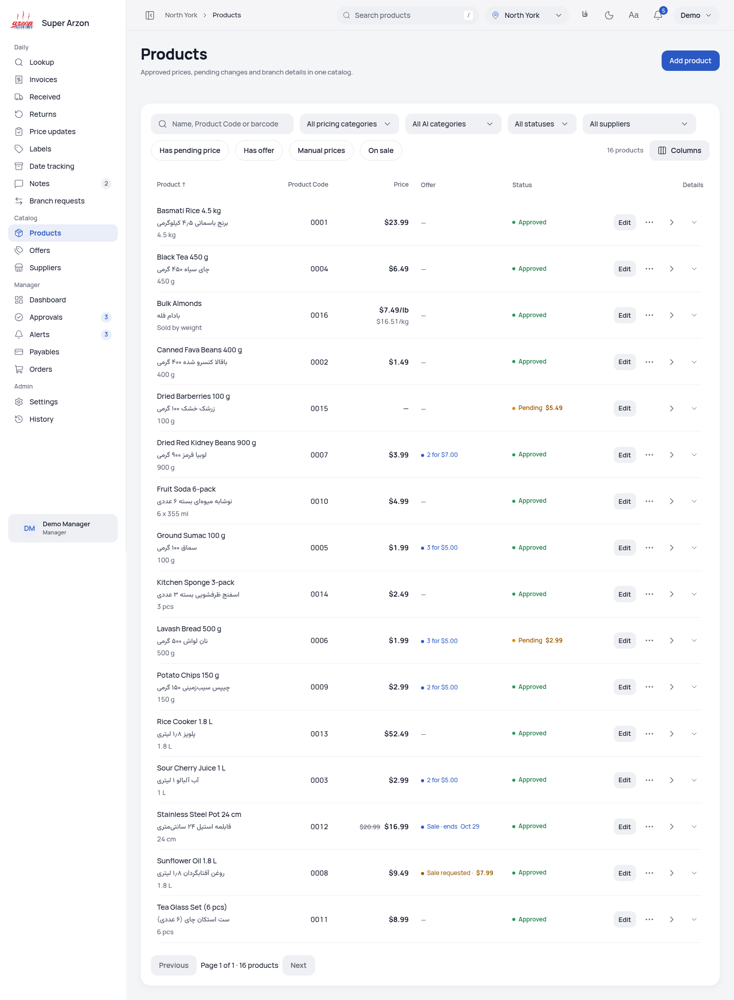</a> | <a href="screenshots/references/Prices.png">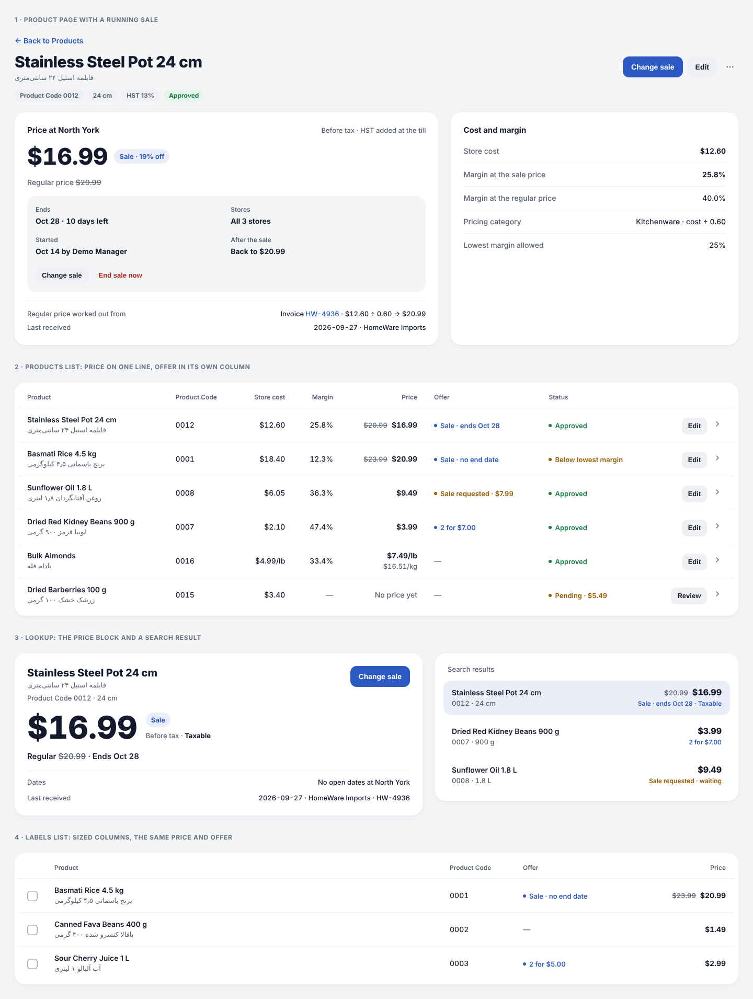</a> | All 16 real products are shown in actual order rather than the six reference examples. Basmati retains its real $23.99 regular price, with no invented sale.  At this shell/content width, Store cost and Margin are available through actual Details disclosures instead of occupying the reference’s wider visible columns.  Primary names appear lighter and include an extra unit-size line compared with the reference’s compact bold two-line rows. |
| **product-sale** <a href="screenshots/product-sale-en-light.png">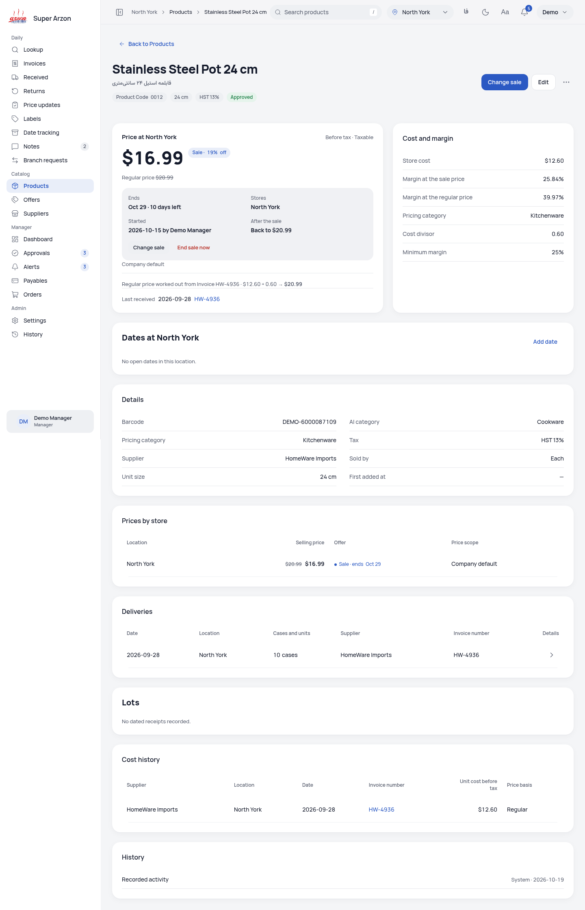</a> |  | Tax copy uses the actual configured Taxable wording instead of the reference’s HST added at the till.  Actual sale is for North York, ending Oct 29 and started 2026-10-15; reference dates and all-three-store terms differ.  Cost divisor remains its own row and financial margins retain two decimals. Reference combines divisor with category and displays one decimal.  Provenance and Last received retain the existing prose/date/source layout rather than the reference’s paired end-aligned fact rows; Company default remains visible. |
| **lookup-sale** <a href="screenshots/lookup-sale-en-light.png">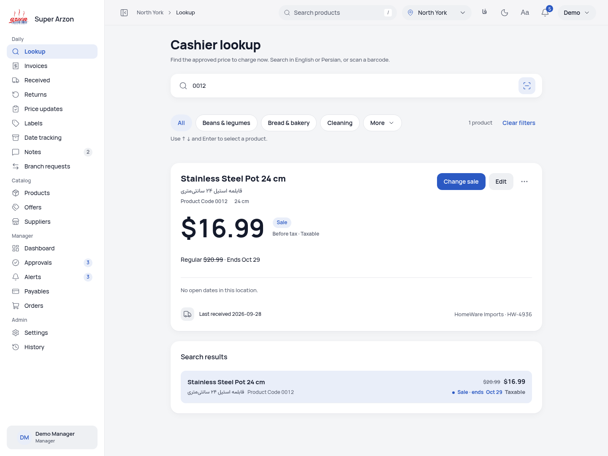</a> |  | Detail and Search results are vertically stacked within the app shell rather than side by side as in the shell-free reference.  The genuine search has one result rather than the reference’s three sample products. Real sale dates and delivery evidence differ.  Existing Edit/More, search/filter controls and delivery icon remain. |
| **labels** <a href="screenshots/labels-en-light.png">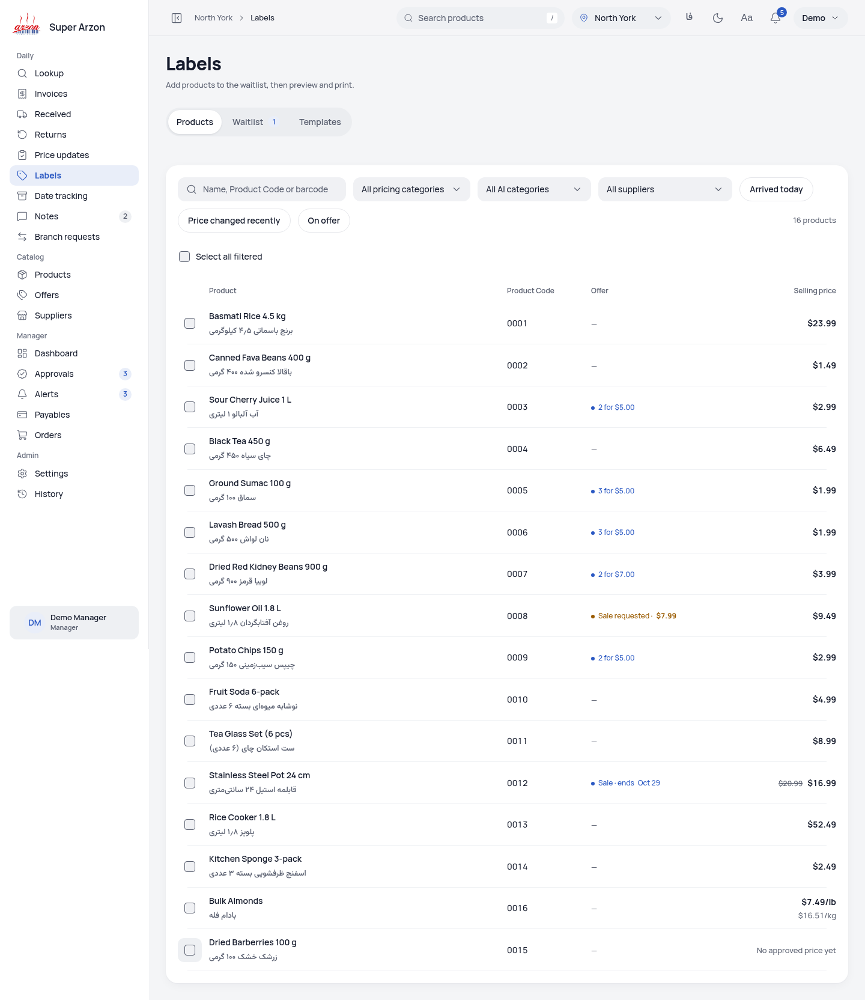</a> |  | The image contains all 16 actual products, not the reference’s three examples. Actual Basmati has no running sale.  Existing Products/Waitlist/Templates tabs and Select all filtered remain; price heading says Selling price rather than Price. |
| **notes-seen-done** <a href="screenshots/notes-seen-done-en-light.png">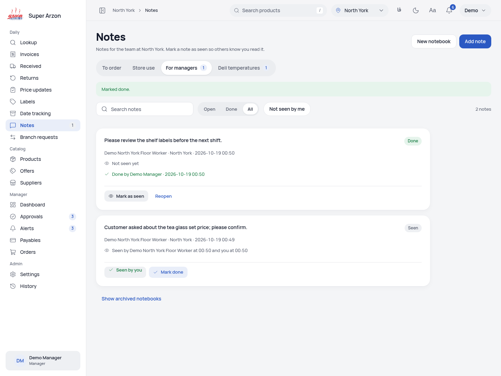</a> | <a href="screenshots/references/Notes.png">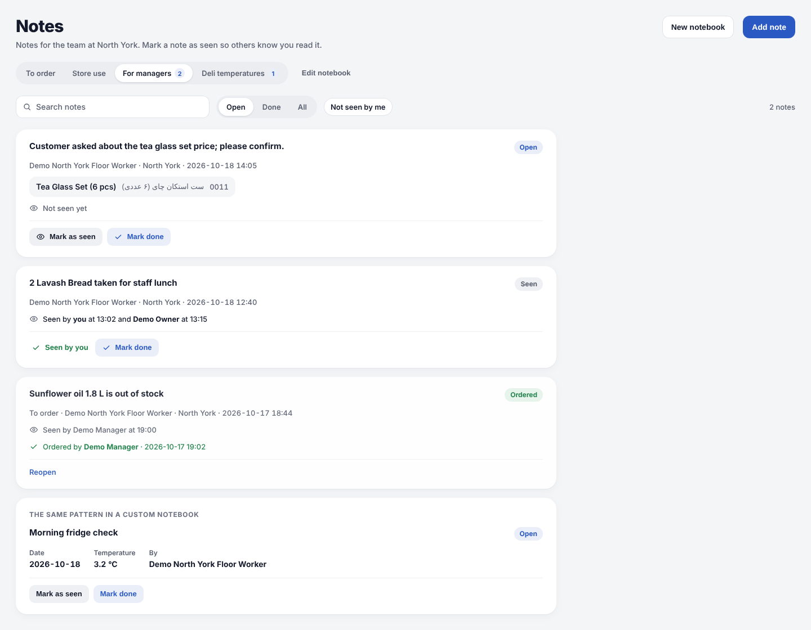</a> | The genuine view contains two actual notes, one Done and one Seen, with All selected; reference combines four example/custom notebook cards.  Body sentences are medium weight and Seen by you retains its disabled neutral fill, compared with the reference’s bold sentence and plain green treatment.  No inline Edit notebook link is visible for the selected built-in notebook, unlike the reference example.  The Done note independently remains Not seen yet and offers Mark as seen; status does not fabricate a reader receipt. |
| **price-updates** <a href="screenshots/price-updates-en-light.png">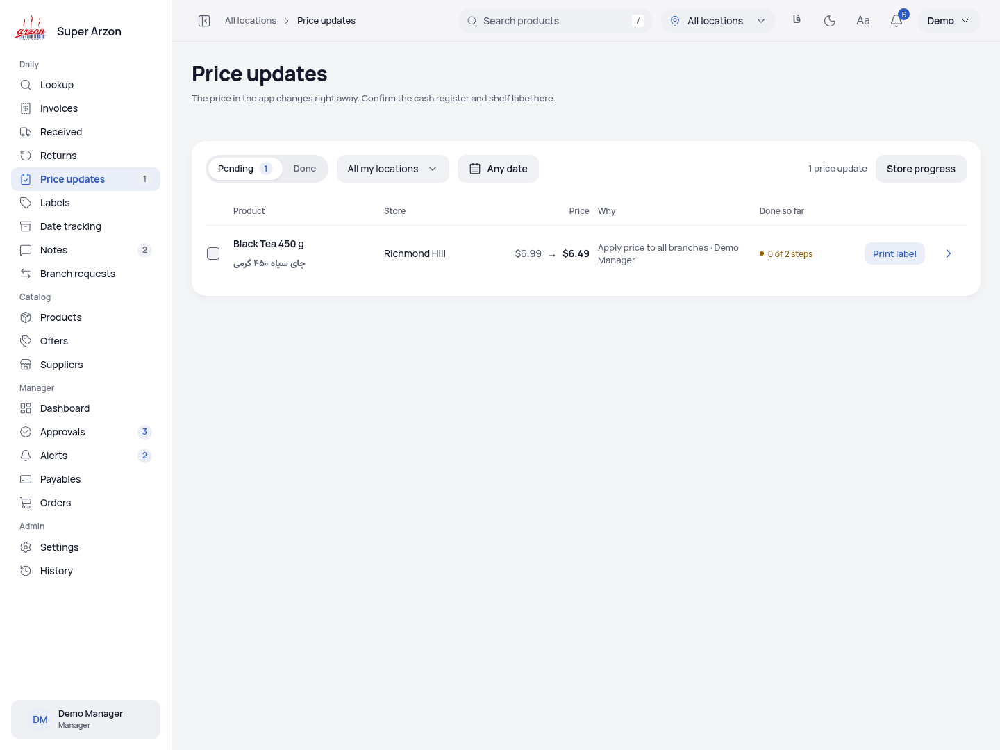</a> | <a href="screenshots/references/Lists.png">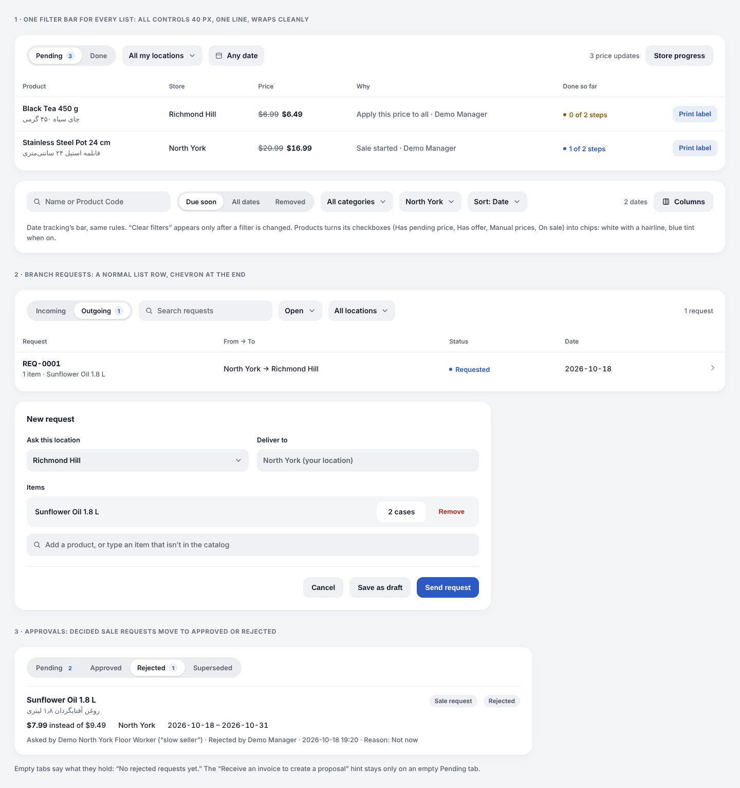</a> | There is one actual pending Black Tea task rather than the reference’s three-count/two examples.  Existing selection checkbox and old-to-new arrow remain; the reference omits the arrow. Actual reason/decider evidence is retained. |
| **dates** <a href="screenshots/dates-en-light.png">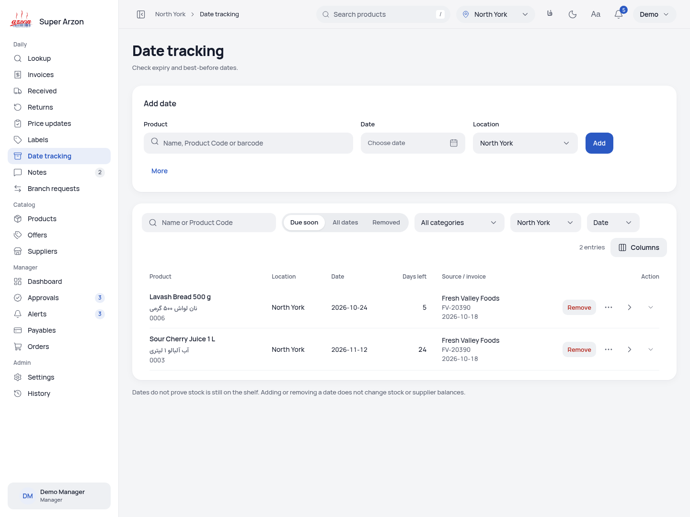</a> |  | The app shell leaves less width than the shell-free single-line reference, so count/Columns wrap.  The real Add date card, source/invoice and operational action columns remain; the reference illustrates only its filter bar.  Sort label is Date instead of Sort: Date. |
| **branch-requests** <a href="screenshots/branch-requests-en-light.png">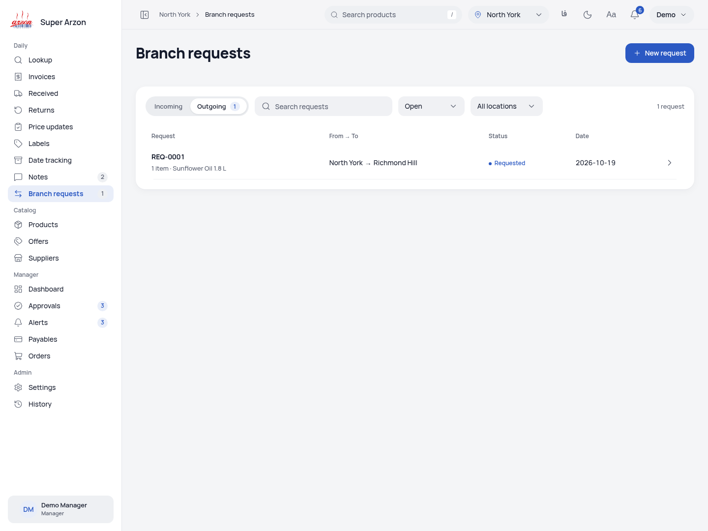</a> |  | The actual request date is 2026-10-19 instead of the reference’s 2026-10-18; real company shell/data remain. |
| **new-branch-request** <a href="screenshots/new-branch-request-en-light.png">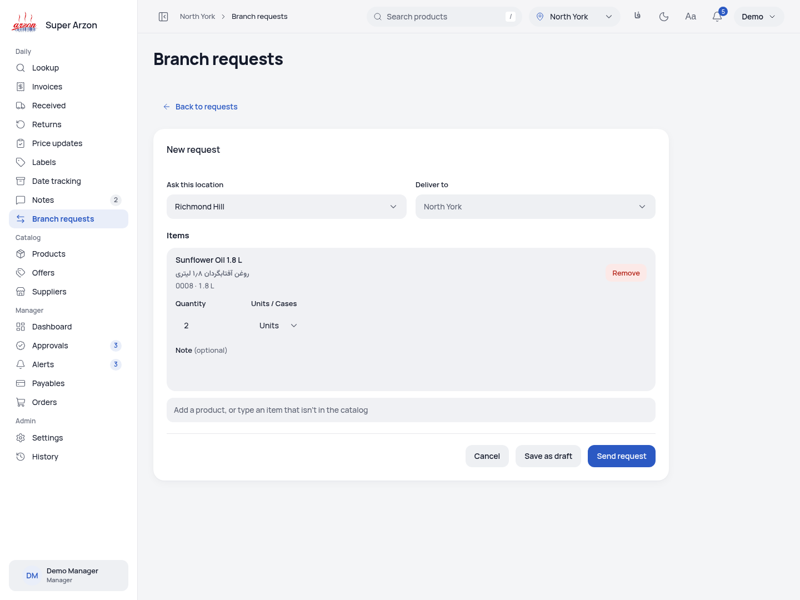</a> |  | The preserved item editor includes bilingual name/code/unit metadata, separate Quantity and Units/Cases, optional Note and tinted Remove, instead of the reference’s compact product / 2 cases / plain Remove row.  Actual quantity is 2 Units and destination remains a genuine permitted dropdown, rather than copying the reference’s 2 cases and fixed your-location field. |
| **approvals-rejected** <a href="screenshots/approvals-rejected-en-light.png">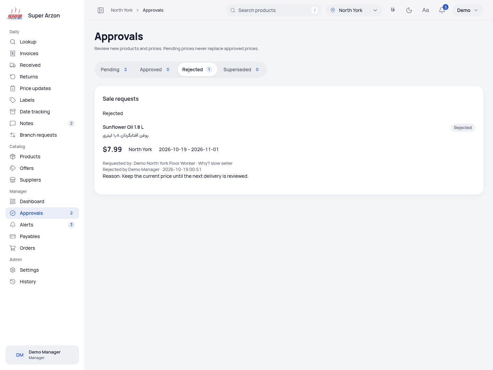</a> |  | This historical request has no retained regular-price snapshot. It therefore omits the reference’s instead of $9.49 comparison; original data is preserved and no comparison is invented from today’s price.  Card uses Sale requests / Rejected headings with a Rejected pill rather than the reference’s pair of small Sale request / Rejected badges. Real request/rejection dates and reason differ. |

## English dark

| Scene and actual screenshot | Matching supplied design | Remaining differences |
| --- | --- | --- |
| **products** <a href="screenshots/products-en-dark.png">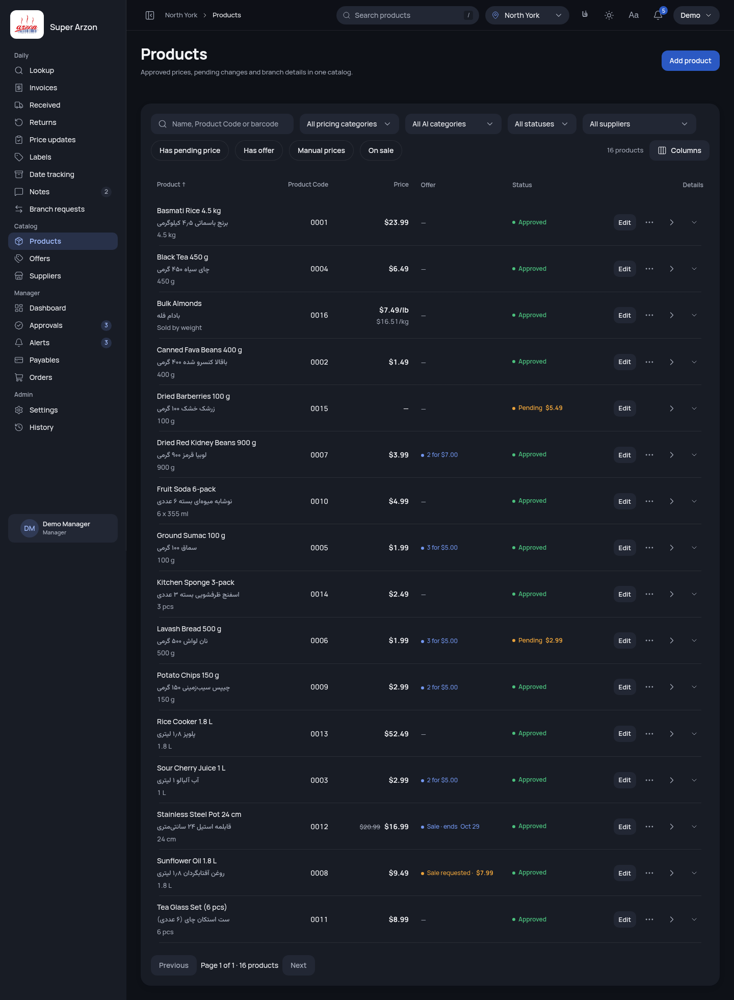</a> |  | Configured dark theme and full sidebar/topbar frame replace the light content-only board.  Full 16-product alphabetical catalogue replaces six selected reference rows; Basmati Rice has actual regular $23.99 without a sale, while the reference depicts a rice sale.  Actual default visible columns omit Store cost and Margin; the existing Columns chooser remains.  Actual list retains search/category/status/supplier filters, boolean chips, pagination, row overflow menu and row expansion affordance beyond the compact reference table.  Product names use regular weight and retain pack-size detail lines; reference names are bold with fewer details.  Sale end date is Oct 29 instead of reference Oct 28 because the fictional fixture is relative to the capture date. |
| **product-sale** <a href="screenshots/product-sale-en-dark.png">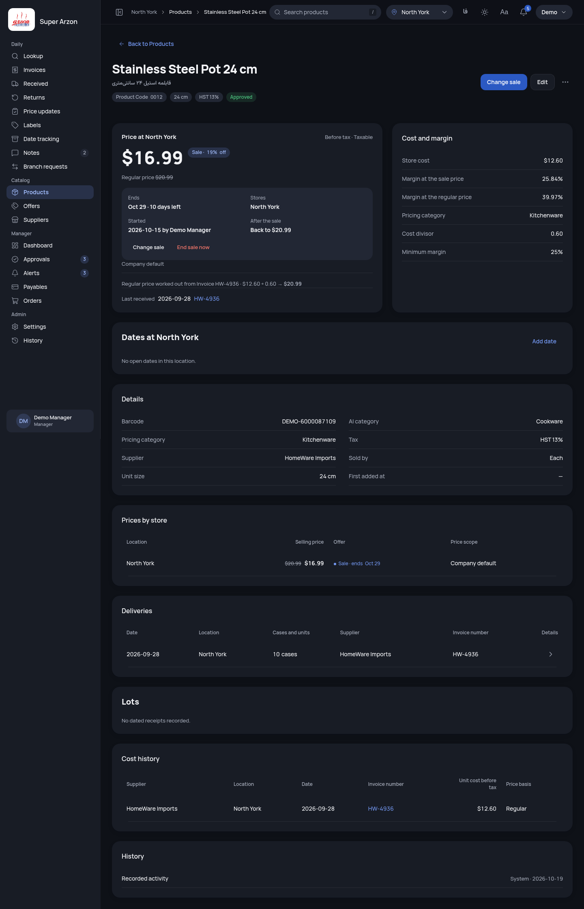</a> |  | Configured dark theme and full app shell replace the light content-only board.  Actual sale is North York only, ends Oct 29 and started 2026-10-15; reference uses All 3 stores, Oct 28 and Oct 14. Last received is Sep 28 instead of Sep 27.  Actual margin precision is 25.84% and 39.97%, rather than the reference 25.8% and 40.0%.  Cost divisor is a separate retained row; reference combines it with Pricing category. Actual label is Minimum margin, versus Lowest margin allowed.  Actual invoice calculation is a single text line and Last received includes its invoice link; reference uses two aligned label/value rows and a supplier name.  Dates and the existing Details, Prices by store, Deliveries, Lots, Cost history and History panels continue below the designed top cards.  Company default remains below the sale panel. Actual tax wording is Before tax · Taxable, rather than the illustrative Before tax · HST added at the till; HST 13% is retained in the product badge. |
| **lookup-sale** <a href="screenshots/lookup-sale-en-dark.png">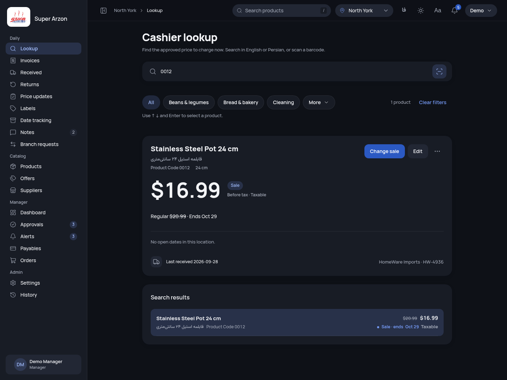</a> |  | Configured dark theme/full app shell and retained Cashier lookup heading, search/scanner/category controls frame the card.  Only the queried pot appears in results, rather than the three example records in the reference.  Actual result card is below the detail card instead of alongside it.  Dates and last-received display retained wording/icon; real receipt is Sep 28 and sale end Oct 29 rather than reference Sep 27/Oct 28. |
| **labels** <a href="screenshots/labels-en-dark.png">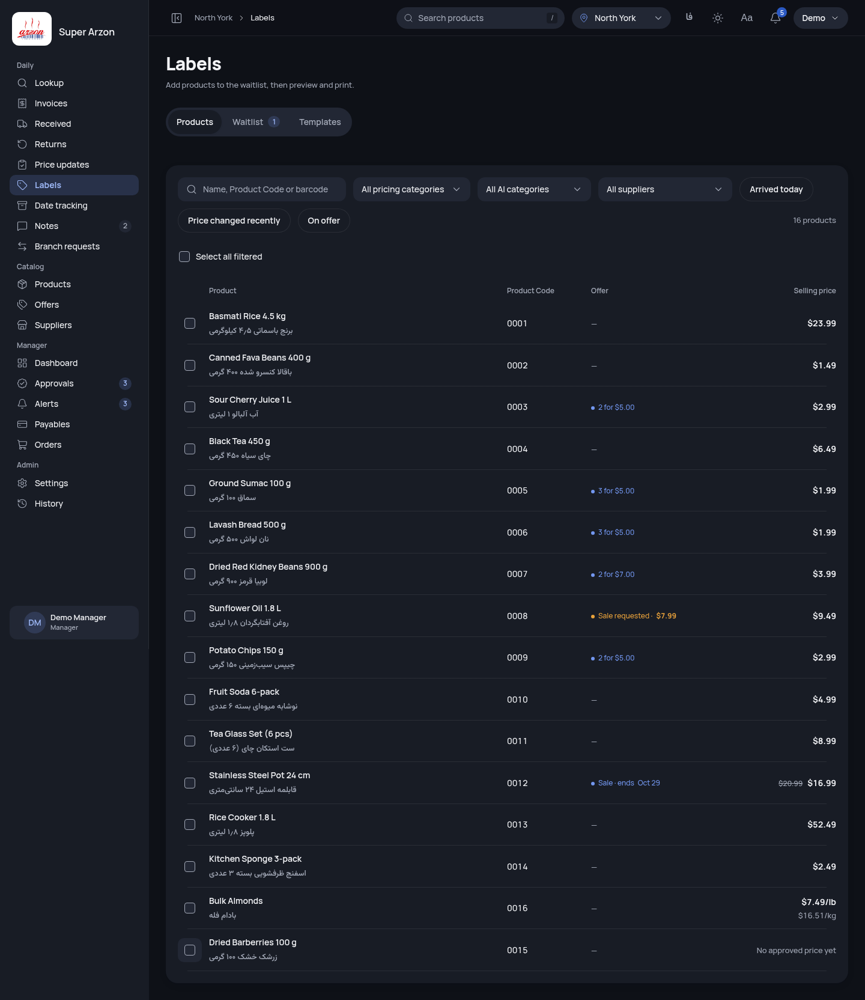</a> |  | Configured dark theme and app shell replace the light board.  Full 16-product list replaces three example rows; actual Basmati Rice has $23.99 regular price without a sale.  Products/Waitlist/Templates tabs, filtering controls and Select all filtered are retained above the table.  Price column label remains Selling price, versus Price in the picture.  Pending product retains No approved price yet and a disabled selector; sample records, dates and row order differ from the picture. |
| **notes-seen-done** <a href="screenshots/notes-seen-done-en-dark.png">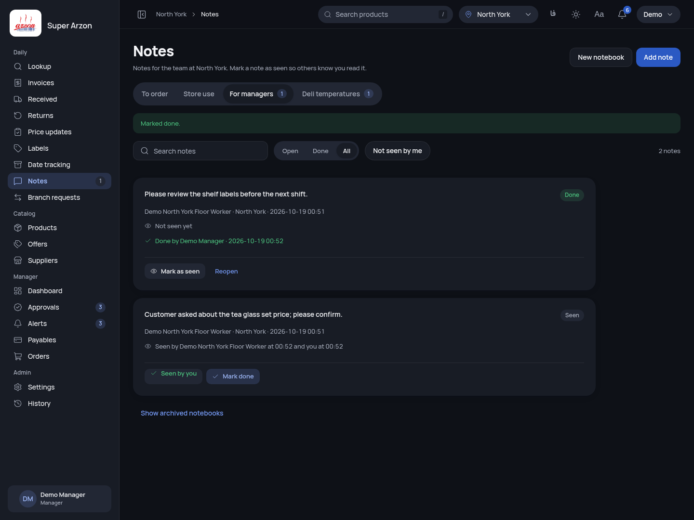</a> |  | Configured dark theme/full app shell replace the light board.  Actual two-note manager conversation replaces the reference composite of open, seen, ordered and custom-notebook examples. Ordered/custom-entry examples are not in this capture.  All is selected to keep completed and seen notes together; reference shows Open.  Retained success message Marked done remains above the filter bar, and Show archived notebooks remains below cards.  Actual note titles use regular weight, versus bold reference titles; card contents and timestamps are genuine capture data.  For managers count is 1 open item while the list shows 2 total notes; reference uses different example counts. |
| **price-updates** <a href="screenshots/price-updates-en-dark.png">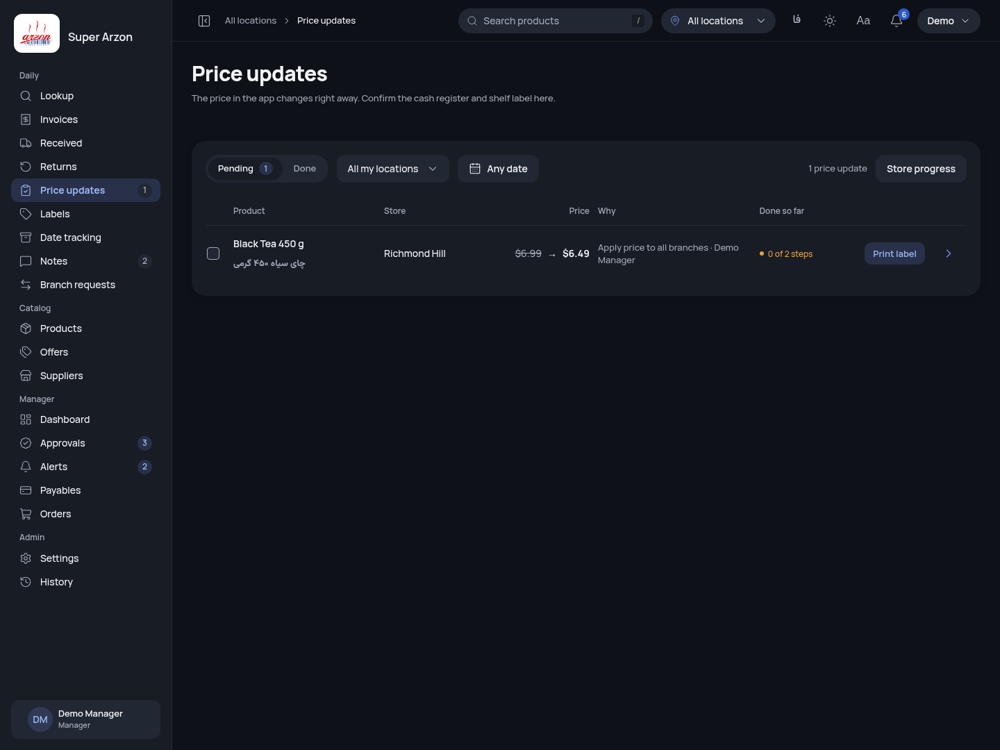</a> |  | Configured dark theme/full app shell, page heading and explanatory subtitle replace the light content-only board.  One genuine Black Tea task and Pending 1 replace the two example rows, illustrative Pending 3 and pot sale task.  Existing row selection checkbox and end navigation chevron are retained beyond the reference Print label action.  The existing old-to-new transition arrow remains between the struck old amount and bold current amount; reference omits that arrow.  Why uses the actual history wording Apply price to all branches · Demo Manager instead of the illustrative Apply this price to all · Demo Manager.  The screenshot verifies appearance only; physical printing, confirmation and completion are not inferred from the visible button. |
| **dates** <a href="screenshots/dates-en-dark.png">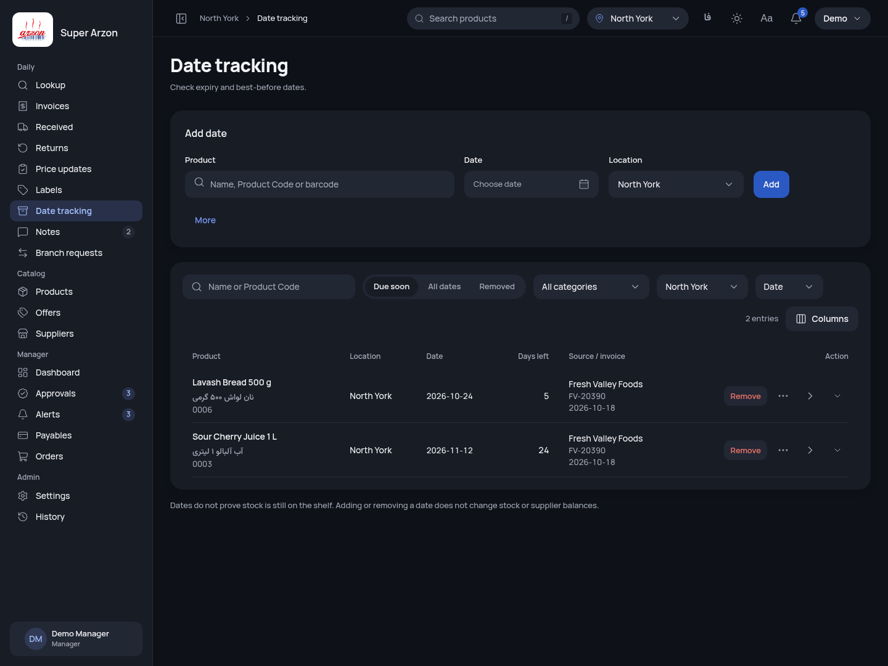</a> |  | Configured dark theme/full app shell and page heading replace the light board.  Retained Add date form is above the list; source picture only illustrates the list toolbar.  At the app-shell content width the count/Columns wrap to a second row, while the full-width reference keeps one line.  Actual sort reads Date, not Sort: Date; count reads 2 entries, not 2 dates.  Real rows, Remove/overflow/chevron/expand actions and the stock/balance disclaimer remain below the toolbar; they are absent from the reference excerpt. |
| **branch-requests** <a href="screenshots/branch-requests-en-dark.png">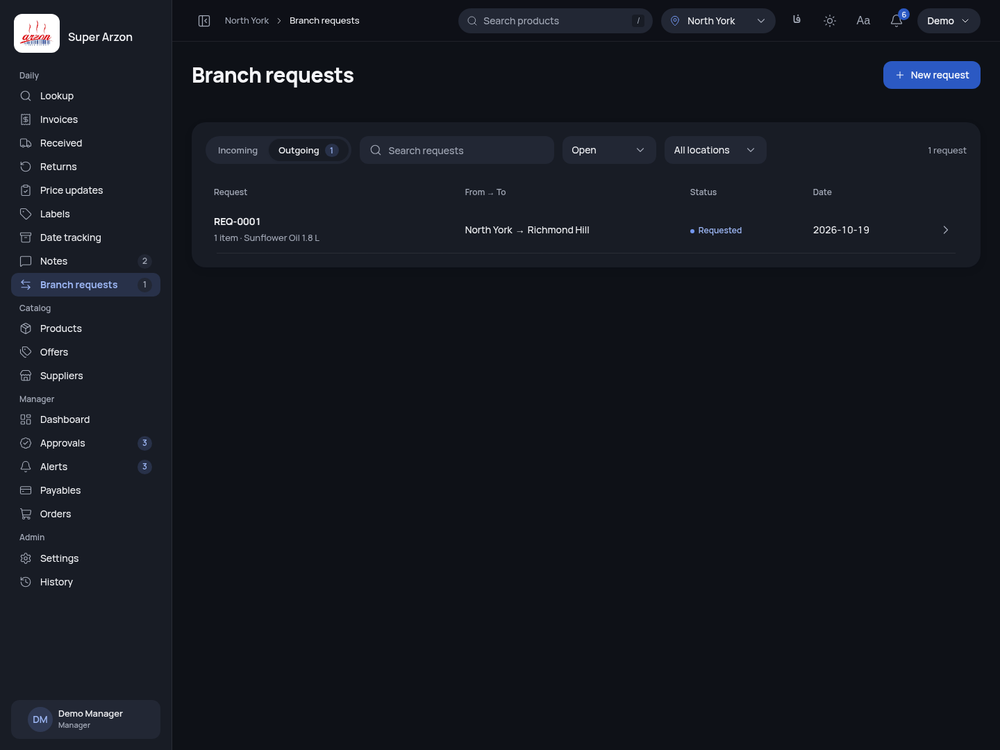</a> |  | Configured dark theme/full app shell and retained page heading/New request action replace the light board.  Actual request creation date is 2026-10-19 rather than 2026-10-18; real capture notification counts differ.  Otherwise the pictured row structure is retained; screenshot itself does not prove whole-row keyboard/click behavior. |
| **new-branch-request** <a href="screenshots/new-branch-request-en-dark.png">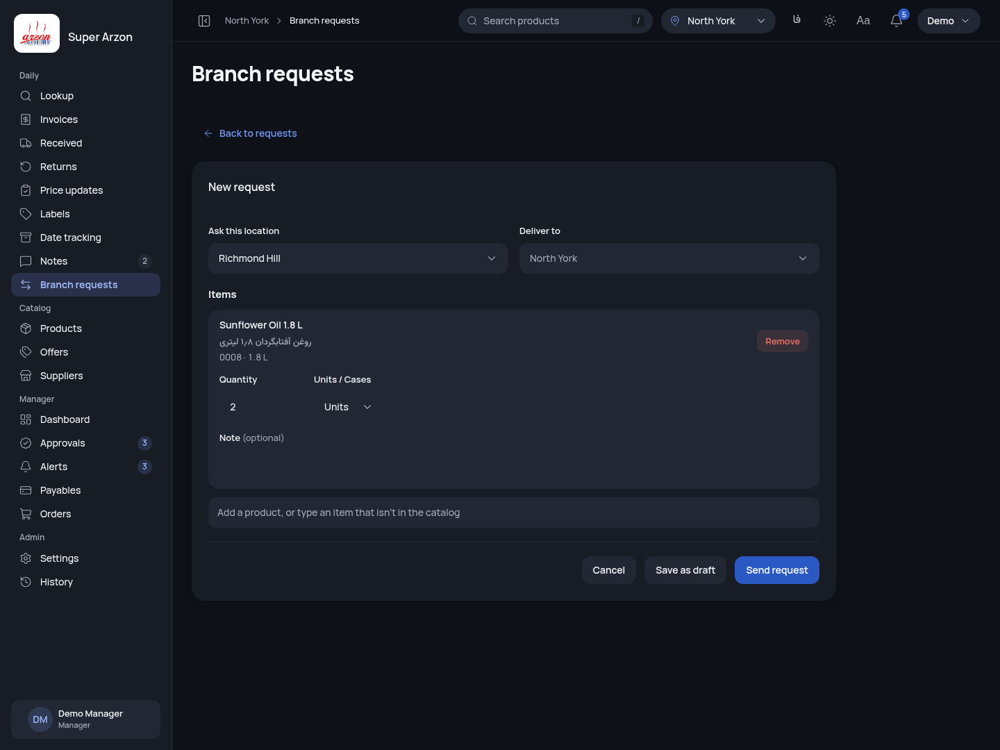</a> |  | Configured dark theme/full app shell, page heading and Back to requests remain.  Item line retains Persian name, code, Quantity, Units/Cases and optional Note, producing a much taller panel than the compact name/2 cases/Remove reference.  Actual quantity is 2 Units, not the illustrative 2 cases.  Remove retains tinted destructive button styling instead of a plain red link; quantity field uses the established dark form styling.  This is an actual unsaved draft; no goods movement is implied.  Endpoint controls now fill their equal columns as pictured. Deliver to retains North York without the reference (your location) suffix. |
| **approvals-rejected** <a href="screenshots/approvals-rejected-en-dark.png">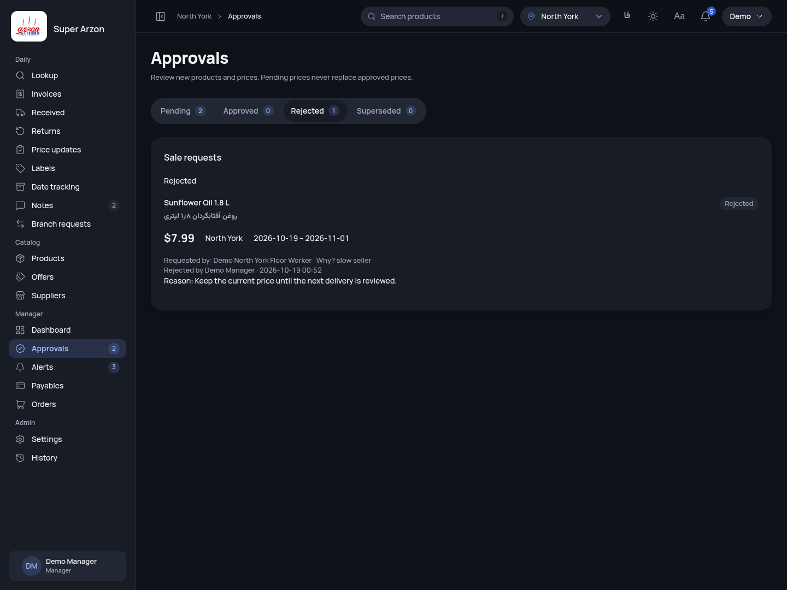</a> |  | Configured dark theme/full app shell and retained page heading/description replace the light board.  Sale requests and Rejected section headings remain above the card; reference uses a more compact card with two pills.  Actual card shows one Rejected pill and $7.99, not the reference Sale request pill plus Rejected pill and $7.99 instead of $9.49.  Actual reason is Keep the current price until the next delivery is reviewed, with Oct19–Nov1 dates; reference uses Not now and Oct18–Oct31.  Requester/decision/reason wrap to separate readable lines instead of the reference single compact metadata line. |

## Persian light

| Scene and actual screenshot | Matching supplied design | Remaining differences |
| --- | --- | --- |
| **products** <a href="screenshots/products-fa-light.png">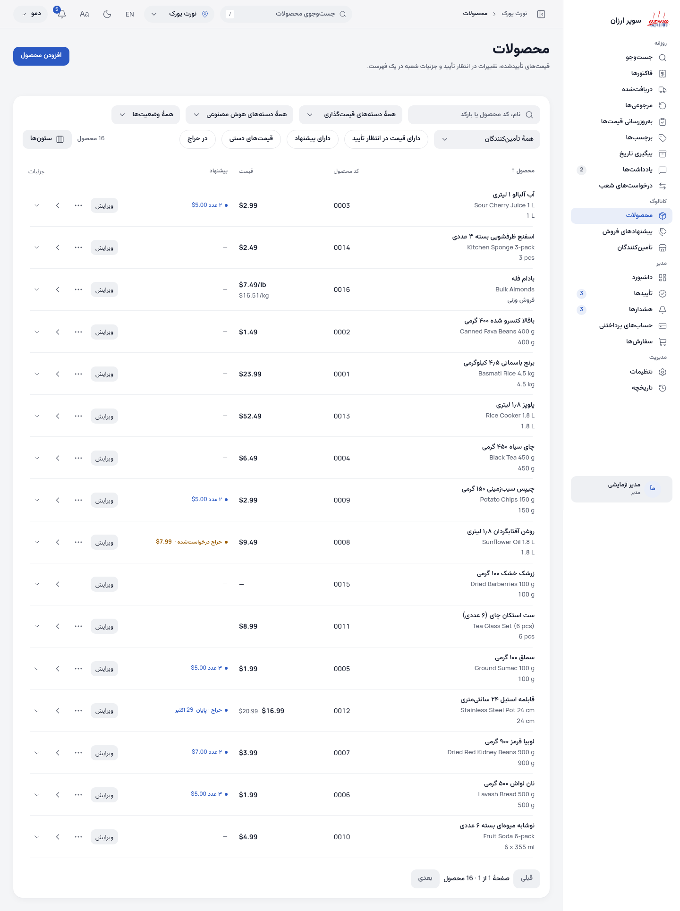</a> |  | Actual catalog contains 16 Persian-sorted rows rather than the six selected English reference rows. Pot is lower in the list; rice is a genuine regular $23.99 item rather than the reference rice-sale example. Additional genuine offers are retained.  Page heading/description/Add product, search/category/AI-category/status/supplier controls, four filter chips, count/Columns, Edit/menu/chevron/expander actions and pagination remain. The reference is only a table excerpt.  Default visible columns omit reference Store cost, Margin and approval Status; existing Columns configuration controls those. Product names include a third package-size line. Filters wrap to two rows within the reduced app-shell content width. |
| **product-sale** <a href="screenshots/product-sale-fa-light.png">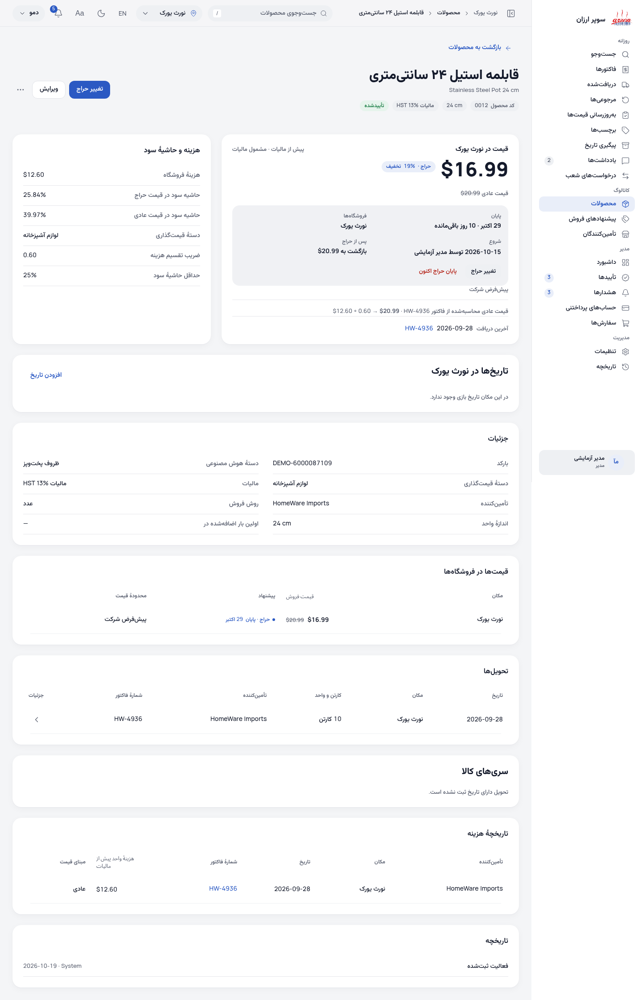</a> |  | Real sale ends Oct 29, started Oct 15 by Demo Manager, applies at North York, and last receipt is Sep 28; reference says Oct 28, Oct 14, all three stores and Sep 27. Actual margins use 25.84%/39.97% rather than one-decimal reference display.  Separate divisor row, company-default scope, Dates/Add date, Details, Prices by store, Deliveries, Product batches, Cost history and History remain below the two-card reference excerpt.  Provenance is one continuous line rather than a label/value pair. Last received shows date and invoice link rather than reference date/supplier. Before-tax/tax hint uses the actual localized taxable state. |
| **lookup-sale** <a href="screenshots/lookup-sale-fa-light.png">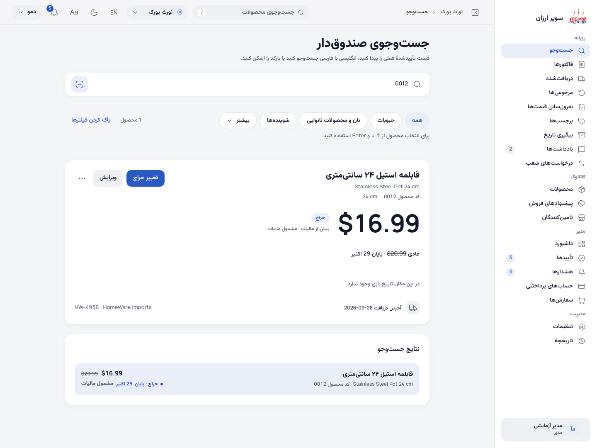</a> |  | Actual code search 0012 yields one pot result; reference illustrates three different results. Actual end is Oct 29 and last receipt Sep 28.  Cashier heading/description, search/scan, category chips, Clear filters/count, keyboard hint, Edit/overflow and original details remain.  Detail card and result card stack vertically in an 880 px measure instead of the reference side-by-side excerpts. Taxable is neutral beside blue offer text. Empty dates are a single line rather than reference Dates label/value. |
| **labels** <a href="screenshots/labels-fa-light.png">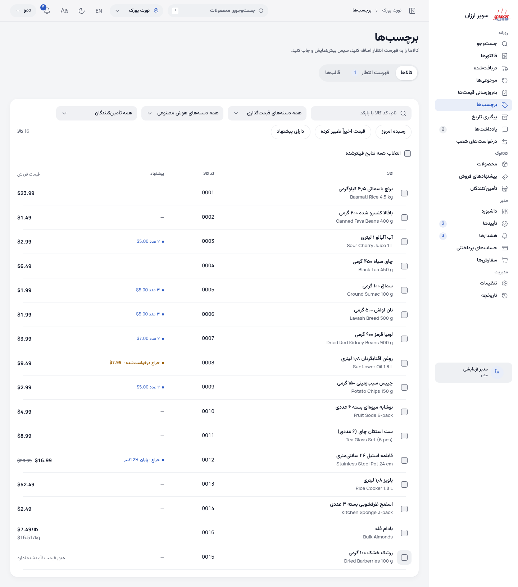</a> |  | All actual catalog rows are shown rather than three examples. The actual sale is pot ending Oct 29; rice remains regular $23.99. Pending barberries correctly show no approved price.  Heading/description, Products/Waitlist/Templates tabs, search/dropdowns, three filter chips, count and Select all filtered results strip remain above the reference table excerpt.  Filters wrap into two rows in the app shell. Table layout is the required RTL mirror and retains the fixed column proportions. |
| **notes-seen-done** <a href="screenshots/notes-seen-done-fa-light.png">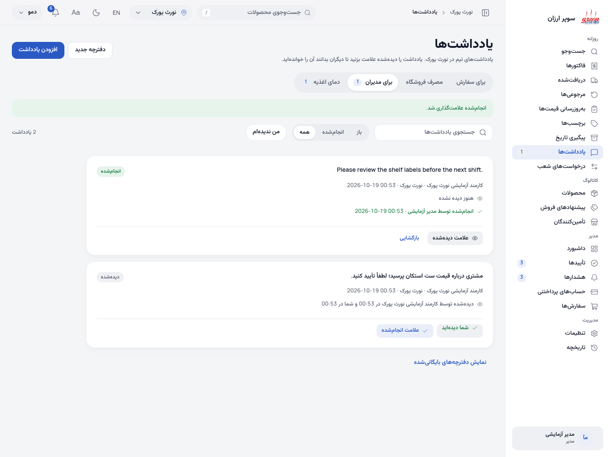</a> |  | All is selected to show two exercised real notes, rather than reference Open selection and four illustrative Open/Seen/Ordered/custom cards. The new English note sentence is actual user-entered note data.  Real success banner and Show archived notebooks link are retained. Selected built-in notebook has no Edit notebook action. Done card still permits Mark as seen because the current Manager has no receipt, unlike the simplified reference Ordered card.  Cards use a right-aligned 960 px measure and normal shared-control geometry. This capture does not include the reference custom-notebook sample or an Ordered card. |
| **price-updates** <a href="screenshots/price-updates-fa-light.png">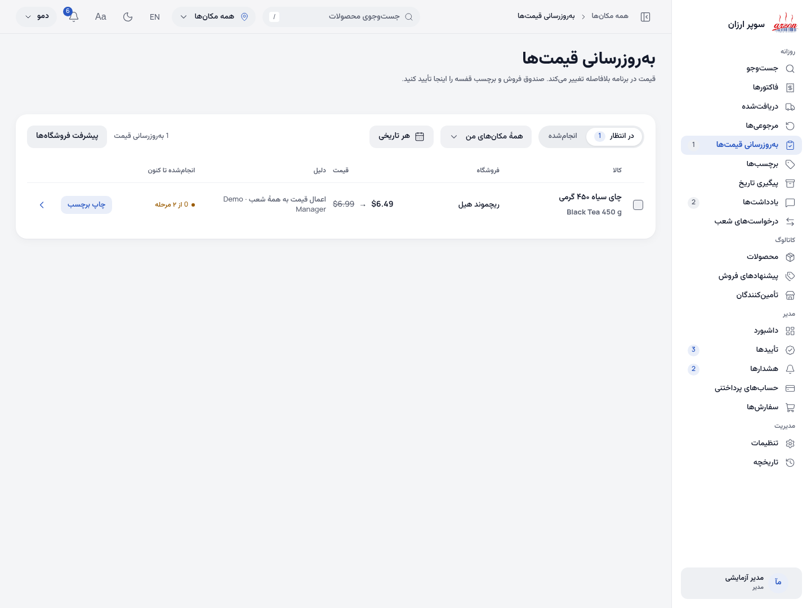</a> |  | One actual pending Black Tea task at Richmond Hill is shown rather than two illustrative tasks. Actual completion is 0 of 2 steps. Actor attribution retains its stored English Demo Manager name within the localized reason.  Original task checkbox and end chevron remain in addition to Print label; the reference excerpt has no checkbox/chevron.  Historical price transition retains an arrow between struck old and current amounts, whereas reference shows struck old then current without an arrow. Actual Why text wraps at a space over two lines within its column. |
| **dates** <a href="screenshots/dates-fa-light.png">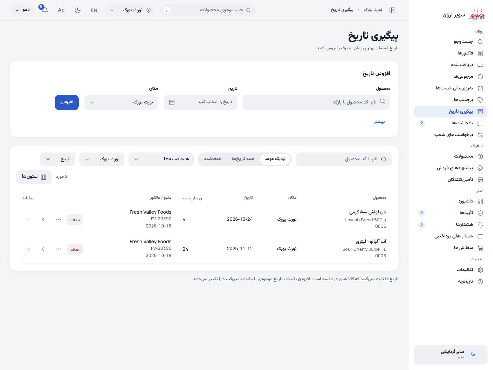</a> |  | Shows real bread Oct 24 and juice Nov 12 records with supplier/invoice/date provenance; reference only demonstrates the filter bar.  Add date form/More, real date table, remove/menu/chevron/expander actions and stock disclaimer are retained.  Count and Columns wrap to a second filter line because the retained shell narrows the list; reference has all filter controls on one line. Card/filter inset remains 20 px. |
| **branch-requests** <a href="screenshots/branch-requests-fa-light.png">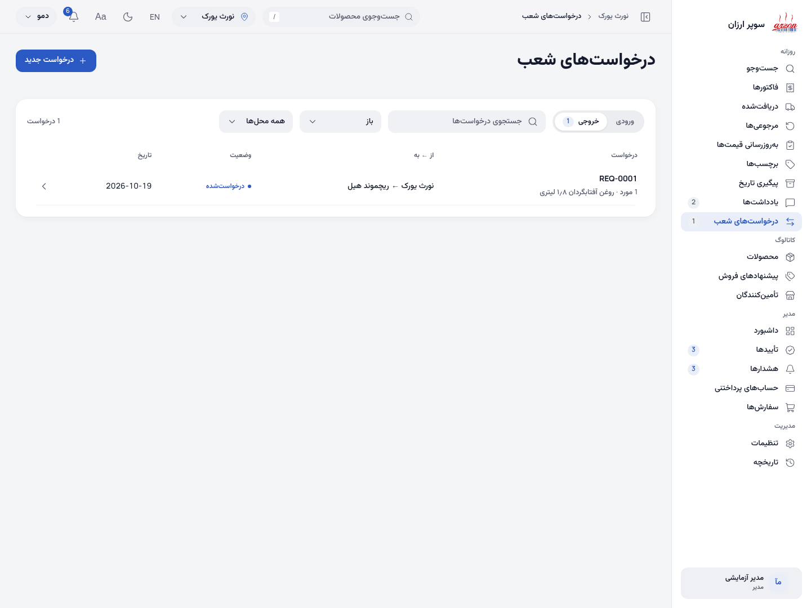</a> |  | Actual request is dated Oct 19 rather than reference Oct 18. Same configured North York to Richmond Hill route and one oil item.  Page heading/New request remain above the card. Filter tabs/search/status/location controls remain inside it.  Row follows the reference structure after RTL mirroring; remaining size/spacing differences reflect the shared app shell and actual Persian typography. |
| **new-branch-request** <a href="screenshots/new-branch-request-fa-light.png">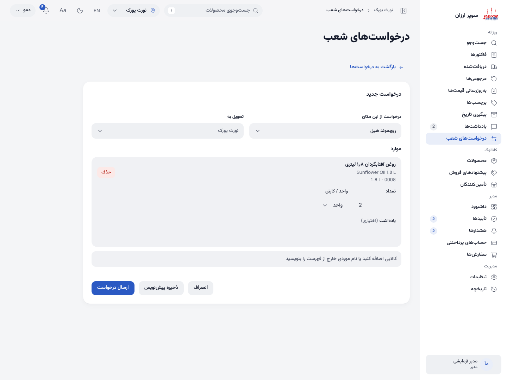</a> |  | Actual unsaved request uses 2 units, whereas the reference example uses 2 cases. Configured Persian location/product names are retained.  Page title/Back link, quantity-unit choice, optional note and retained product code/unit size are legitimate existing controls absent from the simplified reference.  The selected-item panel is taller than the compact reference item row because it retains quantity/mode/note controls. Form is a standalone right-aligned bounded page instead of an excerpt below the list. |
| **approvals-rejected** <a href="screenshots/approvals-rejected-fa-light.png">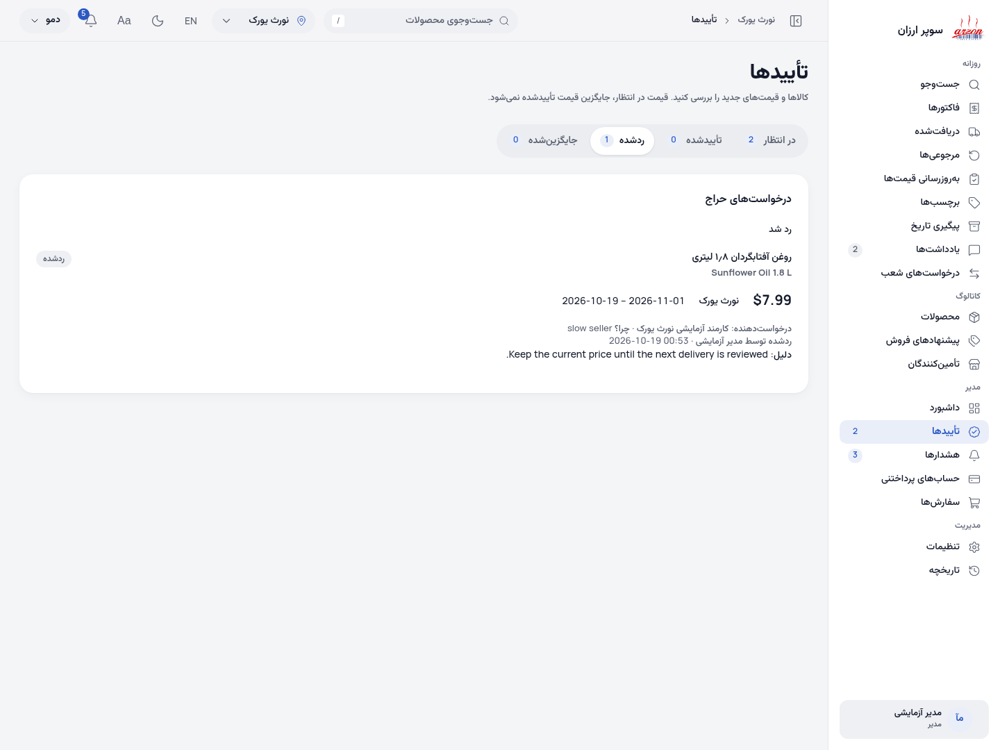</a> |  | Real date interval is Oct 19–Nov 1 and actual decision is Oct 19. Actual entered English reason is Keep the current price until the next delivery is reviewed, rather than the reference Not now.  Page title/description, external decision tabs, Sale requests section title and real localized success message remain; reference places tabs inside the excerpt card and uses an extra Sale request badge.  Requested $7.99 has no instead of $9.49 comparison: SaleRequest/ApprovedSaleTerms store no frozen original regular price, so displaying today's mutable regular price would be historically false. This is an honest reference limitation, not a missing current-price lookup.  Full-width decided card has more vertical space than the compact reference excerpt. |

## Phone390, English dark

| Scene and actual screenshot | Matching supplied design | Remaining differences |
| --- | --- | --- |
| **products** <a href="screenshots/products-phone390.png">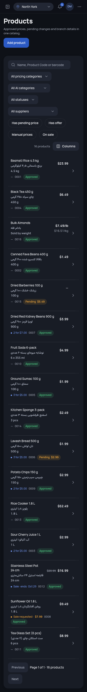</a> |  | The phone presents compact rows instead of the reference desktop table. Filters wrap vertically with count and Columns at the end; preserved package-size, code, approval status, pagination and row actions remain. All 16 genuine products are shown; the pot sale, oil request and configured multi-buy offers use actual terms and dates. |
| **product-sale** <a href="screenshots/product-sale-phone390.png">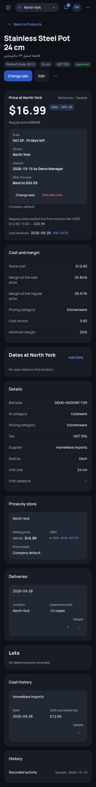</a> |  | Price, Cost and Dates stack into one column. The real sale is North York only, ends Oct 29 and started Oct 15; reference shows three stores and different dates. Company default, two-decimal margins, separate divisor, Dates, Details, per-store prices, deliveries, lots, cost history and history are preserved. Provenance and Last received retain their existing prose/link layout rather than the reference paired fact rows. |
| **lookup-sale** <a href="screenshots/lookup-sale-phone390.png">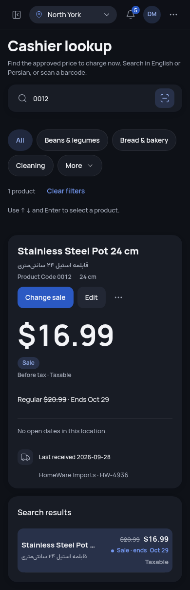</a> |  | The narrow card stacks its 60px charge and context. Search-result names retain the existing ellipsis at phone width while the full selected name is visible above. Genuine query0012, sale16.99, regular20.99 and endOct29 remain. Existing category chips, action buttons, dates and last-received evidence remain; the reference is a shorter desktop excerpt. Taxable is a separate wrapped small line in the result. |
| **labels** <a href="screenshots/labels-phone390.png">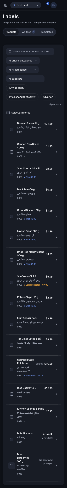</a> |  | Phone rows replace the desktop fixed-width table while keeping custom selection checkboxes, all 16 real products, separate weight-unit lines and single end arrows. Products/Waitlist/Templates and filter chips are retained. Longer product names wrap at word boundaries; the pending product has the genuine No approved price yet state. Reference shows selected table rows and fewer surrounding controls. |
| **notes-seen-done** <a href="screenshots/notes-seen-done-phone390.png">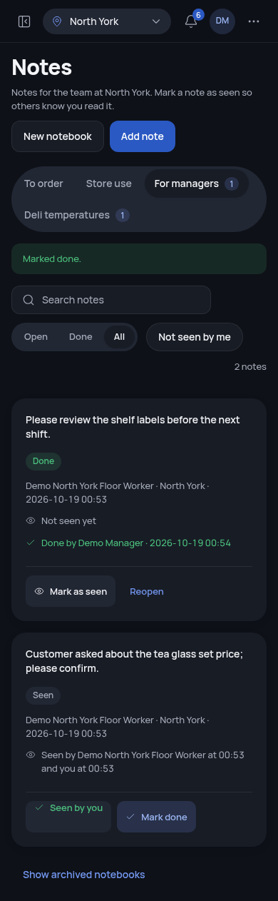</a> |  | Notebook tabs wrap; All is selected so a Done note and a separately Seen note appear together. Reference uses a composite Open view with different examples, readers and times. Real feedback Marked done, New notebook, Add note, archived-notebook link and genuine note text remain. Authored timestamps stay together; green Seen by you and completion are visible. |
| **price-updates** <a href="screenshots/price-updates-phone390.png">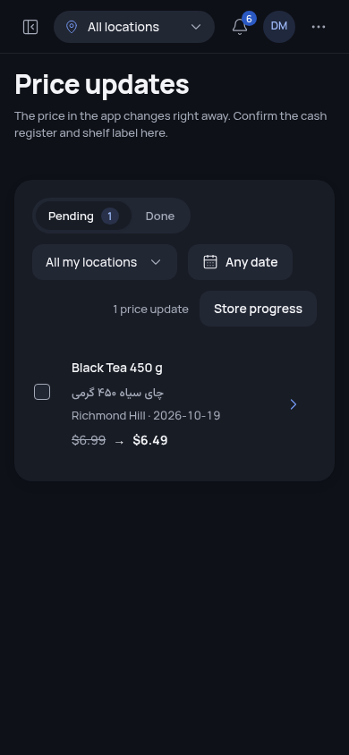</a> |  | At phone width the existing compact task row is retained; desktop Why/Done so far/Print label columns are available in a sufficiently wide card, with phone detail behind the arrow. Actual Black Tea task is0of2 and6.99→6.49, not two example tasks. The transition arrow and real register/label workflow remain; no physical print is claimed. |
| **dates** <a href="screenshots/dates-phone390.png">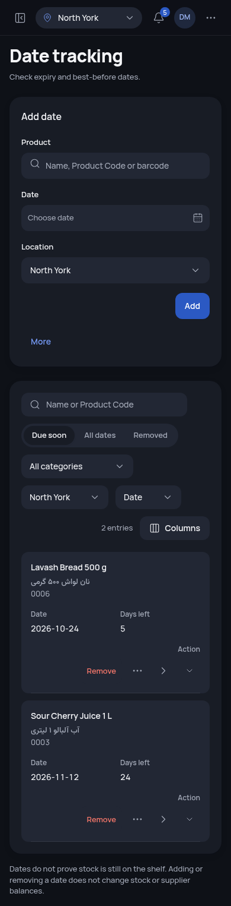</a> |  | The genuine Add date form and two complete date cards remain above/below the wrapped40px filter bar; reference illustrates only the toolbar. Existing Remove/menu/detail controls, two real reminder dates and stock clarification remain. Columns/count stay at the end. |
| **branch-requests** <a href="screenshots/branch-requests-phone390.png">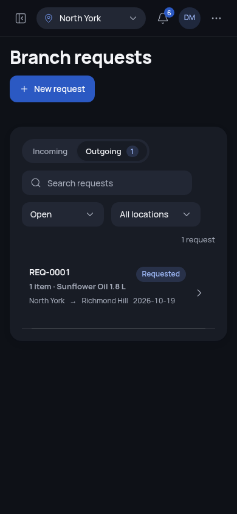</a> |  | One real REQ-0001 appears as a compact phone row with Requested pill, item summary, route and date. Reference shows wide separate columns and a different date; current request is created through the UI with original endpoint meaning. Search/filter/count and one end arrow remain. |
| **new-branch-request** <a href="screenshots/new-branch-request-phone390.png">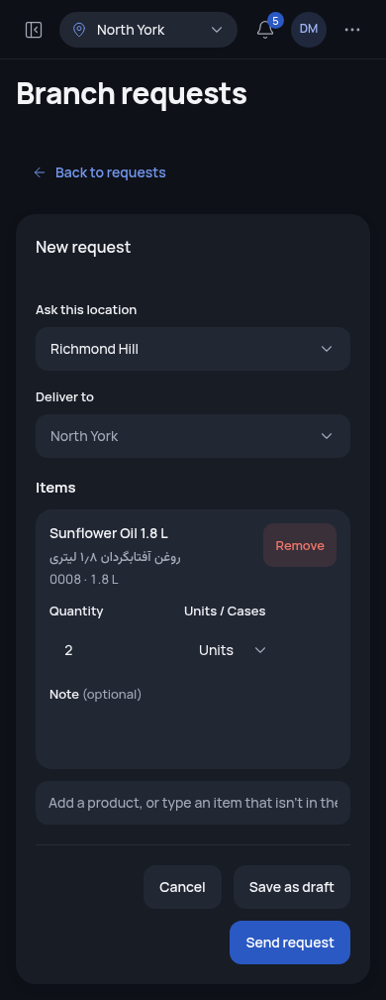</a> |  | Locations stack on the phone and fill the bounded form. Actual catalog item retains translation, code/package, quantity, Units/Cases, conditional pack validation and optional note beyond the compact reference example. Long combined-input placeholder is clipped within the input at phone width; the full accessible label remains. Footer wraps to two lines with12px gaps; no controls were removed. |
| **approvals-rejected** <a href="screenshots/approvals-rejected-phone390.png">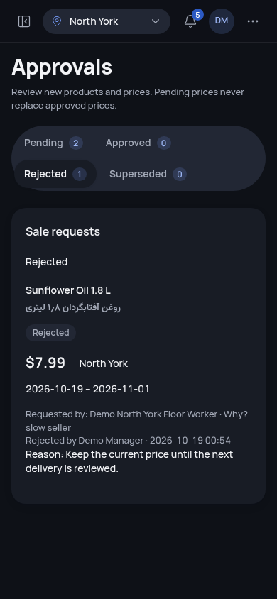</a> |  | Tabs wrap and show all four actual counts, including zero. The actual rejection reason, actor and timestamp differ from the reference; the genuine success status and Sale requests heading remain. Card contains no decision actions. Historical regular-price comparison is omitted because SaleRequest/ApprovedSaleTerms have no frozen original regular price; current mutable price would be misleading. |
