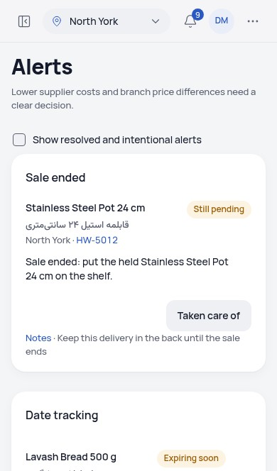
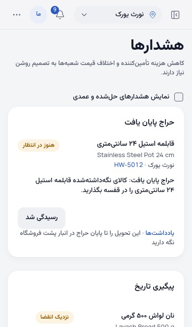

# Corrected English and Persian browser checks

Exact committed source `0786ea262b6ebdf573cd02f2b56479952633ee21`: **72 passed**, comprising **36 desktop and 36 phone cases**, each actual runner exit **0**. There were no failures, skips, retries, global errors or unexecuted selected cases. The four entire selected files cover sales, the real layout negative controls, product-unit order and all-page C8 geometry. All original assertions, budgets and retry settings remain; trace collection was explicitly enabled. [Summary](summary.json), [case outcomes](all72-outcomes.json) and [original manifest](manifest-original.json) retain the original results and hashes.

The source stayed unchanged, the normal build was fresh, and all 61 built and served files passed their byte guards. This is a selected-file replay, **not a new complete 812-case pass**. The [earlier full run](../retained-native-full-f154/README.md) remains 769 passed, one genuine English unit-wrap failure and 42 original intentional skips. The subsequent [431 Persian frame](../sale-inline-units-native/manual-review.json) was manually rejected despite its passing scoped checks; that result is preserved.

Root opened both new, untouched trace frames below. English keeps `24 cm` together; Persian keeps the complete `۲۴ سانتی‌متری` together in the heading and body. [Direct visual review](root-visual-review.json), the measured complete-compound fragments and original trace archives record this separately from the old rejected frame. No image was retouched.

| English, phone | Persian, phone |
| --- | --- |
|  |  |

The later company-color correction changes only `store.test.tsx`, preserving all three exact expected colors and the default assertion timeout. Its separate final application/build proof must establish that the production files and fresh build still match this browser-tested source. Do not relabel this run with that later commit.
