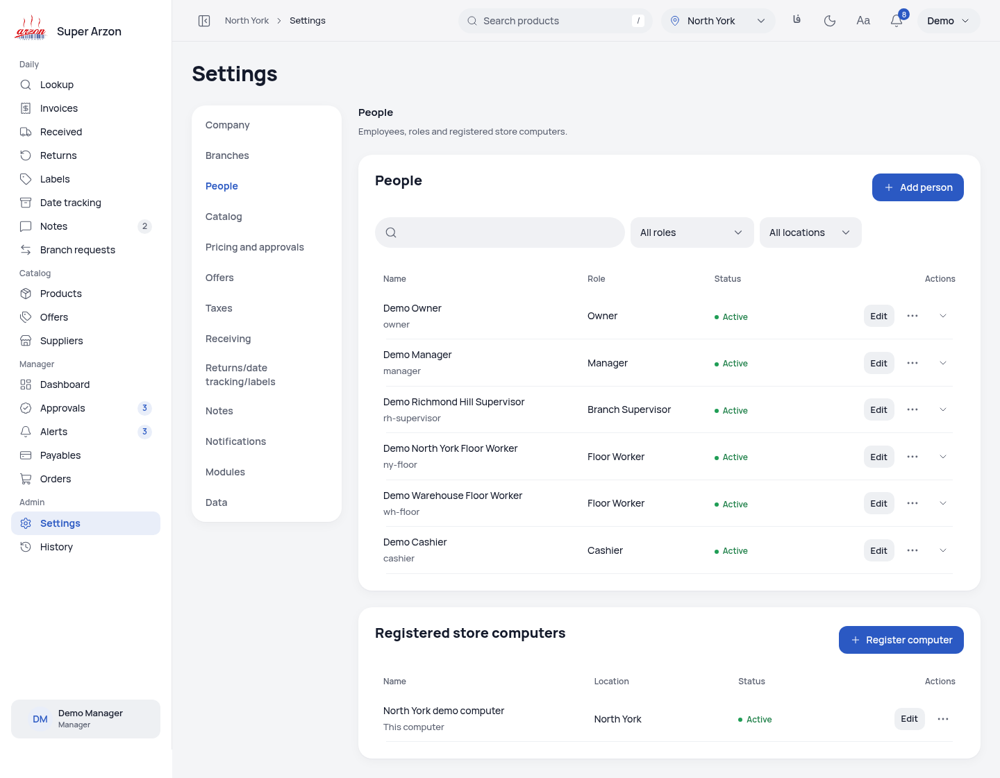
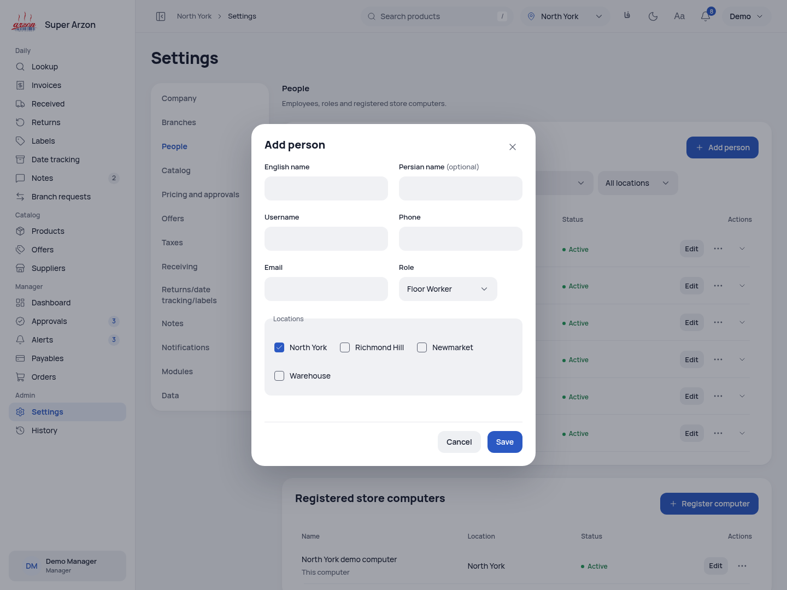
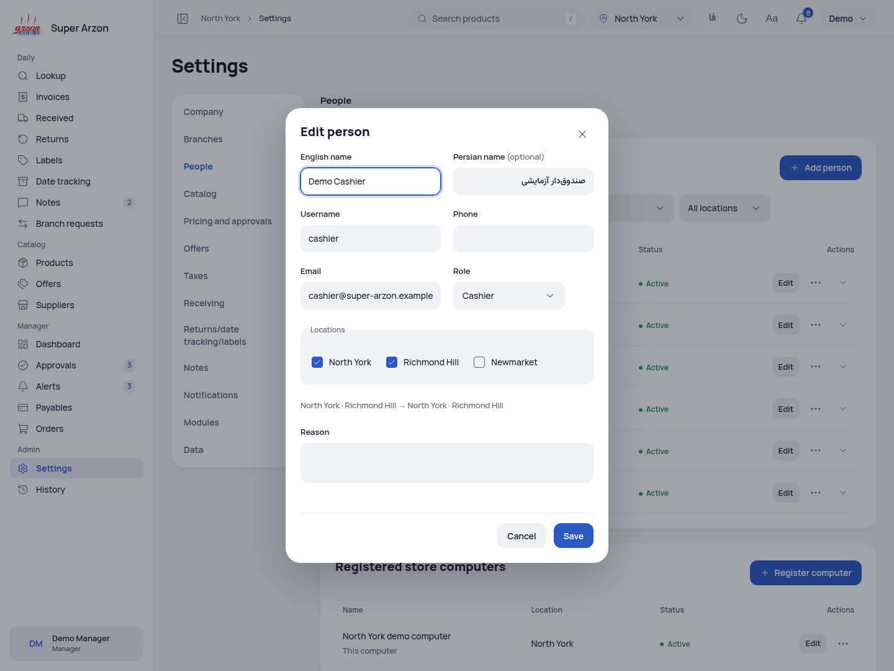
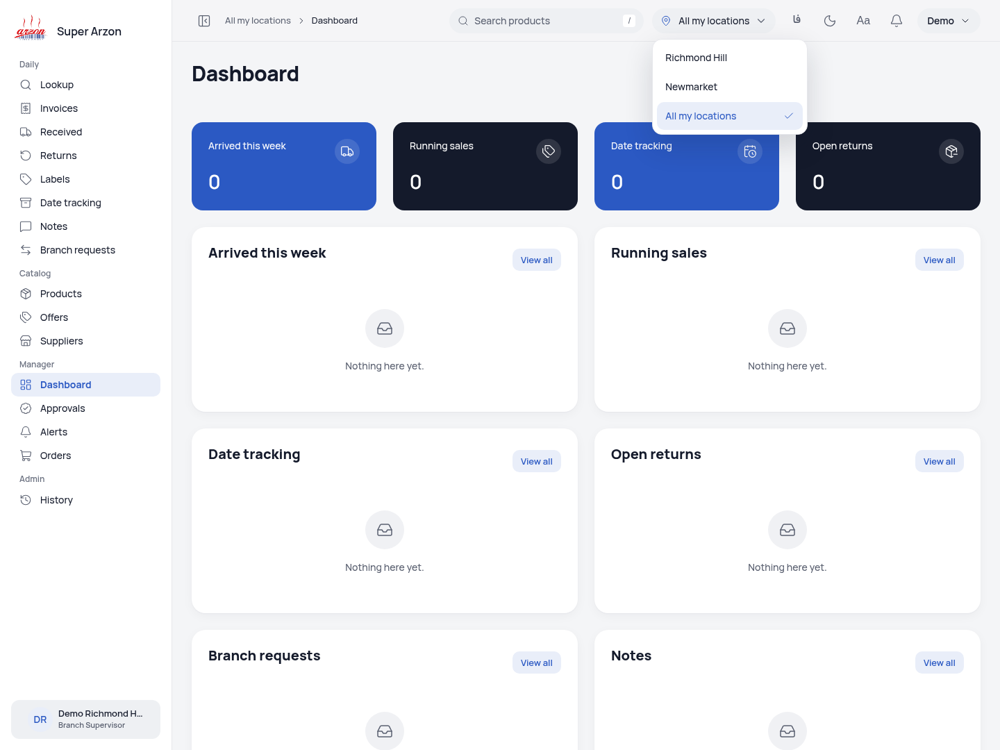
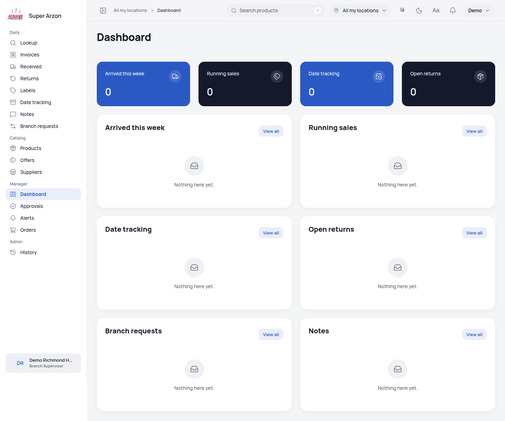

# E1 screenshot gallery

Twenty unedited production screenshots from exact E1 commit `03bc896e7e48668c36bd90ba75cb5a764abf6853`. All were visually reviewed; source and served assets were verified before and after capture.

Phone dialogs retain their real scrollable viewport. The Branch Supervisor aggregate is empty because the configured Richmond Hill/Newmarket fixture has no matching operational records; zeroes are not invented sales.

## People

[English light](people-en-light.png) · [English dark](people-en-dark.png) · [Persian](people-fa-light.png) · [Phone dark](people-phone-dark.png)

## Add person, with locations

[English light](add-person-en-light.png) · [English dark](add-person-en-dark.png) · [Persian](add-person-fa-light.png) · [Phone dark](add-person-phone-dark.png)

## Edit person

[English light](edit-person-en-light.png) · [English dark](edit-person-en-dark.png) · [Persian](edit-person-fa-light.png) · [Phone dark](edit-person-phone-dark.png)

## Restricted location picker

[English light](location-picker-en-light.png) · [English dark](location-picker-en-dark.png) · [Persian](location-picker-fa-light.png) · [Phone dark](location-picker-phone-dark.png)

## Branch Supervisor dashboard

[English light](branch-supervisor-dashboard-en-light.png) · [English dark](branch-supervisor-dashboard-en-dark.png) · [Persian](branch-supervisor-dashboard-fa-light.png) · [Phone dark](branch-supervisor-dashboard-phone-dark.png)

[Manual review](../../evidence/e1/final-review/manual-review.json) · [Committed capture checks](../../evidence/e1/final-review/committed-capture.json)
