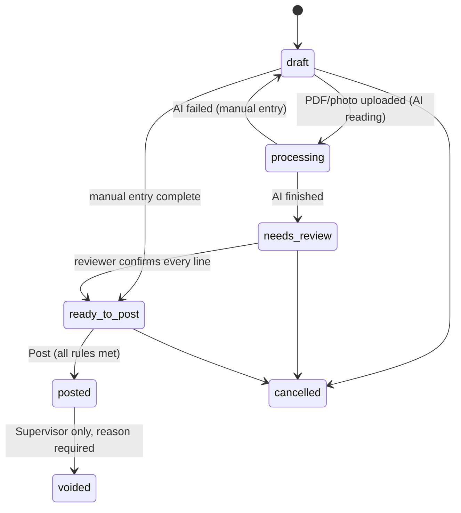
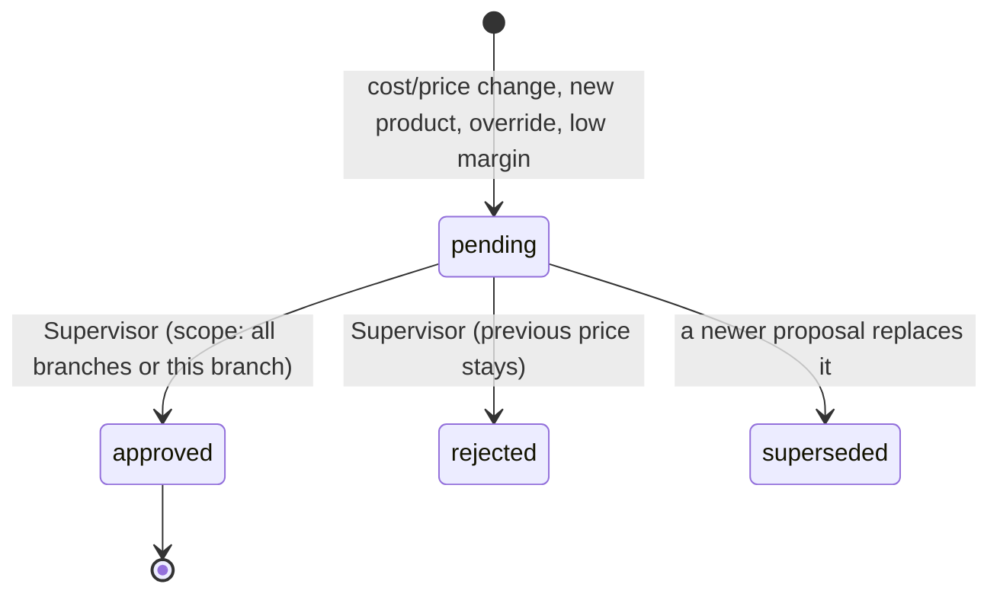
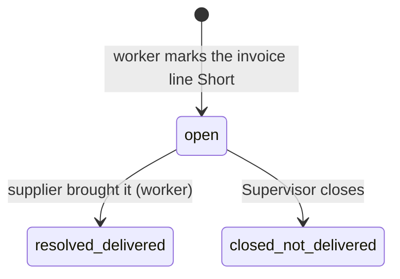
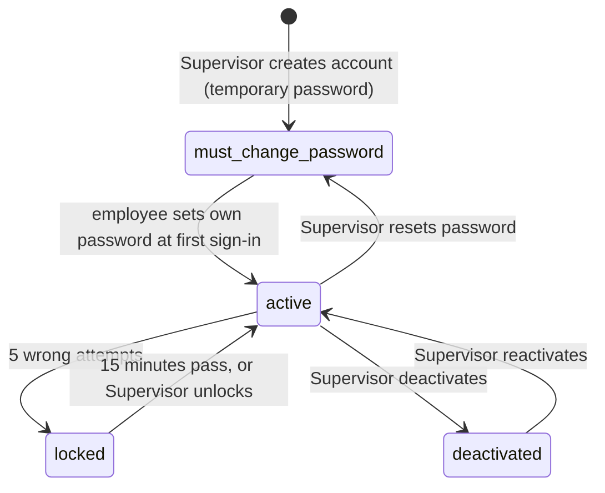

# Workflows and state machines

Current C6/C7 workflows supersede historical date controls, stacked Undo and whole-return settlement limits. Klead design-language governs all new screens before implementation.

Each workflow lists states, who can move it, and the side effects. All state changes are audited.

## 1. Invoice

- **draft**: anything not yet submitted. Auto-saves. Allowed without the image/PDF. Listed in a "Drafts" tab like an email client.
- **Manual entry (B, item 46):** New invoice offers Upload and Manual entry side by side. Supervisor chooses the branch, supplier (including + Add supplier), supplier invoice number, invoice date and payment terms, then adds any product (including + Add new product), quantity and unit cost. Return from either shared add form selects the new record without discarding the draft. Manual entry uses the same pricing, lower-cost questions, date decisions, matching, tax and posting logic as uploaded review. Save as draft works without an original; Post still requires the original photo/PDF and all normal rules. No AI extraction or invented source document is needed for manual entry.
- **processing**: AI is reading the file in the background; the worker can leave and come back.
- **needs_review**: AI lines wait for a person. The reviewer must confirm each line. C4 initializes **Track date: Yes / No** from the product's explicit preference; unset still requires a choice, and Yes requires a valid type/date.
- **ready_to_post**: header complete, original file attached, every line confirmed and supplier review cleared. New/manual supplier or missing contact/terms routes Needs review; Supervisor completes details and explicitly confirms before posting.
- **Posting rules** (all must hold): mandatory header fields present; original file attached; supplier is **confirmed** (a proposed supplier blocks posting with the reason shown as "Waiting for Supervisor to confirm supplier"); every unmatched line resolved (matched or created as a pending new product); worker has answered the same-supplier lower-price questions where they apply.
- **On posting:** create `received` physical movements and Received log entries for actually delivered quantities (exclude missing short quantities); create price proposals with this invoice/line's exact four-decimal cost, invoice number, posting employee and timestamp; create alerts; create the invoice entry in this branch's supplier ledger (net of open shorts); lock the invoice. Drafts/Ready to post previews create no active approvals. Posting stays blocked until every line has a valid **Track date: Yes / No** value (initialized from an explicit product preference or answered by the reviewer), line confirmation and all required dates/decisions are valid.
- A posted invoice is a clean read-only document, corrected only by the Supervisor through **Correct invoice** or **Move invoice**, required reason, impact preview and confirmation; append linked corrections and preserve original/allocation/file evidence. No simple Undo or disabled draft editor.
- Invoice number missing → assign next sequential number for that supplier and mark `number_is_system_assigned`.

## 2. New supplier and manual supplier management

- **Supervisor Add supplier (B, item 44):** open from Suppliers or the invoice Supplier field's + Add supplier. The max-720 px shared form captures name, phone, email, sales rep/phone, payment terms, optional address/notes, and optional balance per allowed branch with an as-of date. A similar-name warning links to existing suppliers before save; it never silently merges. Standalone Supervisor save creates `confirmed` immediately and records actor/time/company in History. Invoice quick-add permits optional phone/email/rep/rep phone/terms; a new supplier or any missing detail routes the invoice to Needs review until the Supervisor completes and explicitly confirms review.
- Each entered branch opening balance appends an `opening_balance` ledger entry labeled **Opening balance**, dated as of the entered date and attributed to the Supervisor. It appears in Payables; it is not an invoice, delivery or purchase-chart contribution. Existing ledger entries are never replaced.
- **Floor Worker invoice quick-add:** the same form has no opening-balance controls and creates `proposed`. Invoice entry continues but posting is blocked with **Waiting for Supervisor to confirm supplier** until the Supervisor confirms (`confirmed`) or explicitly merges it into an existing supplier. Dashboard shows Supplier waiting for confirmation. The transaction rejects unauthorized opening balances, including values supplied outside the UI.
- Only Supervisors can edit or deactivate suppliers. Deactivate excludes a supplier from new-invoice choices without deleting its invoices, returns, products, balances or history; existing records retain their links. Record every edit, confirmation and deactivation. Cashiers cannot add suppliers; Floor Workers have no standalone Suppliers Add supplier action.
- **Payment terms:** Cash on delivery / Weekly(7) / Every2weeks(14) / Monthly(30) / Other nonnegative whole days producing a valid due date → due date from invoice date, editable override retained. Subtotal/Tax compute Final total until an explicit override; a difference gives a warning, never a total-mismatch error gate. Received date/time is entered and displayed in company zone, UTC persisted. Draft/manual **Remove line** records a safe Undo; quantity labels Invoiced/Delivered. Incomplete Save/Post uses linked top-of-form missing list and inline errors; field edits/autosave do not create messages.
- The supplier-confirmation task appears in Approvals and the Supervisor dashboard without price fields. Confirm supplier marks it Approved and releases the supplier posting gate. Reject marks the task Rejected and the proposed supplier inactive, retains its draft/history, and keeps posting blocked; it does not silently confirm or merge the supplier. Recheck a supplier snapshot before either decision so a stale preview cannot decide edited details. Record the signed-in Supervisor and decision time.

## 2A. Supervisor Add product and invoice product proposals

- **Supervisor Add product (B, item 45):** open the shared product editor in new mode from Products or an invoice's + Add new product. Capture English/Persian names, unit size, category, pricing category, barcode, supplier, date tracking, last unit cost before tax and selling price. No starting/opening counts in Phase 1.
- Compute selling price through the unchanged Decimal pricing engine using the entered cost/category. If the Supervisor changes the calculated selling price, record a manual override; if the saved price falls below the configured minimum margin, require the Supervisor's explicit confirmation. Do not invent invoice-number provenance for a manual cost.
- Allocate the next company-wide Product Code, beyond all previously assigned codes including archived records; a failed validation creates no product or movement. Block conflicting barcodes with the existing conflict flow and warn/link when a name is close to an existing product. Never silently merge products or recycle a code.
- Supervisor save creates an **Active** product immediately and records the creation/price decision in History; no separate pending-product approval is needed. C removes the starting-count fields/transactions. Preserve historical movement records and money corrections, never simple destructive Undo/Revert.
- **Floor Worker invoice-only + Add new product:** use the shared new form as a proposal, with no opening-count controls. Save a **Pending approval** product, retain normal invoice/posting-derived approval behavior and the last-approved-price rules. Floor Workers and Cashiers do not get a standalone Products Add product action; Cashiers cannot create invoice proposals. All state changes enforce role and company/branch scope.

## 3. Price proposal and approval

- Triggers and approval rules are in `requirements.md` §6 and `pricing-engine.md`.
- While `pending`, the Products section shows the proposed price labeled **Pending** next to the approved price. The **cashier lookup keeps showing the last approved price as the price to charge**, with a small "New price pending" tag. A new product with no approved price shows its proposed price tagged "Pending: confirm with a Supervisor before selling". **(assumed)**
- Approval with scope **all branches** (default) previews active selling locations, sets the company default and clears the selling-location overrides it actually replaces; **this branch only** updates a selling location's override. Non-selling Warehouse is excluded unless Sells to customers is enabled; keep original receiving source evidence.
- After a price becomes effective, run: offer suggestion check (§7) and cross-branch conflict check (§5).
- **Supervisor catalog edit:** open the shared editor from Lookup/Products; validate permitted fields and immutable Product Code; if selling price changes, choose **All branches** (default) or **This branch only**, preview affected values, and save with the Supervisor manual-override decision. Retain original invoice-calculated value/number and append actor/date/scope/before/after provenance. B adds History UI and conflict-aware Revert to the reversible records. Worker invoice proposals still use their existing review/approval flow; direct Supervisor creation uses §2A's immediate Active decision.

## 4. Same-supplier lower price (and different-supplier price)

Trigger (at invoice review/posting): the new unit cost of a supplier product is **lower** than that supplier product's last cost.

1. Ask the worker: **same expiry date as the stock on hand?**
2. **Yes** → ask: **how many units are left that were bought at the higher cost?**
3. **No** → ask for **both expiry dates** (old stock and new delivery).
4. Create an alert for the Supervisor with: item, supplier, old and new cost, worker's answers, invoice link.
5. Supervisor sets **Taken care of** or **Still pending** (can add a note, e.g., "credit requested").

Different supplier at a different price: the item is registered under that supplier (its own supplier name, SKU, pack size) and an alert `other_supplier_price` is raised with both suppliers' costs. Same Taken care of / Still pending actions.
This alert does **not** block posting and is independent of price approval (a cost drop may leave the selling price unchanged).

## 5. Cross-branch price conflict

- Trigger: after any price becomes effective, if a product's effective approved price differs between branches and there is no valid acknowledgment.
- Alert shows the product and each branch's price. Supervisor actions: **Mark as intentional** (stores the exact price pair; stays quiet until either price changes), **Apply price X to all branches**, or leave open.
- Differences are normal (different costs per branch); the alert is an awareness tool, never a blocker.

## 6. Short item

- **open**: the short amount (line amount plus proportional tax **(assumed)**) is deducted from the invoice's payable total in that branch's supplier ledger; no Received quantity is recorded.
- **resolved_delivered**: record an actual received movement, restore the amount to the payable total, record date and employee. If the delivered cost differs, run the normal price check.
- **closed_not_delivered**: the deduction stands as a credit; the Supervisor sees the invoice and the deducted amount.
- The Supervisor dashboard lists open shorts with age.

## 7. Offers and mix-and-match

- Offer definitions map selling price → offer (settings): 1.99 → 3 for $5, 2.99 → 2 for $5, 3.99 → 2 for $7 **(assumed)**.
- **Suggestion:** when a product's price becomes effective at one of those prices and the product has no offer in that scope, create an `offer_suggestion` task for the Floor Worker: **Confirm offer** (also choose whether it joins the mix-and-match pool) or **Dismiss**. No approval is needed after that.
- A product has at most one active offer per scope. Changing the price to one that maps to a different offer ends the old offer and creates a suggestion for the new one.
- Mix-and-match pools are per offer definition and global across categories and suppliers.
- Workers and Supervisors can also create and stop offers manually; start/end dates are optional.
- **C5:** identical current active/scheduled product/company/scope submissions are idempotent. Changed terms retain their stopped predecessor and normal Undo. Current groups permitted scopes into one product row; Past retains stopped/ended versions newest first.

## 8. Supplier return (C6 item-level pickup and resolution)

Open remains Waiting for pickup / Waiting for credit; History Closed(Credited/Replaced/Written off) / Cancelled. Preserve actual quantities and old evidence.

1. Create return and set-aside record once, reasons/evidence/location, no stock projection.
2. Record **actual pickup quantity per item**, representative/signed-paper/employee/time. Shortfall requires reason plus **Keep for next pickup / Put back on the shelf / Throw away**. Keep permits a new later signed pickup; other dispositions append actual evidence. Lock saved pickup. Supplier memo English by default: store/address/RM number/date/supplier/items/product-code/quantity/unit-cost/expected-credit/total and driver/staff signature/name/date. Print is not settlement.
3. Only **Correct pickup**, required reason and authorized actor, appends a correction to a locked pickup. Owner/Manager only; current Supervisor represents them until E1. No worker/cashier permission is inferred. Record resolution never edits pickup. Validate settled/downstream quantities before correction.
4. Derive provisional pending credit from actual picked-up outstanding coverage only, once. Supervisor projection $600 minus expected $30 shows $570 owed/$30 pending; worker pickup never posts confirmed credit.
5. Resolve each item/partial quantity as **Credited** (distinct credit note/actual amount/evidence, Supervisor verification), **Replaced** (actual incoming product/quantity plus covered original units), **Still outstanding** (expected date/note), or authorized **Written off** (reason). Multiple distinct credit notes for disjoint remaining coverage are allowed; one invoice link retained, duplicates/overlap blocked. Actual credit can differ from expected including tax; use existing exact allocation/unapplied rules.
6. Each line shows cumulative picked-up, credited/replaced/written-off and outstanding progress. Waiting for credit remains until every picked-up claim is settled and next-pickup remainder handled. Partial outcomes append immutable evidence; no old event is overwritten. Release provisional claim only for settled coverage: actual credit replaces its expectation; replacement/write-off releases its part with no new purchase payable. Retain approved $570→$600 full replacement rule and smaller-credit $575 example.
7. Cancellation still requires actual safe-original disposition; no fabricated recovery or erased physical/financial settlement. Workers cancel unsettled operational returns; settled corrections need Supervisor review.
8. Deduplicate waiting-for-credit 14-day alerts; close on final outcome, preserve History. Memo, settlement and pickup retries never double money/movements.

## 9. Date tracking and expiry (C6)

1. Explicit product Yes/No initializes invoice choice; unset asks; Yes needs real type/date and normal line confirmation. Product reminder days default existing Settings 30.
2. In **Add/Edit product**, choosing Yes shows same-form date section immediately. Add/change/remove type/date/quantity/lot for current concrete location and edit reminder days; Save validates/commits product and dates together, Cancel commits none. EN name/pricing required; FA/descriptions/category optional with fallback.
3. Lookup exposes dates **read-only**, including retained dates after tracking stops, plus current-location clearance expiry and Last received. Remove all On/Off and date entry there.
4. Date tracking quick bar keeps scan/search/code/barcode/date/location/Enter/refocus/pinned highlight/More. Products menu preselects it. Removing one date requires existing reason, retains History and eligible Undo.
5. Every preference turn-off chooses **Stop tracking, keep the date on the product** or **Stop tracking and clear the dates**. Both remove product from active Date tracking lists/reminders. Keep preserves Lookup dates; clear marks removed with History. Re-enable does not erase old evidence. Catalog permission Supervisor; entry add/remove worker allowed scope.
6. On entering the product's reminder window, one alert per active date goes to scoped Alerts/bell. Repeat checks/daily updates do not duplicate. Stop/clear/remove suppresses its operational reminder and preserves audit.
7. Tracked delivery review offers **Use this date** from same-company/product/supplier dates entered in last 7 days at other locations, showing location/day/type/date and optional lot only. Explicit use fills draft, no broad other-location read access or cost/quantity/invoice exposure.
8. Posted actual receipts associate one location/product/supplier/expiry lot; immutable source quantity/cost evidence remains. Optional clearance is separate scoped action, never automatic regular repricing or duplicate product/barcode. Cashier Lookup only own current-location effective prices/clearance/date.

## 10. Labels: waitlist and printing

1. **Find products** in the label product list: search, or filter by Arrived today, Price changed recently, On offer, pricing category, AI category, supplier.
2. Select product checkboxes or **Select all filtered**; the sticky selection bar sets a shared copy count and **Add N products to waitlist**. Individual copy changes are in Waitlist only. The waitlist is shared per branch and survives sign-out and refresh. Optional setting: auto-add when a price is approved (off by default).
3. **Open the waitlist:** adjust copies, remove items, choose a saved **template** or duplicate/edit a built-in **Regular / Promo** template, or create one (name, width, height, margins, gaps, calibration offsets). Archive/restore rather than delete; built-ins are inserted once without resetting existing templates.
4. The app calculates how many labels fit on an A4 sheet: `columns = floor((210 − left − right + gap_x) / (width + gap_x))`, `rows` likewise with 297; slots are numbered left-to-right, top-to-bottom (right-to-left setting for Persian layouts).
5. Choose the **starting slot** on the A4 preview (used slots shown grayed).
6. **Preview**, then **Print** (browser print dialog at exact size; "Save as PDF" works the same). Multiple pages are created when needed.
7. After printing, the app asks "Did the labels print correctly?" **Yes** removes the printed items from the waitlist and records the print in History; **No** keeps them.
8. **Test alignment page:** prints slot outlines only, so the user can hold it against a label sheet and adjust the template's calibration offsets.

## 11. Payables (Supervisor)

- Confirmed ledger balance per **location and supplier** = opening balance + invoices (net of open shorts) − confirmed credits − payments ± adjustments. Displayed owed additionally subtracts separately labeled active provisional return credits when the pickup setting is On; never count both expected and confirmed credit for one settlement.
- Partial payments allowed; each payment can carry a cheque number and payment date; entries can be flagged **disputed** with a note.
- A month-end summary per supplier (printable, CSV) lists open invoices, credits, payments, and the balance.
- No QuickBooks integration now. Keep the export format simple and stable.

## 12. Deferred inventory

Phase 1 has **no inventory system**: no Stock page, on-hand estimate, opening count, stock-count form or variance dashboard. Retain physical receiving/return/transfer events for a separately paid later inventory phase after register sales. Do not change historical movements merely because their stock projection is hidden.

## 13. Accounts and sessions

- **Create:** only the Supervisor (and the platform owner for the first Supervisor). Username unique per company; one role; branch(es); temporary password shown once.
- **First sign-in / after reset:** the only screen available is "Choose a new password"; the temporary password stops working immediately after.
- **Registered store computer:** "recent users on this computer" list → tap name → password. Other devices: username + password.
- **Idle lock:** after N minutes the screen locks; the same user unlocks with their password, or someone else signs in (which signs the first user out). No actions are possible while locked.
- **Sensitive actions** (approve, payables, settings, users) ask for the password again if it was last entered more than 15 minutes ago **(setting)**.
- Every sign-in, failed attempt, lock, reset, and deactivation is written to the audit log.

## 14. Notebooks

- Built-in notebooks (To order, Store use, For Supervisor) behave as in `requirements.md` §15.
- **Create/edit/archive notebook definition (Supervisor only):** English name required/Persian optional with English fallback, branch scope, read roles, add roles, optional fields, status on/off, notify Supervisor on/off → notebook appears in the Notes tabs for the allowed roles.
- **Add entry:** the fields the notebook enables; author and time are automatic, and the entry always has a concrete allowed location. In All branches, Supervisor sees a styled location picker and can add. New custom notebooks allow Supervisor/Floor Worker read/add by default. Explain archived/read-only/no-allowed-location/outside-scope blockers; never silently hide the form.
- **Edit entry:** author within the undo window, Supervisor anytime (recorded in History).
- **Archive notebook:** hidden from tabs, entries stay searchable; can be restored.

## 15. History, undo, and revert

- Every action writes a History entry with before/after values and a `reversible` flag.
- **Undo display (C6):** one message for eligible remove/stop/approve/reject/send/complete actions, about 8 seconds, bottom-right EN/bottom-left FA, Undo and ×. New replaces old; reserve space above page/footer buttons. No edit/autosave message or stacking. Existing History/reversible transaction checks remain; never financial/legal Undo. Preserve company/role/location/record-version checks and scoped inversion.
- Undo request actions appends `transfer_correction` with `reverses_event_id` and retains original operational/physical evidence; never deletes sent/received events or invents recovery. Place order/source-note mark ordered may Undo only before any receipt/later edit, retaining reference and audit evidence. Money/legal actions (Post invoice, payment, Move invoice, Correct invoice) use confirmation then subsequent corrections, never Undo.
- **Revert from History (Supervisor):** available on reversible entries; shows the before/after and asks for confirmation; creates a new entry "Reverted [action]". If the record changed again since then, show the conflict and do not overwrite silently.
- **Not reversible by undo/revert:** posted invoices, stock movements, payables entries, prints. These use corrections (`workflows.md` §1, §11) so the original stays visible.
- Examples: offer stopped by mistake → Undo, or Supervisor reverts → the offer is active again. Wrong product name → revert to the previous name. Price approved by mistake → revert restores the previous approved price (and creates a new price proposal history entry).

## 1A. Invoice receiving location and posted relocation (C1)

- New invoice defaults to user's own concrete allowed location; Supervisor uses the current concrete location when their account spans all locations, otherwise first active allowed location. Ship-to evidence suggests a matching active location but requires reviewer confirmation. Retain reviewer origin location/assignment on a draft. An authorized handling reviewer can change its receiving location to any active same-company Store/Warehouse and still finish that draft; this does not grant access to unrelated records at the destination.
- Posted invoice remains immutable. Supervisor chooses **Move invoice**, destination and required reason; preview received entries, pending approvals and current outstanding financial liability. Recheck the original effective location/record version and allocation snapshot before saving; same-location, foreign-company, inactive-target, stale and repeated correction attempts add nothing.
- Append `invoice_location_correction` with original invoice, from/to locations, actor/time/device/reason and affected references. Effective-location queries resolve correction chains for invoice display, Received, product Last received, supplier tabs, short/date entries and source-linked approval location. Preserve original posted header and receipt references. Record paired movement-location corrections; never fabricate a second delivery.
- Transfer **current outstanding liability**, after existing shorts/adjustments and allocated payments/credits, with paired source/destination supplier-ledger corrections. Keep historical payments/credits and their original allocations where recorded, with the impact shown in preview; never replay money. Source outstanding becomes zero and destination outstanding becomes the exact prior remainder. Company total, currency, supplier, actual invoice totals and payment evidence are conserved, even for fully paid invoices whose receipts still move. Future short deliveries and invoice corrections use the effective destination.
- Append non-reversible History for the correction; another move is another correction, never edit/delete/Undo of the original. Pending approval effective origin follows its **latest monetary cost-basis source invoice** (`source_invoice_id`, with retained invoice number/posted timestamp compatibility). Merged approval `invoice_ids` are historical evidence: moving an older linked invoice cannot redirect the latest proposal or split/replay money. Approved global/branch price decisions are not silently reapplied to a different branch.

## 16. Manual-price receipt decisions (C8 supersedes C1)

An effective manual regular price remains approved while receiving records an actual changed cost. The receiver can recommend Keep or Use calculated, but every accepted normal changed-cost receipt with retained manual price creates a Supervisor approval regardless of that recommendation. The approval's Selling price dropdown defaults to **Use the new calculated price $X** and also offers **Keep $Y**. Show retained regular/calculated prices and actual new-cost margin through the pure manual regular-price preview.

Approve Use calculated applies the reviewed price under the existing scope/snapshot guards and removes only the applicable manual provenance. Approve Keep is restricted to the original receiving store, preserves the approved amount/manual provenance and records the final choice. For either Rule or Keep, require a reason when the selected price is below the configured minimum margin or below cost, using **Add a reason.** / **یک دلیل اضافه کنید.** for a missing reason. Shared warning: **This price is below the minimum margin.** / **این قیمت کمتر از حداقل حاشیهٔ سود است.** Reject preserves the currently approved price. Receiving never approves or suppresses this decision. Same-cost and short-dated receipts preserve the current manual decision and do not create a changed-cost manual-price review. Margins remain private. An active sale continues charging its sale price while a regular decision is pending; its eventual end uses the then-current approved regular price.

## 17. Orders and receipt reconciliation (C2)

1. Supervisor (or explicitly enabled Floor Worker) selects allowed location and active confirmed supplier; add supplier items with pack/last-price snapshots and positive cases. Save draft or Place order with expected before-tax Decimal total. `orders.allow_floor_worker` defaults false; opt-in grants order cost snapshots/expected amounts only inside Orders, not Supplier cost-history/catalog access. Units must be positive whole; fractional Cases require an integer retained pack with exact positive whole converted units (0.5 × 12 = 6), using Decimal without float rounding. A manually added supplier item without purchase evidence displays no bought cost/date/invoice; require explicit Expected unit cost before placement unless an actual purchase or separately marked Supervisor quote supplies it. No hidden catalog-cost fallback. A source To order note is linked and becomes ordered only when the order is placed. Free-text notes without a catalog match require explicit supplier-item selection or intentionally created New item line and Cases quantity before placement; never invent their product, pack or quantity. Print order is an English-default supplier-facing A4 sheet with its own en/bilingual setting; no Payables entry.
2. Ordered/Partially received orders can be suggested only on invoices with the same company, supplier and effective receiving location. Explicitly link; changing invoice supplier/location invalidates incompatible links/decisions and returns their blockers.
3. Normalize case/unit quantities using each retained pack. As ordered is OK; partial invoiced delivery uses existing Short flow. Order line absent from invoice requires **Short / Back-ordered / Cancelled**, without inventing an invoice payable/deduction. If an order expects 4 cases but the invoice bills/delivers 3, classify the retained remaining 1 case as Short/Back-ordered/Cancelled without deducting an uninvoiced amount. Retain line comparison snapshots. Extra line requires **Keep it (we pay for it) / Refused / sent back with the driver**; refused quantities are removed from payable and Received using original proportional tax conservation and cannot create regular-cost/price approvals. Cost differences show old/new and require decision.
4. Lower cost offers **Short-dated (expiry discount)** plus existing same-supplier explanations. Short-dated requires expiry date; on posting create Date tracking and actual discounted receipt/payable but no regular-cost update, selling-price change or price-change approval. Supervisor may separately create clearance offer/Promo print.
5. Every difference needs its decision before Post; original/supplier/date/matching/line gates remain. Posting once updates order cumulative actually received quantities and remaining decisions, records invoice link, and creates one Supervisor alert summarizing all differences. Linked invoices retain regular lower-cost answers inside this consolidated alert, without a second lower-price alert; unlinked invoices retain their existing alerts. Retry cannot create duplicate order receipts, delivery entries, approvals, money or alerts.
6. Draft → Ordered → Partially received → Received, or Cancelled. Complete actual deliveries or explicitly cancelled residual quantities close an order; unresolved Short/Back-ordered remains partial/open. Preserve all previous partial deliveries and receipt links. Order itself never changes supplier balance or stock.

## 18. Branch request lifecycle (C2)

- Requester (Supervisor/Floor Worker) at a concrete allowed location creates Draft to another active same-company Store/Warehouse (request destination may differ from the requester's assigned location; this grants no unrelated destination records) with catalog/free-text items, Units/Cases, positive quantity and optional notes; send → Requested. Free-text Cases without a pack must be positive whole Cases, with no invented unit conversion; fractional Cases require an explicit retained integer pack and exact whole normalized units. Cashier cannot read or act.
- Sending-location actor sees Incoming checklist, ticks quantities sent or records Short; **Mark as sent** → Sent. Printing a bilingual picking list changes no state. Requester sees Outgoing; actor at requesting location records actual arrivals or Missing, then **Mark as received** → Received; retain missing annotations, then **Close request** → Closed. Cancel is allowed only for Draft/Requested and retains original/reason/evidence. Once Sent, record actual receiving/missing and close; do not cancel away physical transfer evidence.
- Endpoint role/location permissions are checked on every transition, not only menu visibility. Supervisor explicitly selects the acting endpoint. Stale/repeated/out-of-order transitions fail atomically. Requests at one endpoint do not expose unrelated records from another company/location.
- Actual sent/received quantities produce linked physical transfer events for later inventory only, with distinct from/to locations and request references; no stock balance or Payables mutation. Received quantity never exceeds sent; short/missing partial quantities remain documented. **Copy short or missing items** creates a new linked Draft containing just residual quantities; preserve original, never silently send the new draft.

## 19. Correct a posted invoice (C4)

Supervisor opens the readable effective invoice → **Correct invoice** → populated current lines → edit quantity/cost/product/pack/date and required reason → preview payable delta, Received effects, affected pending approvals and Date tracking → confirm. Revalidate invoice/correction version, scope and downstream allocation/short/order/return context before atomic save. Unsupported downstream conflicts block with a precise fix path.

Append an immutable correction version and compensating references; preserve original header/lines/file, actor/reason/time and allocated payment/credit history. Apply only the delta at effective location, once; do not replay original payable/delivery/order receipts or automatically reapply approved selling prices. Replace/supersede eligible source pending proposals and date projections while retaining prior evidence. If corrected liability falls below allocated payments/credits, retain excess explicitly unapplied/corrective, not erased. Show **Corrected** and both original/current versions in History. Another correction is another version, not a mutable overwrite. Confirmation is required; Undo is absent.

## 20. New item order association and source documents (C4)

Create a temporary **New item** order line using a typed name, explicit Cases quantity, optional pack/expected cost; preserve missing estimate metadata openly, no silent catalog fallback. Print the New item pill and whole A4 page with aligned bilingual Cases/Units headings. New order table uses available desktop width and phone item cards.

Link same-company/supplier/location invoice → explicitly choose which actual invoice line fulfills each temporary line → match/create actual product under normal receiving permissions → resolve discrepancies and confirm normal line requirements → Post once. Only posting creates the supplier-item association and links the temporary line/receipt; draft linking does not invent bought history. Repeated or conflicting associations fail atomically. All existing absent/short/refused/price/short-dated reconciliation remains.

Original upload is retained with invoice across refresh, including posted/corrected views. Image fit/zoom and PDF page navigation/Download use the actual bytes. Manual no-file state exposes Attach original; posting gate unchanged. Demo images have matching fictional header/bill-to/line-packs/subtotal/tax/total and no .txt placeholder. Realistic fixture packs/case quantities preserve all prior monetary totals and saved posted evidence.

## 21. Validation, responsive detail links and durable browser files (C6)

Save/Post/Send click with unmet requirements → one short amber **What's missing** list at form top → each item scrolls/focuses/highlights corresponding field, with field-local message. Correct one input clears only that issue. Save as draft checks actual draft constraints, not all posting gates. Permission/stale-state errors remain explicit.

Received range From/To uses company-zone Today/This week/This month. Supplier Last delivery opens actual latest invoice, month deliveries opens same-supplier/current-month Invoices, Open returns opens filtered Returns; static balance has no click/hover. Payables ledger Columns belongs in title row. Responsive priorities/cards and shell behavior follow current design-language, not historical desktop-only checks.

New file → validate type/size → normal photo derivative≤2000 px (original invoice exact bytes retained) → write scoped IndexedDB Blob → read/hash verify → only then save reference in JSON. View/download resolves reference asynchronously to actual bytes/object URL. Legacy migration backs up exact state and durably verifies every target before replacing inline data; interruption/failure leaves recoverable source and retries idempotently. Refresh and twenty 3 MB photos must work without main-state quota failure. No backend/production storage service is implied.

**C6 new-write guard:** New resolutions, credits and replacements require actual retained signed pickup evidence and remaining actual picked-up quantity coverage. Legacy imported settlements stay readable and unchanged; they do not authorize a new no-pickup settlement.

## 22. C8: price changes, sales and requests (2026-10-12)

This section supersedes direct existing-product price entry and the older changed-cost manual-price default. It preserves all invoice, company, financial, physical-evidence and role guards. Correct pickup is Supervisor-only until E1, then Owner/Manager only; correction remains reasoned and append-only.

1. **Product save:** stage catalog and current-location dates. Include a valid picked-but-unadded date in the same transaction. Tracking Yes needs an active/unremoved company date at any location; past dates still qualify. Otherwise show the owner's linked/focused missing message and save nothing. Cancel writes neither. Add product retains initial price entry; existing Edit uses Change price.
2. **Change price:** Supervisor previews Sale (default) or New regular price, reviewed retail targets, amount/unit, dates and labels. Validate positive Decimal price, lower-than-own-regular for each new/changed sale, no schedule overlap, calendar interval, below-margin acknowledgement and below-cost reason. Warehouse/non-selling targets are forbidden. Missing fields use linked/inline validation; permission/version failures remain explicit. Saving is Supervisor approval; failure writes none.
3. **Scheduled → Active → Ended:** local first-day start activates the overlay and queues Promo once when selected/configured. Midnight after inclusive last day restores the current approved regular price and queues Regular when enabled; early ending requires confirmation. Existing multi-buy is paused only at affected stores and resumes if otherwise eligible. Ended records stay in Past. No-end reminders recur at configured 14-day intervals with Keep it/End sale; rerender/retry does not duplicate effects.
4. **Change/Revert:** change the existing guarded sale/revision, validate new targets/overlap and retain prior evidence. Removed targets lose that sale effect, not their history. Revert checks company/role/versions/current clock and appends evidence; no stale regular-price restore, elapsed reactivation or physical print reversal. Corrective labels are a fresh effect.
5. **Request:** Floor Worker uses Sale-only Request a sale at an own selling location, no costs/margins, optional Why and the exact pending summary. Submit Pending only; customer charge stays approved. Own request can change/withdraw until decided. A proposed change to an existing sale links its revision and waits for approval. Cashier is read-only. One pending request per product/store.
6. **Decision:** Approve, Change and approve, or Reject with reason. Revalidate pending revision, current regular/cost, targets and overlap. The approver supplies required margin acknowledgement/below-cost reason; worker submission keeps Why optional and does not expose private checks. A past start begins at approval; retain last day. A last day already passed expires/notifies, without extending dates. Request decision, sale creation/change and notification commit atomically and idempotently.
7. **Regular invoice during sale:** capture previous regular cost before posting accepted regular receipt. With retained manual price and an actual different cost, create the Supervisor approval regardless of the receiver's recommendation. Default Use the new calculated price; explicit Keep is the final authorised decision at the original store, preserving manual provenance. Both Rule and Keep require a reason when their selected price is below minimum or below cost. Same cost changes nothing. Mark the regular proposal Applies after the sale; customers keep paying sale. Short-dated/refused evidence never updates regular price or creates a sale-cost alert.
8. **Sale-cost alerts:** cost increase retains real invoice/store/product, before/after costs and margins/minimum, sale/end and after-sale regular proposal. Calculated regular at/below sale creates its distinct alert. Keep/Change/End is explicit; no silent closure or forced stop. New/changed sale validation still applies, while the owner's Keep choice may retain an existing sale after regular cost/price changes. Retry never duplicates alerts. Resolve the actual linked approval for display: show waiting in Approvals only while it is pending; otherwise show the current approved regular amount with **Current regular price** / **قیمت عادی فعلی**. Preserve the original alert evidence.
9. **Hold delivery:** authorized alert review may create a linked store notebook instruction. Retain actual invoice/product and known/unknown end; the first-day-after-sale shelf reminder follows changed or early/natural ending. Persist `release_reminder_on`: automatic expiry uses last day plus one; explicit early end uses the actual store-local ending date plus one, with reversion restoring/clearing it as appropriate; refresh instructions immediately but do not issue the reminder before that civil date. It is no stock movement, estimate or claim of physical action.
10. **Labels/displays:** sale is large with regular comparison, expiry/no-end and Sale pill; request amber beside actual charge; multi-buy paused and mix-and-match excluded; clearance remains separate. Auto queue carries actual Regular/Promo preference/source and idempotency, preserving user choice and geometry. Automatic Regular labels for a new regular price during a sale are deferred until actual sale end, preserving active Promo and explaining the future effect. Currency and cases are shared display rules, not evidence rewrites.

## 23. E1/E2/E3 planned workflows

**E1:** central permission capabilities replace dispersed Supervisor checks. Owner/Manager cover current/future company locations; other roles are assigned. People setup code → forced password → simulated second step where required → Active; reasoned role/location edits; deactivate invalidates all sessions; reactivate retains history. Forbid own-role change/self-deactivation and loss of the last active Owner. Apply picker and device defaults. These flows are not built in C8.

**E2:** actual store price/offer transition creates one Pending task, no Warehouse/no-op effect. Sale first-day morning has a start task; last-day morning has an end preparation task whose regular price takes effect tomorrow. New change coalesces pending history; an unacted reversal cancels. Register and label (or reasoned waiver) gate Done, with actor/location permissions. Reminders/escalation and bell routing are scoped and deduplicated. Mixed Regular/Promo bulk labels use separate template batches; no real push/email.

**E3:** compact phone rows and all new screens at 390/430 English/Persian; configured manifest/standalone/offline page. Document LAN/HTTPS private hosting only, no accounts/resources created. Explain independent browser data and HTTPS camera/install limits; do not fabricate installed-phone evidence.
