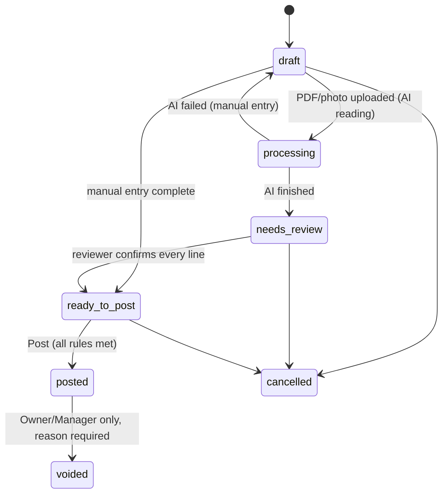
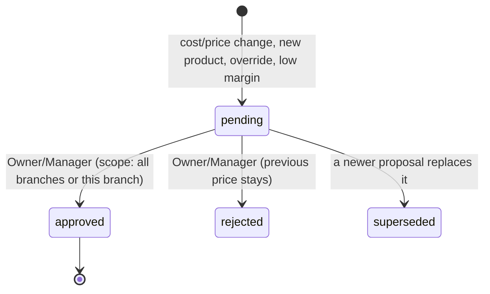
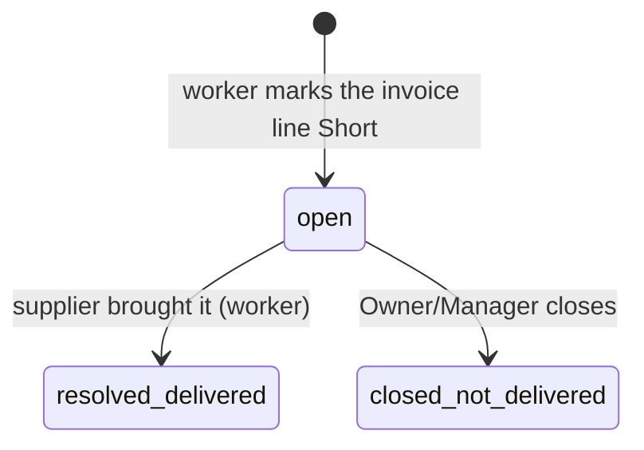

# Workflows and state machines

## R3c K4 — editable receiving selling price

Open an unposted invoice line and edit Selling price directly. The field labels its configured each/kg/lb unit and saves through the actual protected receiving proposal command. Rapid typing keeps the complete buffered amount/focus; closing the editor does not undo saved draft edits. Use calculated price removes the override. Reopening/reloading retains the saved proposal and its actual receiver.

Empty, zero, malformed or stale price evidence keeps the real field marked; Confirm waits for queued saves and canonical validation before closing an explicitly edited price. A genuine storage rejection restores the committed visible value and permits an explicit retry. Cost/category/source or unit-factor changes require fresh review; they cannot silently adopt another receiver's action token. Weight re-review uses the visible entered amount/unit with the current configured factor.

Posting creates an individual manual-price approval with requested and independently calculated prices, entered weight amount/unit and Set by <person> during receiving. The supervisor's existing approval/reason/scope rules decide the actual price. The earlier approved charge and active Sale behavior remain authoritative until that decision.

## R3c K3 — configured .49 to .99 and Use Lower

In Settings → Catalog → Rounding rules, configure Round selected price endings up, Source price endings and Round up to ending. The default is On, 0.49 → 0.99. Save changes retains an explicit custom/disabled rule; the same page's Price tester is a preview and never reprices stored approved Products.

A newly calculated receiving price that changes ending shows Rounded up from $X (store rule) and Use $X. Choosing it makes a real attributed manual receiving-price proposal, clears confirmation and preserves the separately calculated amount. Use calculated price removes the proposal. Posting sends the proposal to individual approval with the original receiving person, even when somebody else posts. Existing scope, below-cost/minimum reason and final approval guards remain; no approved charge changes before approval.

## R3c F3 — native picker before draft creation

From Invoices, **New invoice → Photo (AI reading)** opens the browser's native image picker directly; **PDF (AI reading)** opens a single-PDF picker. Photo permits multiple images and does not force a camera capture attribute. The chooser closes when the native picker opens. Cancelling returns to the current screen without creating a blank invoice. Valid selection retains the previous workspace, creates the authorized target, saves the chosen originals and opens that target; ordinary intake no longer passes through an empty upload page. A live selection becomes ready to read and requires the existing explicit **Read invoice** action; saving a source does not automatically call the reader or post an invoice.

Invalid/empty selections do not create a target. A selection that outlives its initiating person, location or mounted navigation intent is ignored or rejected before creation, including leaving and returning while asynchronous source validation is pending. If original storage fails after creation, the draft remains available with an actionable choose-again message. Simulated intake retains its actual fictional original and existing simulated reading behavior; exact included-fictional-original recognition and its reuse behavior remain intact. Native camera/library choices are controlled by the device and browser.

## R3c F7 — truthful reading header

A reading invoice, or an empty invoice with an original, shows **New invoice** instead of an incomplete reference/supplier/date header. A genuinely owned active request shows **Reading with AI…**. An inactive ready attempt says **Original saved · ready to read**; failed and cancelled attempts say respectively **Reading did not finish · original saved** and **Reading cancelled · original saved**. A persisted interrupted attempt says **Reading interrupted · read again**. Simulated reading keeps its own explicit caption. Post invoice is absent during processing. Review resumes the ordinary invoice identity/header and existing posting checks.

## R3c F4 — retained Discard, Cancelled and Undo

Discard is available from a nonposted invoice header and its list-row More menu. An empty draft moves directly to Cancelled. Entered content opens **Discard invoice?**, explains retained originals/history and requires a reason; Cancel makes no change. The Cancelled tab shows the retained record, attribution, reason and authorized original viewer in read-only form. Use the existing Undo feedback or eligible History reversal to restore the exact draft. Changing the workspace does not redirect Undo. Restoring a reading does not launch a network request; choose Read again explicitly. A previously manual invoice remains usable for manual entry under the same current permissions.

## R3c K6 — missing-paper payment default

When a new AI/checked reading has no payment terms, use the company's receiving default. The seeded Monthly value means the first day of the next month and shows the quiet **Default: first of next month** hint. Printed terms, including explicit checked terms, take precedence; genuinely flagged printed terms/due dates and unrelated questions still need review. Changing the terms manually removes the default hint and recalculates the due date normally. This reading default does not prefill ordinary manual invoice creation or rewrite existing stored invoice terms.

## R3c K2 — Checked import followed by a raw printed reading

Settings → Data → My checked values overlays supplied corrections without replacing the original AI line evidence. The clean checked description becomes the product proposal; original printed text remains separately viewable. Confirm and post normally. Only genuine accepted posting learns normalized printed keys on the exact supplier/Product association, retaining its source evidence and prior keys.

Read a later delivery from that supplier with the same printed text and a distinct invoice number. Its scoped learned key identifies the cleanly named Product, then K1 compares actual known fields. The preview and final import use the same original/checked/source-index evidence and report the same checks. Original files, raw text, pack/quantity/cost basis and paper totals remain retained. Description edits on known lines stay with the delivery; Edit product remains the catalog path.

## R3c K1 — First delivery, then repeat delivery

Read/import a first fictional delivery, review its new product and post through ordinary authority. The Product's approval may remain pending. Read another invoice from the same supplier: trusted unchanged name/pack/cost/category values become a green Same as last delivery line automatically, with no line-confirmation click or fabricated checker receipt. Only real changed fields stay amber with before/after and earlier-delivery date; unresolved independent evidence is retained. The progress strip counts same/changed/new and includes automatic confirmations.

Import complete derives readiness from the protected imported invoices and opens the actual Ready to post or Needs review tab explicitly, so an older saved tab filter cannot hide a green delivery. No matching, preview or ready-state navigation posts an invoice or changes a Product, approval or ledger. Posting remains explicit and all genuine header/totals/source blockers still apply.

## R3c K0 — Completing the approval board

Approve an individual request or the selected eligible invoice batch through the existing guarded command. Retain refresh data and the existing scroll position while real remaining content is still in view. After departing rows finish, release obsolete reserved space and expose the genuine empty state when the authoritative board is empty. If finishing a bottom invoice group leaves all remaining groups above the viewport, anchor the nearest real remaining row instead of retaining a blank viewport. This deliberate visibility recovery is the narrow exception to ordinary partial-list scroll preservation; it does not create or repeat any approval, receipt, price, invoice or ledger action.

Page-content render errors show a translated reload card inside the app shell. Reload is explicit; ordinary healthy navigation does not remount page content merely to reset the boundary, so unrelated buffered work keeps its existing save/navigation guards.

## R2g Tier 1 — Review edits and dialog feedback

Invoice review edits charges once, inline inside the lines card. Add, signed-amount/description/tax edit and remove recheck current company, location and draft/review authority, keep the raw original and record actual before/after audit evidence. Charges never become product receipts. Reconcile each change through the existing Decimal totals rules. A draft subtotal currently derived from complete lines/charges updates with those amounts; incomplete evidence remains unresolved. Preserve printed or explicitly entered headers, unknown tax/total and every posted financial record. A later human subtotal edit is authoritative, rather than a historical calculated-from-lines flag.

Change price keeps one verified warning/facts composition. A duration preset follows a changed start date; explicit Date and No end retain their chosen meanings. Pending financial queries cannot display an old warning against a new price or store selection. If selected stores have different costs/margins, identify the actual location rather than presenting one store's facts as universal.

Dialog Undo feedback belongs to the open instance in which its command began. Opening a different dialog, or closing/reopening the same title, cannot adopt an earlier page/dialog message. Defer page Undo while a dialog is open and retain its remaining display budget and actual guarded eligibility. Own feedback does not become an action column or move the active control/footer actions. Scroll long bodies within the existing frame, with hidden native scrollbars and truthful edge fades; do not reserve an empty feedback band.

## R3 — Live reading, saved original first

1. Owner/Manager chooses Settings → Receiving → AI reading → Live, saves the reader address (Reset uses this page's hostname at port 5191) and may Test connection. The Demo Simulated reading switch changes this same protected setting. JSON-file import stays available in both modes.
2. An authorized invoice uploader chooses a concrete permitted location and photos or one PDF. Save a Processing draft with its existing identity and all unchanged raw originals before preparing or sending images. Photos can be reordered before sending; preserve that page order in both source viewing and the payload. PDFs use the bundled renderer at about 200 dpi/quality 0.85, capped at ten pages and a 2400 px long side; photos share the dimension cap.
3. Read sends one `{images:[{mime,data},…]}` request to the configured local kit. No other app data or provider credential leaves the browser. The first progress step is the live request; product matching and price calculation are subsequent local work. Show elapsed time, Usually 1–2 minutes and Cancel. End the request after four minutes; no retry loop or automatic simulation.
4. Build a version-1 `super-arzon-invoice-readings` envelope in memory from the sent pages, actual original hashes and returned reading/statuses/models/cost. Invoke the existing AI importer against only the verified Processing target. Preserve its ID, raw file handles and handling origin; recheck current authority, attempt and location. All existing matching, Decimal, weight/pack/totals/confidence/date and posting rules apply. Ignore stale/cancelled results. A different retained duplicate blocks with the existing message and keeps this draft.
5. Success opens review without posting. `checksPassed: false` with usable lines also opens review with existing checks. Invalid/unusable results, HTTP/network/CORS failures or timeout show “The AI reading didn't finish. Your original is saved.” Offer Try again, Enter by hand and demo-only Use simulated reading; each is an explicit user action. Manual fallback is restricted to this authorized verified live-original draft and does not grant New manual invoice access.
6. Cancel or leaving the workspace keeps the saved original. After reload there is no resumable browser request: show Read again/Enter by hand rather than an endless spinner or the simulated completion timer. A current same-window request may show Reading with AI… and its elapsed time in Processing. Session/role/location changes cannot apply a late reading to another workspace or navigate someone away.
7. Store actual elapsed seconds, Decimal USD cost and returned model names as live reading provenance. Accept names as strings or model objects with a nonempty `id`; retain valid optional per-model `ok`, `seconds` and Decimal USD `costUSD` alongside the normalized names. Ignore unknown response fields such as `checkFailures`. Show the quiet provenance line to Owner/Manager only, and redact all live provenance in the protected operational projections and History for other roles. Original bytes, legal/financial records and ordinary approval permissions remain unchanged.

## R2d — Branch timesheets

1. An authorized Owner, Manager, Branch Supervisor or Cashier opens Daily → Timesheets. Resolve the current company/person/session/module/allowed branches again at the protected boundary. Floor Worker and module Off reveal no sheet, History, CSV or print data. Aggregate selection asks for a branch; its first implicit date uses that branch's local Today. Explicit past dates/week views remain selected, and ordinary save refresh does not move an open day across midnight.
2. Choose existing branch staff or atomically add a staff member and first shift. Staff may have a safe optional app-login link but need no login. Configured bilingual departments drive the cards and paper; editing, archiving, restoring and removing a shift retain evidence and attributed History.
3. Type In/Out or Notes → local buffer → normalize valid 24-hour input → serialize actual protected saves against the original editing identity and location. Earlier Out means next day, equal times zero, and integer minutes supply totals. Missing past Out and shifts over 16 hours show checks without inventing a clock-out.
4. Date/view/export/print and Back/hash navigation wait for valid pending entries. Invalid or failed saves retain the sheet, typed text and Retry. Only the latest accepted route can open; stale callbacks cannot reopen an old page or write as a replacement person. Native reload/close warns while dirty or saving and stops warning after the actual save.
5. Week view reads the selected branch's Monday–Sunday rows and staff/department/day/week totals. A day cell opens that exact daily sheet. CSV flushes valid edits, rechecks authority and downloads the actual selected day/week with formula-safe cells. Print also rechecks and opens the bilingual three-column day paper or weekly totals, with Notes and Made with Klead; physical output remains a hardware review.
6. The authorized dashboard's On shift now tile reads distinct staff with a nonfuture In and no Out, including prior unclosed days. It opens that concrete branch's sheet; aggregate selection asks for a branch and module Off removes the tile.
7. Existing-store upgrade first verifies an exact private backup and unchanged canonical revision, then adds absent defaults and empty timesheet collections. Fresh demo/explicit Reset alone seeds fictional practice rows; Empty store keeps its marker and stays empty after reload. This prototype introduces no shared server, wage calculation or payroll payment execution.

## R2c Groups 2–6 — Search, statements, atomic approvals and personal inbox

1. Open a product/supplier picker → search public names/code/barcode/aliases → keyboard or click selects a real option. Closed-box Choose… instructions never enter the list. No matches leaves the current selection intact; Escape closes without change. Flip/bound popovers inside the visible viewport, retaining input position and existing shelf Enter/refocus behavior.
2. Suppliers → current protected read → distinct Loading/Error/Filtered-empty/Company-empty presentation. Profile incomplete is actual missing fields, not obsolete proposed status. Open one record → one header and padded contacts/real KPI destinations. Supplier creation remains Active and optional profile work never blocks receiving.
3. Payables → capture current scoped list position → open stable supplier-ID statement route at the top → operate through the existing canonical payment/credit/print/export guards → Back or All suppliers restores the list within 2px. A failed/foreign supplier route never silently selects another supplier; overview filters cannot hide an opened statement.
4. Approvals → Edit and approve → protected product/cost/category/manual snapshot → locally edit the full shared form → Cancel writes nothing, or Save and approve validates fresh decision/catalog authority and every relevant source/pricing/product/supplier/date snapshot → apply genuine operations on a candidate → publish all changes and one attributed audit only on success. Required manual/below-margin reasons and explicit rule/keep choices remain. Failure keeps local edits visible without partial canonical changes; original invoice/ledger/physical evidence remains. Preserve board scroll and specialized barcode/margin guards.
5. Invoice group → Review invoice approvals → inspect select-all/Product/category/cost/price/margin and amber warnings → choose eligible rows → counted primary validates current batch snapshots/authority → selected-only approval in one command. Busy/stale/error leaves the dialog open; individual-only rows remain pending. Ordinary decisions retain existing Undo; the full edit/approve operation retains one nonreversible before/after action. Rejected resubmission remains a new linked pending request.
6. Offers → inspect real suggestion name/terms/regular saving/scope → set dates/pool → Confirm or Dismiss through existing commands. Create offer chooses a public product and displays its configured read-only bundle quantity/total; Sale price continues to the current price editor. Existing Stop/confirmation/Undo, role/location and monetary rules remain.
7. Bell → newest authorized event groups/unread-group badge → Mark all read or personal Clear all. Clear persists read/dismissal while retaining records/event keys and all source evidence. Open group → fresh current permitted members → canonical related destination (current eligible branch preferred) → mark this person's eligible members read → navigate only if actor/request/location/route/menu intent still agrees. A closed or superseded UI request cannot redirect later. Source completion/decision filters handled notices; reconciliation cannot recreate a personally dismissed old event, while genuine new events remain eligible. No external push/email service is introduced.

## R2 import → receiving → approved prices (2026-10-21)

Settings → Data → Choose file… or New invoice → JSON file imports additively; select the readings export, source and locations, then import. Removing fictional data is separate and optional, with typed DELETE (or حذف). In-file duplicates identify both copies; only one is selected, with the more complete copy preferred. Already in the app means persisted evidence only. The summary can switch to All my locations when invoices were imported elsewhere.

Invoices opens the first tab with work: Needs review, Ready to post, Drafts, Processing, otherwise Posted. Counts and the sidebar badge follow the selected authorized locations. New invoice offers Photo (AI reading), PDF (AI reading), Manual entry and JSON file; invoice details have their own header and back link.

Open an invoice, compare its details and original, acknowledge the details card, and open one line at a time. Choose an existing product or provide the new product's English name/category; verify quantity/cost and optional tax/date choices. More details contains rare printed evidence. Report short or refused shows the changed delivered quantity and exact deduction. Confirm line keeps other lines' confirmations, closes the editor and preserves the row's position. Only Next to check or an explicit field/delivery link deliberately scrolls. Acknowledge calculated totals, then post when the grouped missing checks are resolved. Supplier contact details never block this flow.

Approvals groups pending requests by invoice. Approve all opens the selected-only category/cost/price/margin review with eligible select-all. Edit and approve locally stages the shared full product editor, recalculates through existing pricing and commits the genuine product/date/supplier/approval operations atomically under current authority/snapshot guards. Cancel writes nothing. Fix and resubmit retains rejected evidence and links the new pending request in both directions. Ordinary decisions keep supported Undo; full edit/approve retains one nonreversible before/after audit action. List/count/scroll stay stable during refresh. Only Owner/Manager may decide.

Suppliers created here are active immediately. Owners/Managers can complete their optional profiles later from the notification or supplier banner. Similar-name warnings compare distinctive names, can use the existing supplier, or remember a Not the same supplier decision for that pair.

Historical imports retain raw printed descriptions/packs and source quantities/costs; conservative name/contact/term/amount defaults carry appropriate provenance. Same-supplier code/printed-description matching survives catalog rename; other-supplier fallback requires review. Initial received events use delivery time, while import/post History uses actual action time.

Posted date correction appends metadata and attributed audit, leaving original source/financial/physical events retained. Correct invoice uses a local staged editor, required reason, canonical difference/impact preview and current-authority/stale checks; confirmed corrections append a version and apply the displayed delta once. Existing allocations, later deliveries, order/return evidence and approvals remain protected. See [R2b click guide](PR_R2B_REVIEW.md).

## R1: import an invoice-reader export

Owner/Manager → Settings → Data → Choose file… → Reading file… → preview the AI reading (default) or My checked values → review suggested locations and disabled duplicates → Import N invoices → summary → Open Needs review. Parsing runs off the UI thread. The protected preview and final command enforce current authority; final import rechecks locations and duplicates after original-page storage completes. No AI service is called.

Imported drafts use active suppliers, ordinary product/category/date review and posting. Editing saves canonical alias acknowledgments; one Confirm line clears all remaining line questions. Explicitly flagged empty optional evidence has Not on the invoice with who/when; ordinary blank optional evidence stays quiet. What's missing links unresolved fields and totals differences. Original images have Page X of N and Previous/Next. Other charges remain separate from product receiving and contribute to the payable.

Start with an empty store → Remove fictional data… → inspect what stays/what is removed → Remove fictional data → intentional empty operational screens. Settings, locations, people, pricing, templates and notebook definitions remain; History contains one removal entry. Reset demo warns that imported invoices are also removed before restoring the full fictional business and configured demo people.

Current E1 authority replaces three-role and static actor rules. Owner/Manager carry former Supervisor authority; historical C1–C8 clauses retain original wording where explicitly historical. Current C6/C7/C8 workflows supersede earlier date controls, stacked Undo and whole-return settlement limits. Klead design-language governs all new screens before implementation.

Each workflow lists states, who can move it, and the side effects. All state changes are audited.

## 1. Invoice

- **draft**: anything not yet submitted. Auto-saves. Allowed without the image/PDF. Listed in a "Drafts" tab like an email client.
- **Manual entry (B, item 46):** New invoice offers Photo (AI reading), PDF (AI reading), Manual entry and JSON file; JSON uses the additive importer. Owner/Manager chooses the branch, supplier (including + Add supplier), supplier invoice number, invoice date and payment terms, then adds any product (including + Add new product), quantity and unit cost. Return from either shared add form selects the new record without discarding the draft. Manual entry uses the same pricing, lower-cost questions, date decisions, matching, tax and posting logic as uploaded review. Save as draft works without an original; Post still requires the original photo/PDF and all normal rules. No AI extraction or invented source document is needed for manual entry.
- **processing**: AI is reading the file in the background; the worker can leave and come back.
- **needs_review**: AI lines wait for a person. The reviewer must confirm each line. C4 initializes **Track date: Yes / No** from the product's explicit preference; unset still requires a choice, and Yes requires a valid type/date.
- **ready_to_post**: header complete, original file attached, every line confirmed and supplier review cleared. New/manual supplier or missing contact/terms routes Needs review; Owner/Manager completes details and explicitly confirms before posting.
- **Posting rules** (all must hold): mandatory header fields present; original file attached; supplier is active (optional profile completion never blocks posting); every unmatched line resolved (matched or created as a pending new product); worker has answered the same-supplier lower-price questions where they apply.
- **On posting:** create `received` physical movements and Received log entries for actually delivered quantities (exclude missing short quantities); create price proposals with this invoice/line's exact four-decimal cost, invoice number, posting employee and timestamp; create alerts; create the invoice entry in this branch's supplier ledger (net of open shorts); lock the invoice. Drafts/Ready to post previews create no active approvals. Posting stays blocked until every line has a valid **Track date: Yes / No** value (initialized from an explicit product preference or answered by the reviewer), line confirmation and all required dates/decisions are valid.
- A posted invoice is a clean read-only document, corrected only by the Owner/Manager through **Correct invoice** or **Move invoice**, required reason, impact preview and confirmation; append linked corrections and preserve original/allocation/file evidence. No simple Undo or disabled draft editor.
- Invoice number missing → assign next sequential number for that supplier and mark `number_is_system_assigned`.

## 2. New supplier and manual supplier management

- **Owner/Manager Add supplier (B, item 44):** open from Suppliers or the invoice Supplier field's + Add supplier. The max-720 px shared form captures name, phone, email, sales rep/phone, payment terms, optional address/notes, and optional balance per allowed branch with an as-of date. A similar-name warning links to existing suppliers before save; it never silently merges. Standalone Owner/Manager save creates `confirmed` immediately and records actor/time/company in History. Invoice quick-add permits optional phone/email/rep/rep phone/terms; a new supplier or any missing detail routes the invoice to Needs review until the Owner/Manager completes and explicitly confirms review.
- Each entered branch opening balance appends an `opening_balance` ledger entry labeled **Opening balance**, dated as of the entered date and attributed to the Owner/Manager. It appears in Payables; it is not an invoice, delivery or purchase-chart contribution. Existing ledger entries are never replaced.
- **Floor Worker invoice quick-add:** the same form has no opening-balance controls and creates `proposed`. Invoice entry continues but posting is blocked with **Waiting for Owner/Manager to confirm supplier** until the Owner/Manager confirms (`confirmed`) or explicitly merges it into an existing supplier. Dashboard shows Supplier waiting for confirmation. The transaction rejects unauthorized opening balances, including values supplied outside the UI.
- Only Owners and Managers can edit or deactivate suppliers. Deactivate excludes a supplier from new-invoice choices without deleting its invoices, returns, products, balances or history; existing records retain their links. Record every edit, confirmation and deactivation. Cashiers cannot add suppliers; Floor Workers have no standalone Suppliers Add supplier action.
- **Payment terms:** Cash on delivery · Weekly (7 days) · Every 2 weeks (14 days) · Net 30 · Net 45 · Net 60 · Monthly (first of next month) · Other N days. Other days remains inline. Compute Monthly as calendar first-next-month; recognize receipt/NET aliases and flag corrected contradictions or inferred earlier-supplier terms. Unresolved terms stay blank+check. Received is company-zone/UTC persisted; historical import uses reviewed handwriting or invoice-date noon, manual/live now. Incomplete Post names/focuses actual fixes without writing; authority and pending remain guarded.
- The supplier-confirmation task appears in Approvals and the Owner/Manager dashboard without price fields. Confirm supplier marks it Approved and releases the supplier posting gate. Reject marks the task Rejected and the proposed supplier inactive, retains its draft/history, and keeps posting blocked; it does not silently confirm or merge the supplier. Recheck a supplier snapshot before either decision so a stale preview cannot decide edited details. Record the signed-in Owner/Manager and decision time.

## 2A. Owner/Manager Add product and invoice product proposals

- **Owner/Manager Add product (B, item 45):** open the shared product editor in new mode from Products or an invoice's + Add new product. Capture English/Persian names, unit size, category, pricing category, barcode, supplier, date tracking, last unit cost before tax and selling price. No starting/opening counts in Phase 1.
- Compute selling price through the unchanged Decimal pricing engine using the entered cost/category. If the Owner/Manager changes the calculated selling price, record a manual override; if the saved price falls below the configured minimum margin, require the Owner/Manager's explicit confirmation. Do not invent invoice-number provenance for a manual cost.
- Allocate the next company-wide Product Code, beyond all previously assigned codes including archived records; a failed validation creates no product or movement. Block conflicting barcodes with the existing conflict flow and warn/link when a name is close to an existing product. Never silently merge products or recycle a code.
- Owner/Manager save creates an **Active** product immediately and records the creation/price decision in History; no separate pending-product approval is needed. C removes the starting-count fields/transactions. Preserve historical movement records and money corrections, never simple destructive Undo/Revert.
- **Floor Worker invoice-only + Add new product:** use the shared new form as a proposal, with no opening-count controls. Save a **Pending approval** product, retain normal invoice/posting-derived approval behavior and the last-approved-price rules. Floor Workers and Cashiers do not get a standalone Products Add product action; Cashiers cannot create invoice proposals. All state changes enforce role and company/branch scope.

## 3. Price proposal and approval

- Triggers and approval rules are in `requirements.md` §6 and `pricing-engine.md`.
- While `pending`, the Products section shows the proposed price labeled **Pending** next to the approved price. The **cashier lookup keeps showing the last approved price as the price to charge**, with a small "New price pending" tag. A new product with no approved price shows its proposed price tagged "Pending: confirm with a Owner/Manager before selling". **(assumed)**
- Approval with scope **all branches** (default) previews active selling locations, sets the company default and clears the selling-location overrides it actually replaces; **this branch only** updates a selling location's override. Non-selling Warehouse is excluded unless Sells to customers is enabled; keep original receiving source evidence.
- After a price becomes effective, run: offer suggestion check (§7) and cross-branch conflict check (§5).
- **Owner/Manager catalog edit:** open the shared editor from Lookup/Products; validate permitted fields and immutable Product Code; if selling price changes, choose **All branches** (default) or **This branch only**, preview affected values, and save with the Owner/Manager manual-override decision. Retain original invoice-calculated value/number and append actor/date/scope/before/after provenance. B adds History UI and conflict-aware Revert to the reversible records. Worker invoice proposals still use their existing review/approval flow; direct Owner/Manager creation uses §2A's immediate Active decision.

## 4. Same-supplier lower price (and different-supplier price)

Trigger (at invoice review/posting): the new unit cost of a supplier product is **lower** than that supplier product's last cost.

1. Ask the worker: **same expiry date as the stock on hand?**
2. **Yes** → ask: **how many units are left that were bought at the higher cost?**
3. **No** → ask for **both expiry dates** (old stock and new delivery).
4. Create an alert for the Owner/Manager with: item, supplier, old and new cost, worker's answers, invoice link.
5. Owner/Manager sets **Taken care of** or **Still pending** (can add a note, e.g., "credit requested").

Different supplier at a different price: the item is registered under that supplier (its own supplier name, SKU, pack size) and an alert `other_supplier_price` is raised with both suppliers' costs. Same Taken care of / Still pending actions.
This alert does **not** block posting and is independent of price approval (a cost drop may leave the selling price unchanged).

## 5. Cross-branch price conflict

- Trigger: after any price becomes effective, if a product's effective approved price differs between branches and there is no valid acknowledgment.
- Alert shows the product and each branch's price. Owner/Manager actions: **Mark as intentional** (stores the exact price pair; stays quiet until either price changes), **Apply price X to all branches**, or leave open.
- Differences are normal (different costs per branch); the alert is an awareness tool, never a blocker.

## 6. Short item

- **open**: the short amount (line amount plus proportional tax **(assumed)**) is deducted from the invoice's payable total in that branch's supplier ledger; no Received quantity is recorded.
- **resolved_delivered**: record an actual received movement, restore the amount to the payable total, record date and employee. If the delivered cost differs, run the normal price check.
- **closed_not_delivered**: the deduction stands as a credit; the Owner/Manager sees the invoice and the deducted amount.
- The Owner/Manager dashboard lists open shorts with age.

## 7. Offers and mix-and-match

- Offer definitions map selling price → offer (settings): 1.99 → 3 for $5, 2.99 → 2 for $5, 3.99 → 2 for $7 **(assumed)**.
- **Suggestion:** when a product's price becomes effective at one of those prices and the product has no offer in that scope, create an `offer_suggestion` task for the Floor Worker: **Confirm offer** (also choose whether it joins the mix-and-match pool) or **Dismiss**. No approval is needed after that.
- A product has at most one active offer per scope. Changing the price to one that maps to a different offer ends the old offer and creates a suggestion for the new one.
- Mix-and-match pools are per offer definition and global across categories and suppliers.
- Workers and Owners and Managers can also create and stop offers manually; start/end dates are optional.
- **C5:** identical current active/scheduled product/company/scope submissions are idempotent. Changed terms retain their stopped predecessor and normal Undo. Current groups permitted scopes into one product row; Past retains stopped/ended versions newest first.

## 8. Supplier return (C6 item-level pickup and resolution)

Open remains Waiting for pickup / Waiting for credit; History Closed(Credited/Replaced/Written off) / Cancelled. Preserve actual quantities and old evidence.

1. Create return and set-aside record once, reasons/evidence/location, no stock projection.
2. Record **actual pickup quantity per item**, representative/signed-paper/employee/time. Shortfall requires reason plus **Keep for next pickup / Put back on the shelf / Throw away**. Keep permits a new later signed pickup; other dispositions append actual evidence. Lock saved pickup. Supplier memo English by default: store/address/RM number/date/supplier/items/product-code/quantity/unit-cost/expected-credit/total and driver/staff signature/name/date. Print is not settlement.
3. Only **Correct pickup**, required reason and authorized actor, appends a correction to a locked pickup. Owner/Manager only in E1; no other role receives correction authority. No worker/cashier permission is inferred. Record resolution never edits pickup. Validate settled/downstream quantities before correction.
4. Derive provisional pending credit from actual picked-up outstanding coverage only, once. Owner/Manager projection $600 minus expected $30 shows $570 owed/$30 pending; worker pickup never posts confirmed credit.
5. Resolve each item/partial quantity as **Credited** (distinct credit note/actual amount/evidence, Owner/Manager verification), **Replaced** (actual incoming product/quantity plus covered original units), **Still outstanding** (expected date/note), or authorized **Written off** (reason). Multiple distinct credit notes for disjoint remaining coverage are allowed; one invoice link retained, duplicates/overlap blocked. Actual credit can differ from expected including tax; use existing exact allocation/unapplied rules.
6. Each line shows cumulative picked-up, credited/replaced/written-off and outstanding progress. Waiting for credit remains until every picked-up claim is settled and next-pickup remainder handled. Partial outcomes append immutable evidence; no old event is overwritten. Release provisional claim only for settled coverage: actual credit replaces its expectation; replacement/write-off releases its part with no new purchase payable. Retain approved $570→$600 full replacement rule and smaller-credit $575 example.
7. Cancellation still requires actual safe-original disposition; no fabricated recovery or erased physical/financial settlement. Workers cancel unsettled operational returns; settled corrections need Owner/Manager review.
8. Deduplicate waiting-for-credit 14-day alerts; close on final outcome, preserve History. Memo, settlement and pickup retries never double money/movements.

## 9. Date tracking and expiry (C6)

1. Explicit product Yes/No initializes invoice choice; unset asks; Yes needs real type/date and normal line confirmation. Product reminder days default existing Settings 30.
2. In **Add/Edit product**, choosing Yes shows same-form date section immediately. Add/change/remove type/date/quantity/lot for current concrete location and edit reminder days; Save validates/commits product and dates together, Cancel commits none. EN name/pricing required; FA/descriptions/category optional with fallback.
3. Lookup exposes dates **read-only**, including retained dates after tracking stops, plus current-location clearance expiry and Last received. Remove all On/Off and date entry there.
4. Date tracking quick bar keeps scan/search/code/barcode/date/location/Enter/refocus/pinned highlight/More. Products menu preselects it. Removing one date requires existing reason, retains History and eligible Undo.
5. Every preference turn-off chooses **Stop tracking, keep the date on the product** or **Stop tracking and clear the dates**. Both remove product from active Date tracking lists/reminders. Keep preserves Lookup dates; clear marks removed with History. Re-enable does not erase old evidence. Catalog permission Owner/Manager; entry add/remove worker allowed scope.
6. On entering the product's reminder window, one alert per active date goes to scoped Alerts/bell. Repeat checks/daily updates do not duplicate. Stop/clear/remove suppresses its operational reminder and preserves audit.
7. Tracked delivery review offers **Use this date** from same-company/product/supplier dates entered in last 7 days at other locations, showing location/day/type/date and optional lot only. Explicit use fills draft, no broad other-location read access or cost/quantity/invoice exposure.
8. Posted actual receipts associate one location/product/supplier/expiry lot; immutable source quantity/cost evidence remains. Optional clearance is separate scoped action, never automatic regular repricing or duplicate product/barcode. Cashier Lookup only own current-location effective prices/clearance/date.

## 10. Labels: waitlist and printing

1. **Find products** in the label product list: search, or filter by Arrived today, Price changed recently, On offer, pricing category, AI category, supplier.
2. Select product checkboxes or **Select all filtered**; the sticky selection bar sets a shared copy count and **Add N products to waitlist**. Individual copy changes are in Waitlist only. The waitlist is shared per branch and survives sign-out and refresh. Optional setting: auto-add when a price is approved (off by default).
3. **Open the waitlist:** adjust copies, remove items, choose a saved **template** or duplicate/edit a built-in **Regular / Promo** template, or create one (name, width, height, margins, gaps, calibration offsets). Archive/restore rather than delete; built-ins are inserted once without resetting existing templates.
4. The app calculates how many labels fit on an A4 sheet: `columns = floor((210 − left − right + gap_x) / (width + gap_x))`, `rows` likewise with 297; slots are numbered left-to-right, top-to-bottom (right-to-left setting for Persian layouts).
5. Choose the **starting slot** on the A4 preview (used slots shown grayed).
6. **Preview**, then **Print** (browser print dialog at exact size; "Save as PDF" works the same). Multiple pages are created when needed.
7. After printing, the app asks "Did the labels print correctly?" **Yes** removes the printed items from the waitlist and records the print in History; **No** keeps them.
8. **Test alignment page:** prints slot outlines only, so the user can hold it against a label sheet and adjust the template's calibration offsets.

## 11. Payables (Owner/Manager)

- Confirmed ledger balance per **location and supplier** = opening balance + invoices (net of open shorts) − confirmed credits − payments ± adjustments. Displayed owed additionally subtracts separately labeled active provisional return credits when the pickup setting is On; never count both expected and confirmed credit for one settlement.
- Partial payments allowed; each payment can carry a cheque number and payment date; entries can be flagged **disputed** with a note.
- A month-end summary per supplier (printable, CSV) lists open invoices, credits, payments, and the balance.
- No QuickBooks integration now. Keep the export format simple and stable.

## 12. Deferred inventory

Phase 1 has **no inventory system**: no Stock page, on-hand estimate, opening count, stock-count form or variance dashboard. Retain physical receiving/return/transfer events for a separately paid later inventory phase after register sales. Do not change historical movements merely because their stock projection is hidden.

## 13. Accounts and sessions (E1)

```mermaid
stateDiagram-v2
  [*] --> invited: Owner/Manager adds person; setup code shown once
  invited --> choose_password: valid one-time code; retained setup session
  choose_password --> second_step_setup: Owner/Manager/Branch Supervisor
  choose_password --> active: Floor Worker/Cashier setup complete
  second_step_setup --> active: simulated passkey/authenticator complete
  active --> locked: idle lock or configured failed attempts
  locked --> active: permitted password unlock/lockout expiry
  active --> invited: Owner/Manager resets password/setup
  active --> deactivated: authorised reasoned deactivation
  deactivated --> active: authorised Reactivate; required setup already complete
  deactivated --> invited: authorised Reactivate; required setup incomplete
```

1. Resolve username/alias within the current company directory. `supervisor` resolves the Manager person, not an extra role or identity. Preserve configured lockout and password policy. New invitation code is consumed once; a second sign-in with that code fails. Retained setup session resumes password/second-step setup after reload. Owner/Manager can reset an interrupted setup with a new code, revoking old challenges first.
2. Password choice and required simulated second-step setup complete before issuing full business access. Setup/challenge sessions can only continue setup or sign out. Privileged demo fixture completion does not bypass setup for invited/custom people. No real text/email invitation or passkey/authenticator verification is claimed.
3. Fresh sign-in selects an allowed active registered-computer location first; otherwise a sole allowed location, otherwise All my locations for multiple assignments or All locations for company scope. A resumed valid current session retains its chosen allowed selection. With no active permitted location, require a valid location before business access. rh-supervisor rejects the North York computer default and starts at All my locations for Richmond Hill/Newmarket; it never silently chooses either first store. Aggregate is a read selection; a write or charged-price view requires an explicit concrete location.
4. Only Owner/Manager Add/Edit/Deactivate/Reactivate/reset/unlock/manage computers. Add validates name, unique username/aliases, phone or email, role/scope and returns the one-time code once. Edit role/location requires reason and expected version. The same IndexedDB readwrite transaction validates current editing actor, target version, no own-role change/no self-deactivation, promotion authority and at least one usable Active Owner after the change: status Active, password setup complete and required second-step setup complete. Invited/Deactivated/setup-incomplete placeholders do not count. Floor Worker promotion to Owner/Manager/Branch Supervisor retains the chosen password, revokes old sessions and stays Invited until required second-step setup completes. Removal/demotion/setup reset cannot leave zero usable Owners.
5. Commit directory, nonsecret audit and required session/challenge revocations atomically. Role/location edits, reset and deactivation invalidate authority epochs. Notify shared-browser tabs only after commit; each protected query/command independently reads current authority, so missed invalidation cannot allow a revoked actor. Reactivate keeps records and does not revive revoked sessions. Separate prototype phones/browsers remain isolated; future authenticated server revokes across devices.
6. Preserve Recent users on this computer, username/password, idle lock and sensitive password re-prompt. Registered computer rows have concrete locations; registration is a convenience, not a grant. Append nonsecret People/device audit within the successful transaction; expose committed safe History summaries only through fresh authorityHistory(identity) with history.read_all, without credentials/challenges/sessions/setup internals/private aliases. Generic business Undo/Revert never restores directory/epochs. Every new audit uses stable actor/target identity without credentials or raw codes.

## 14. Notebooks

- Built-in notebooks (To order, Store use, For Owner/Manager) behave as in `requirements.md` §15.
- **Create/edit/archive notebook definition (Owner/Manager only):** English name required/Persian optional with English fallback, branch scope, read roles, add roles, optional fields, status on/off, notify Owner/Manager on/off → notebook appears in the Notes tabs for the allowed roles.
- **Add entry:** the fields the notebook enables; author and time are automatic, and the entry always has a concrete allowed location. In All branches, Owner/Manager sees a styled location picker and can add. New custom notebooks allow Owner/Manager/Floor Worker read/add by default. Explain archived/read-only/no-allowed-location/outside-scope blockers; never silently hide the form.
- **Edit entry:** author within the undo window, Owner/Manager anytime (recorded in History).
- **Archive notebook:** hidden from tabs, entries stay searchable; can be restored.

## 15. History, undo, and revert

- Every action writes a History entry with before/after values and a `reversible` flag.
- **Undo display (C6):** one message for eligible remove/stop/approve/reject/send/complete actions, about 8 seconds, bottom-right EN/bottom-left FA, Undo and ×. New replaces old; reserve space above page/footer buttons. No edit/autosave message or stacking. Existing History/reversible transaction checks remain; never financial/legal Undo. Preserve company/role/location/record-version checks and scoped inversion.
- Undo request actions appends `transfer_correction` with `reverses_event_id` and retains original operational/physical evidence; never deletes sent/received events or invents recovery. Place order/source-note mark ordered may Undo only before any receipt/later edit, retaining reference and audit evidence. Money/legal actions (Post invoice, payment, Move invoice, Correct invoice) use confirmation then subsequent corrections, never Undo.
- **Revert from History (Owner/Manager):** available on reversible entries; shows the before/after and asks for confirmation; creates a new entry "Reverted [action]". If the record changed again since then, show the conflict and do not overwrite silently.
- **Not reversible by undo/revert:** posted invoices, stock movements, payables entries, prints. These use corrections (`workflows.md` §1, §11) so the original stays visible.
- Examples: offer stopped by mistake → Undo, or Owner/Manager reverts → the offer is active again. Wrong product name → revert to the previous name. Price approved by mistake → revert restores the previous approved price (and creates a new price proposal history entry).

## 1A. Invoice receiving location and posted relocation (C1)

- New invoice defaults to user's own concrete allowed location; Owner/Manager uses a valid current concrete location; an aggregate must ask for a permitted concrete target rather than silently choosing the first location. Ship-to evidence suggests a matching active location but requires reviewer confirmation. Retain reviewer origin location/assignment on a draft. The actual Floor Worker creator/handler/reviewer of an unposted invoice may choose any active same-company receiving location, including Warehouse, and post that invoice through its retained active assigned handling origin. This preserves the C8 invoice-only exception; it grants no unrelated destination records or Orders, no later Short receiving/resolution, and no reviewer reassignment. Branch Supervisor remains assigned-location only.
- Posted invoice remains immutable. Owner/Manager chooses **Move invoice**, destination and required reason; preview received entries, pending approvals and current outstanding financial liability. Recheck the original effective location/record version and allocation snapshot before saving; same-location, foreign-company, inactive-target, stale and repeated correction attempts add nothing.
- Append `invoice_location_correction` with original invoice, from/to locations, actor/time/device/reason and affected references. Effective-location queries resolve correction chains for invoice display, Received, product Last received, supplier tabs, short/date entries and source-linked approval location. Preserve original posted header and receipt references. Record paired movement-location corrections; never fabricate a second delivery.
- Transfer **current outstanding liability**, after existing shorts/adjustments and allocated payments/credits, with paired source/destination supplier-ledger corrections. Keep historical payments/credits and their original allocations where recorded, with the impact shown in preview; never replay money. Source outstanding becomes zero and destination outstanding becomes the exact prior remainder. Company total, currency, supplier, actual invoice totals and payment evidence are conserved, even for fully paid invoices whose receipts still move. Future short deliveries and invoice corrections use the effective destination.
- Append non-reversible History for the correction; another move is another correction, never edit/delete/Undo of the original. Pending approval effective origin follows its **latest monetary cost-basis source invoice** (`source_invoice_id`, with retained invoice number/posted timestamp compatibility). Merged approval `invoice_ids` are historical evidence: moving an older linked invoice cannot redirect the latest proposal or split/replay money. Approved global/branch price decisions are not silently reapplied to a different branch.

## 16. Manual-price receipt decisions (C8 supersedes C1)

An effective manual regular price remains approved while receiving records an actual changed cost. The receiver can recommend Keep or Use calculated, but every accepted normal changed-cost receipt with retained manual price creates a Owner/Manager approval regardless of that recommendation. The approval's Selling price dropdown defaults to **Use the new calculated price $X** and also offers **Keep $Y**. Show retained regular/calculated prices and actual new-cost margin through the pure manual regular-price preview.

Approve Use calculated applies the reviewed price under the existing scope/snapshot guards and removes only the applicable manual provenance. Approve Keep is restricted to the original receiving store, preserves the approved amount/manual provenance and records the final choice. For either Rule or Keep, require a reason when the selected price is below the configured minimum margin or below cost, using **Add a reason.** / **یک دلیل اضافه کنید.** for a missing reason. Shared warning: **This price is below the minimum margin.** / **این قیمت کمتر از حداقل حاشیهٔ سود است.** Reject preserves the currently approved price. Receiving never approves or suppresses this decision. Same-cost and short-dated receipts preserve the current manual decision and do not create a changed-cost manual-price review. Margins remain private. An active sale continues charging its sale price while a regular decision is pending; its eventual end uses the then-current approved regular price.

## 17. Orders and receipt reconciliation (C2)

1. Owner/Manager (or explicitly enabled Floor Worker) selects allowed location and active confirmed supplier; add supplier items with pack/last-price snapshots and positive cases. Save draft or Place order with expected before-tax Decimal total. `orders.allow_floor_worker` defaults false; opt-in grants order cost snapshots/expected amounts only inside Orders, not Supplier cost-history/catalog access. Units must be positive whole; fractional Cases require an integer retained pack with exact positive whole converted units (0.5 × 12 = 6), using Decimal without float rounding. A manually added supplier item without purchase evidence displays no bought cost/date/invoice; require explicit Expected unit cost before placement unless an actual purchase or separately marked Owner/Manager quote supplies it. No hidden catalog-cost fallback. A source To order note is linked and becomes ordered only when the order is placed. Free-text notes without a catalog match require explicit supplier-item selection or intentionally created New item line and Cases quantity before placement; never invent their product, pack or quantity. Print order is an English-default supplier-facing A4 sheet with its own en/bilingual setting; no Payables entry.
2. Ordered/Partially received orders can be suggested only on invoices with the same company, supplier and effective receiving location. Explicitly link; changing invoice supplier/location invalidates incompatible links/decisions and returns their blockers.
3. Normalize case/unit quantities using each retained pack. As ordered is OK; partial invoiced delivery uses existing Short flow. Order line absent from invoice requires **Short / Back-ordered / Cancelled**, without inventing an invoice payable/deduction. If an order expects 4 cases but the invoice bills/delivers 3, classify the retained remaining 1 case as Short/Back-ordered/Cancelled without deducting an uninvoiced amount. Retain line comparison snapshots. Extra line requires **Keep it (we pay for it) / Refused / sent back with the driver**; refused quantities are removed from payable and Received using original proportional tax conservation and cannot create regular-cost/price approvals. Cost differences show old/new and require decision.
4. Lower cost offers **Short-dated (expiry discount)** plus existing same-supplier explanations. Short-dated requires expiry date; on posting create Date tracking and actual discounted receipt/payable but no regular-cost update, selling-price change or price-change approval. Owner/Manager may separately create clearance offer/Promo print.
5. Every difference needs its decision before Post; original/supplier/date/matching/line gates remain. Posting once updates order cumulative actually received quantities and remaining decisions, records invoice link, and creates one Owner/Manager alert summarizing all differences. Linked invoices retain regular lower-cost answers inside this consolidated alert, without a second lower-price alert; unlinked invoices retain their existing alerts. Retry cannot create duplicate order receipts, delivery entries, approvals, money or alerts.
6. Draft → Ordered → Partially received → Received, or Cancelled. Complete actual deliveries or explicitly cancelled residual quantities close an order; unresolved Short/Back-ordered remains partial/open. Preserve all previous partial deliveries and receipt links. Order itself never changes supplier balance or stock.

## 18. Branch request lifecycle (C2)

- Requester (Owner/Manager/Floor Worker) at a concrete allowed location creates Draft to another active same-company Store/Warehouse (request destination may differ from the requester's assigned location; this grants no unrelated destination records) with catalog/free-text items, Units/Cases, positive quantity and optional notes; send → Requested. Free-text Cases without a pack must be positive whole Cases, with no invented unit conversion; fractional Cases require an explicit retained integer pack and exact whole normalized units. Cashier cannot read or act.
- Sending-location actor sees Incoming checklist, ticks quantities sent or records Short; **Mark as sent** → Sent. Printing a bilingual picking list changes no state. Requester sees Outgoing; actor at requesting location records actual arrivals or Missing, then **Mark as received** → Received; retain missing annotations, then **Close request** → Closed. Cancel is allowed only for Draft/Requested and retains original/reason/evidence. Once Sent, record actual receiving/missing and close; do not cancel away physical transfer evidence.
- Endpoint role/location permissions are checked on every transition, not only menu visibility. Owner/Manager explicitly selects the acting endpoint. Stale/repeated/out-of-order transitions fail atomically. Requests at one endpoint do not expose unrelated records from another company/location.
- Actual sent/received quantities produce linked physical transfer events for later inventory only, with distinct from/to locations and request references; no stock balance or Payables mutation. Received quantity never exceeds sent; short/missing partial quantities remain documented. **Copy short or missing items** creates a new linked Draft containing just residual quantities; preserve original, never silently send the new draft.

## 19. Correct a posted invoice (C4)

Owner/Manager opens the readable effective invoice → **Correct invoice** → populated current lines → edit quantity/cost/product/pack/date and required reason → preview payable delta, Received effects, affected pending approvals and Date tracking → confirm. Revalidate invoice/correction version, scope and downstream allocation/short/order/return context before atomic save. Unsupported downstream conflicts block with a precise fix path.

Append an immutable correction version and compensating references; preserve original header/lines/file, actor/reason/time and allocated payment/credit history. Apply only the delta at effective location, once; do not replay original payable/delivery/order receipts or automatically reapply approved selling prices. Replace/supersede eligible source pending proposals and date projections while retaining prior evidence. If corrected liability falls below allocated payments/credits, retain excess explicitly unapplied/corrective, not erased. Show **Corrected** and both original/current versions in History. Another correction is another version, not a mutable overwrite. Confirmation is required; Undo is absent.

## 20. New item order association and source documents (C4)

Create a temporary **New item** order line using a typed name, explicit Cases quantity, optional pack/expected cost; preserve missing estimate metadata openly, no silent catalog fallback. Print the New item pill and whole A4 page with aligned bilingual Cases/Units headings. New order table uses available desktop width and phone item cards.

Link same-company/supplier/location invoice → explicitly choose which actual invoice line fulfills each temporary line → match/create actual product under normal receiving permissions → resolve discrepancies and confirm normal line requirements → Post once. Only posting creates the supplier-item association and links the temporary line/receipt; draft linking does not invent bought history. Repeated or conflicting associations fail atomically. All existing absent/short/refused/price/short-dated reconciliation remains.

Original upload is retained with invoice across refresh, including posted/corrected views. Image fit/zoom and PDF page navigation/Download use the actual bytes. Manual no-file state exposes Attach original; posting gate unchanged. Demo images have matching fictional header/bill-to/line-packs/subtotal/tax/total and no .txt placeholder. Realistic fixture packs/case quantities preserve all prior monetary totals and saved posted evidence.

## 21. Validation, responsive detail links and durable browser files (C6)

Save/Post/Send click with unmet requirements → one short amber **What's missing** list at form top → each item scrolls/focuses/highlights corresponding field, with field-local message. Correct one input clears only that issue. Save as draft checks actual draft constraints, not all posting gates. Permission/stale-state errors remain explicit.

Received range From/To uses company-zone Today/This week/This month. Supplier Last delivery opens actual latest invoice, month deliveries opens same-supplier/current-month Invoices, Open returns opens filtered Returns; static balance has no click/hover. Payables ledger Columns belongs in title row. Responsive priorities/cards and shell behavior follow current design-language, not historical desktop-only checks.

New file → validate type/size → normal photo derivative≤2000 px (original invoice exact bytes retained) → prepare versioned binary bytes before opening the scoped IndexedDB write transaction → commit and read/hash verify → only then save reference in JSON. View/download resolves references asynchronously to Blobs/object URLs. Existing Blob records remain readable without conversion writes; new private ArrayBuffer rows preserve source/preview MIME and exact bytes. Legacy migration backs up exact state and durably verifies every target before replacing inline data; interruption/failure leaves recoverable source and retries idempotently. Refresh and twenty 3 MB photos must work without main-state quota failure. No backend/production storage service is implied.

**C6 new-write guard:** New resolutions, credits and replacements require actual retained signed pickup evidence and remaining actual picked-up quantity coverage. Legacy imported settlements stay readable and unchanged; they do not authorize a new no-pickup settlement.

## 22. C8: price changes, sales and requests (2026-10-12)

This section supersedes direct existing-product price entry and the older changed-cost manual-price default. It preserves all invoice, company, financial, physical-evidence and role guards. Correct pickup is Owner/Manager-only until E1, then Owner/Manager only; correction remains reasoned and append-only.

1. **Product save:** stage catalog and current-location dates. Include a valid picked-but-unadded date in the same transaction. Tracking Yes needs an active/unremoved company date at any location; past dates still qualify. Otherwise show the owner's linked/focused missing message and save nothing. Cancel writes neither. Add product retains initial price entry; existing Edit uses Change price.
2. **Change price:** Owner/Manager previews Sale (default) or New regular price, reviewed retail targets, amount/unit, dates and labels. Validate positive Decimal price, lower-than-own-regular for each new/changed sale, no schedule overlap, calendar interval, below-margin acknowledgement and below-cost reason. Warehouse/non-selling targets are forbidden. Missing fields use linked/inline validation; permission/version failures remain explicit. Saving is Owner/Manager approval; failure writes none.
3. **Scheduled → Active → Ended:** local first-day start activates the overlay and queues Promo once when selected/configured. Midnight after inclusive last day restores the current approved regular price and queues Regular when enabled; early ending requires confirmation. Existing multi-buy is paused only at affected stores and resumes if otherwise eligible. Ended records stay in Past. No-end reminders recur at configured 14-day intervals with Keep it/End sale; rerender/retry does not duplicate effects.
4. **Change/Revert:** change the existing guarded sale/revision, validate new targets/overlap and retain prior evidence. Removed targets lose that sale effect, not their history. Revert checks company/role/versions/current clock and appends evidence; no stale regular-price restore, elapsed reactivation or physical print reversal. Corrective labels are a fresh effect.
5. **Request:** Floor Worker uses Sale-only Request a sale at an own selling location, no costs/margins, optional Why and the exact pending summary. Submit Pending only; customer charge stays approved. Own request can change/withdraw until decided. A proposed change to an existing sale links its revision and waits for approval. Cashier is read-only. One pending request per product/store.
6. **Decision:** Approve, Change and approve, or Reject with reason. Revalidate pending revision, current regular/cost, targets and overlap. The approver supplies required margin acknowledgement/below-cost reason; worker submission keeps Why optional and does not expose private checks. A past start begins at approval; retain last day. A last day already passed expires/notifies, without extending dates. Request decision, sale creation/change and notification commit atomically and idempotently.
7. **Regular invoice during sale:** capture previous regular cost before posting accepted regular receipt. With retained manual price and an actual different cost, create the Owner/Manager approval regardless of the receiver's recommendation. Default Use the new calculated price; explicit Keep is the final authorised decision at the original store, preserving manual provenance. Both Rule and Keep require a reason when their selected price is below minimum or below cost. Same cost changes nothing. Mark the regular proposal Applies after the sale; customers keep paying sale. Short-dated/refused evidence never updates regular price or creates a sale-cost alert.
8. **Sale-cost alerts:** cost increase retains real invoice/store/product, before/after costs and margins/minimum, sale/end and after-sale regular proposal. Calculated regular at/below sale creates its distinct alert. Keep/Change/End is explicit; no silent closure or forced stop. New/changed sale validation still applies, while the owner's Keep choice may retain an existing sale after regular cost/price changes. Retry never duplicates alerts. Resolve the actual linked approval for display: show waiting in Approvals only while it is pending; otherwise show the current approved regular amount with **Current regular price** / **قیمت عادی فعلی**. Preserve the original alert evidence.
9. **Hold delivery:** authorized alert review may create a linked store notebook instruction. Retain actual invoice/product and known/unknown end; the first-day-after-sale shelf reminder follows changed or early/natural ending. Persist `release_reminder_on`: automatic expiry uses last day plus one; explicit early end uses the actual store-local ending date plus one, with reversion restoring/clearing it as appropriate; refresh instructions immediately but do not issue the reminder before that civil date. It is no stock movement, estimate or claim of physical action.
10. **Labels/displays:** sale is large with regular comparison, expiry/no-end and Sale pill; request amber beside actual charge; multi-buy paused and mix-and-match excluded; clearance remains separate. Auto queue carries actual Regular/Promo preference/source and idempotency, preserving user choice and geometry. Automatic Regular labels for a new regular price during a sale are deferred until actual sale end, preserving active Promo and explaining the future effect. Currency and cases are shared display rules, not evidence rewrites.

## 23. E1 current actor, protected operations and migration

1. Protected commands and queries use awaited `Store.command`/`Store.query` through runBusinessCommand/queryBusiness, reading latest authority and latest persisted business revision within the same IndexedDB boundary. Commit the successful new revision before publishing React; never save a stale captured draft from a later useEffect. Resolve actual active Person/session/setup/epoch from session identity, privately brand the actor, bind the snapshot, then run synchronous central capability and domain checks. Missing/forged role objects, mismatched user/session/company IDs, stale epoch, revoked/locked session or forbidden location fail closed. Screen scope is a precheck; canonical resource scope is checked again. Internal clocks use the same lock through runSystemReconciliation with separate System/source-decision attribution. Preferences and unsaved field edits are separate from authoritative business writes.
2. Branch Supervisor creates/reviews/posts invoices only at assigned locations, with own-location invoice/Supplier items/Orders purchase costs. Their pending supplier/product/regular-price proposals wait for Owner/Manager decisions. These costs do not grant catalog costs/margins/Payables/balances or approval authority. Floor Worker retains the C8 own/explicitly handled unposted-invoice read/review/edit, receiving-destination selection and posting exception through the canonical creator/handler/reviewer identity and retained active assigned origin. The destination must be active and in the same company. No unrelated destination access, historical Order comparison, later Short receiving/resolution or reviewer reassignment is granted.
3. Branch Supervisor opens existing **Change price**, selects **New regular price** at one assigned selling Store, enters the public configured-unit amount and **Send request**. `pricing.propose_manual` creates only a pending Owner/Manager approval with requester/store/time and current regular-price snapshot; no private cost/margin is returned and no approved price/provenance/label changes yet. Owner/Manager reviews the actual cost/proposed-price margin, current source/versions and any required below-minimum/below-cost reason under C8 rules before execution. During an active sale the customer keeps paying the sale amount; approved regular change applies after it. Branch Supervisor can also request a sale; Floor Worker retains Sale-only standalone request and invoice-derived regular proposals. Own pending Approval cards are read-only. The **Keep this delivery in the back** checkbox uses a separate `sales.delivery_hold` command that appends the existing instruction/reminder without executing Keep/Change/End sale, resolving the price alert or exposing private margins. Only Owner/Manager executes regular/sale decisions.
4. Branch Supervisor returns stop at recording signed pickup. Owner/Manager alone correct pickup/post credit/review financial cancellation. Floor Worker replacement/nonfinancial outcomes remain independent existing grants, with signed pickup and coverage checks. Do not infer a hierarchy. Preserve Labels printing/template creation/duplication/edit/archive/restore/calibration for the documented operational roles, independently of Company Settings. Ordinary multi-buy management stays with Owner/Manager and current Floor Worker operations; no new Branch Supervisor grant.
5. Query projections, Columns/details/accessibility text, original downloads, CSV and print reject private fields before returning them. Invoice/supplier/order source histories have separately permitted purchase evidence; no raw financial snapshot leaks through generic History. Undo checks current permission for the original action, identity, scope and conflict/evidence guards; generic inverses cannot bypass a denied action.
6. Normal additive migration verifies raw legacy auth backup separately, preserves saved people/passwords/forced-password intent/preferences and all business/file/audit evidence. Stable username mappings preserve authors without rewriting history. Explicit Reset demo alone restores six configured users, revokes old sessions and clearly states the People effect.

## 24. E2/E3 planned workflows

**E2:** actual store price/offer transition creates one Pending task, no Warehouse/no-op effect. Sale first-day morning has a start task; last-day morning has an end preparation task whose regular price takes effect tomorrow. New change coalesces pending history; an unacted reversal cancels. Register and label (or reasoned waiver) gate Done, with actor/location permissions. Reminders/escalation and bell routing are scoped and deduplicated. Mixed Regular/Promo bulk labels use separate template batches; no real push/email.

**E3:** compact phone rows and all new screens at 390/430 English/Persian; configured manifest/standalone/offline page. Document LAN/HTTPS private hosting only, no accounts/resources created. Explain independent browser data and HTTPS camera/install limits; do not fabricate installed-phone evidence.

### E1 own-store ordinary-offer Stop

Fresh command validates the actual actor, one explicitly selected own selling store and canonical Offer ID+version. It retains the global Offer, creates that store suppression and removes only that store from effective offer/pool/label terms. Undo clears the matching current suppression with retained audit. Company-wide decisions remain Owner/Manager only.

### E1 self password-reset setup relay

A permitted self password reset never revives the revoked session or exposes its setup code. The private runtime consumes the actual returned code through the authentication service, producing a new setup-only session for Choose password and mandatory privileged simulated MFA. The last usable Owner rule still applies. A later explicit sign-out, lock, location/session change or Demo switch cancels the relay; any late setup session is closed. Fresh authentication rejects a code replaced by another reset or a deactivated account.

## 25. E2 store price work and personal notifications

This section replaces E2's planned workflow paragraph in §24; E3 stays planned. Requirements §36 is the complete current contract.

1. Actual authorized decision/clock → compare latest canonical before/after public selling terms for each active selling Store → skip unchanged/private-cost-only/proposed terms → create one Pending store task or revise its existing Pending target with retained steps. Commit price/task/audit/personal notifications together. No Warehouse or initial-upgrade backlog.
2. C8 scheduled first-day morning starts the Sale and its task. Last-day morning prepares **Sale ends after today: back to $X tomorrow**, effective next local midnight; current app charge remains Sale. At midnight match the same end effect, including any newer approved regular amount, without duplicate tasks. Respect the Store's IANA zone and DST.
3. Assigned Branch Supervisor → Price updates → open genuine task → Print label now or Add to label waitlist → real Regular/Promo print preview → acknowledge actual print, or No label needed plus reason → confirm Changed on the cash register → Mark as done. Queue/preview alone never confirms print. Last-day Sale-end work prints its frozen future Regular target rather than today’s live Sale/Promo, while the app stays on Sale today. Revalidate source/target/version on each operation. Owner/Manager may do the same; Floor Worker label-only by default, optional complete requires existing permitted register evidence.
4. New price while Pending → same task/version with earlier steps and real actions retained; current target confirmations reset. Undo before any staff action cancels, while action after actual physical work requires retained corrective work. Generic History inversion cannot undo a real print or bypass current actor/source checks.
5. Pending 24 hours → one scoped reminder per actual Branch Supervisor/source/threshold. Pending 48 hours → Owner/Manager per-store count, once for that genuine state. Done/cancelled is excluded. Reconciliation uses supplied UTC time, real directory recipients and retained event identities.
6. Personal bell → newest authorized event groups/unread-group count → canonical related link rechecks source/current recipient → mark current permitted group/all read or personally soft-dismiss all. Owner/Manager Settings → Notifications changes permitted role-event routing. Approval/request/return/date/Sale-cost adapters reuse actual event references and safe projections, never fake actor names or private costs in worker bells. Own Sale decision notifications remain personal.
7. Cashier at the actual Store → Lookup → pending ordinary change shows Price changed/old crossed-out value; running Sale uses Sale instead. Staff completion clears the pending pill on next protected read. No task command or other-store price is granted.

Bulk Print labels queues selected allowed current tasks in Regular/Promo groups. Bulk completion checks every actual selected target's scope/version and complete evidence before commit; missing/stale/forbidden input leaves an actionable error. All failures preserve original task/price/print evidence. Browser-local Demo switching demonstrates people; it does not transmit between phones.

## 26. E3 compact phone review, install, offline and safe update

1. At 390/430 EN/FA, open the seven designated lists using genuine role/location data → compact name/secondary/key-value/end-chevron rows → tap/keyboard opens the existing permitted detail. Labels checkbox toggles selection without navigation. Preserve filters, Columns/hidden facts, sticky selection, list-return state and all role masking. Wider tables retain alignment and overflow proof.
2. On an owner-hosted HTTPS URL protected by Access, approved email OTP opens the real prototype; sign in with a local demo person. Browser install/Add to Home Screen uses configured manifest/icons and standalone display. Android Chrome and iPhone Safari steps are in phone-demo-hosting. Cloudflare gate identity and prototype local identity are separate.
3. Failed navigation → dedicated bilingual No connection page → reconnect → Try again. Do not replay cached signed-in HTML/private data or imply remote writes succeeded. Already loaded local state remains browser-local; no network service or cross-phone feed is introduced.
4. New public build → waiting update announced in Demo → while real pending command/file/migration/print, dirty form/draft/dialog or label selection exists, keep the current app/release → finish/save/cancel/close work → explicit Update app → recheck actual activity immediately before activation/reload. A failure preserves current work; no silent reset or automatic dirty reload. Do not replace current-source business guards with a presentation safe flag.
5. Owner may later follow the written private hosting procedure. Harmless placeholder first → protect exact production and wildcard preview Access applications → explicit allowed email OTP policies with no public/bypass rule → unauthenticated denial checked on every hostname → upload fictional production build → retest denial and permitted flow. Remove or disable the Pages content/project before removing Access; removing Access first can publish the demo.

The PR creates no external account/resource or deployment. Real phones, Home Screen launches and Safari/physical-camera behavior remain untested unless actual hardware evidence is separately recorded. Each phone's demo changes remain separate, and removing a hosted link cannot remotely erase local browser data or already cached public assets.

## 27. C9 note engagement and sale correction

Read requirements §38 and the C9 design-language rules. Seen is an independent reader receipt, not completion: current read permission → append the actual reader/time once → mark their linked bell read → append History → eight-second conflict-aware Undo retaining other readers. Status uses existing current write permission → record Done/Ordered actor/time → Reopen creates an open note task again, including an order-linked note, without reversing its retained Order or physical evidence; preserve the original order reference and its separate Undo guards. Notebook management and archive discovery occur only on Notes.

An Owner/Manager changing regular price during a sale changes its after-sale price. Above the sale retains the actual sale; at/below it requires the explicit default End the sale now or Change the sale price resolution in the same guarded transaction. A decided sale request remains in its relevant Approvals tab with immutable approved terms or rejection/expiry/withdrawal evidence, not a pending action. Additive invalid-demo repair preserves exact prior evidence and never resets unrelated data.

## R2c 7.1 — Create a scoped supplier return

1. Any of the five genuine roles opens **Returns → New return** at an allowed active location. Cashier uses assigned Stores only. Aggregate selection explicitly chooses the responsible location. Module-off, company, current person/session and assignment checks happen in the canonical query/command, independently of the button.
2. Choose a supplier and received product from positive accepted posted receipts. Follow effective invoice/location/time corrections, aliases and actual later deliveries; no catalog-only/draft fallback. Search names/code/barcode. Show costs only with the existing source-cost grant, never to Floor Worker/Cashier. Keep the chosen source pinned.
3. Enter a whole Units quantity or lb with at most three decimal places, and a reason. Other requires a note. Damaged/Expired requires a genuine durably saved photo. Save original bytes and hash, recheck current authority/source after file storage, and retain only a branded private request/source/session-bound proof for final creation. Raw references or another person's proof fail.
4. Create re-resolves current canonical source, authority, unit/quantity/reason/note/photo proofs and request identity atomically. Stale/conflicting/missing currency/cost evidence requires manager review; refresh/reselect explicitly. Exact retries return the same real ID without another audit/event. Changed payload under that request rejects without partial writes.
5. Open the actual new **Waiting for pickup** return (`status:open`) with real creator/time and `created`/`creation_photo` evidence. Reload reads the same protected original photos. No stock movement, price, approval, liability or confirmed credit is created.
6. The supplier's open returns immediately includes it. Owner/Manager Payables separately shows **Expected credit · Not deducted yet**, original ISO currency and a return link. Do not subtract it from owed or reuse the existing picked-up `pending_credit` bucket before actual signed pickup.
7. Retain the original exact receipt cost/currency through later unrelated purchases. Manual invoice currency comes from its actual retained posting when import currency is absent; missing/conflicting historical currency or another currency is unavailable for creation. A later company-currency change keeps the original preview denomination and excludes it from the new-currency total; new-return pickup/correction/monetary credit submission/posting rejects before writes until the original currency matches. No implicit FX or relabeling.
8. Continue the existing signed-pickup/coverage/credit workflow with its separate grants. Cashier receives no pickup, cancellation, replacement, financial claim/posting or Payables authority. Existing Floor Worker/Branch Supervisor operational distinctions remain; creation permissions never imply a role hierarchy or broader History access.

The prototype boundary is serialized fresh-authority IndexedDB queries/transactions plus protected file storage, not a newly deployed HTTP service. [Detailed fictional click steps and executed proof](PR_R2C_RETURNS.md) cover all roles, durable photos and currency/no-deduction regressions.

## R2e D4: package price propagation

The existing protected controller commit adapter reconciles active weight packages **before** capturing price-update snapshots. Parent approvals, manual regular changes, and current sale start/change/end therefore update the parent's effective approved branch price and its packages in the same canonical write. Clock reconciliation uses only the repository-minted `price_updates` system witness. Package prices use the parent's effective approved price (including an active approved sale); ending that sale derives the restored regular amount. A package may have its own normal offer/sale overlay, but its base regular price is derived and cannot be independently manually overridden.

For every changed child/location, append non-reversible formula/before/after History and coalesce one label-waitlist entry; the existing Price update mechanism creates/coalesces its Seen/Done task. Repeat reconciliation with unchanged inputs emits nothing. Other locations retain their prices when only one parent location changes; archived children retain their historical values. Category, tax and supplier changes propagate from the parent. A child has no separate approval; its pending display follows only the parent's actual pending location.

The installed sales-clock adapter also derives package prices and captures tasks before committing the parent start/end lifecycle write, using that transaction’s `sales_clock` witness. It does not defer child propagation to the later price-updates job. The later job rechecks current state idempotently.

Package price derivation retains the ordinary C8 Sale review workflow. If a new derived regular child price is at or below its own existing approved sale, the same protected write keeps that sale and creates one actual `sale_regular_not_above_sale` alert linked to the real child, parent, location and sale revision, with no invented invoice. Owner/Manager can Keep, Change or End through the existing decision command. Repeated derivation does not duplicate the alert or notification. A matching pending package alert or genuine authorized Keep decision survives the retained-sale startup check; unrelated invalid sale records still follow the existing repair. Automatic package offer maintenance reuses the configured normal offer reconciliation, stops stale old-price mappings, adds current suggestions and audits actual changed offers; it never activates a suggestion automatically.

## R2f D3 — weight Product add/edit

Owner/Manager opens Products or Lookup → weight product → Edit. Names, How it's sold, actual cost and rule preview, staged Change price, Package sizes, category and supplier share one Save product. Optional descriptions/barcode/unit/date fields remain under More details. Existing date validation opens that section and focuses the real missing field. Cancel, close and inner Apply to draft never write business data. A stale source/config/package snapshot keeps the draft and asks the user to reopen; a pre-existing unrelated pending invoice-price review must be decided before changing cost rather than silently superseded.

New size shows a live price for the selected location and allocates identities on Save. The package menu stages Edit or Archive with a reason; a pending archive keeps its row with Undo until Save. New parent plus all packages commit together. Archive active children before converting the parent to Each. Branch Supervisors use the separate Package sizes header action (shared by Product and Lookup); it has no cost fields or parent-metadata authority. Floor Workers and Cashiers retain their existing ordinary product actions and cannot call package writes.

## R2f D6 — Approval card acknowledgment

A below-minimum ordinary pending price/product card asks for the explicit amber acknowledgment before its normal approval preview. The UI binds it to the protected row’s actor/location, proposed price, current cost, margin and configured minimum; a fresh protected read rejects an acknowledgment for changed evidence. The normal confirmation and domain command still enforce the original snapshot, reasons, permissions and business rules. Sale requests retain their existing accept-below-margin input and reason checks. Specialized margin-review Keep/Override and full staged Edit and approve flows remain intact. This presentation change neither recalculates prices nor invents historical margins for decided sale requests.

### R2f D8 — overview credit is informational

Opening Returns queries the existing authorized return records and a separate returns.amount_read projection. Before pickup, the expected amount uses retained original cost/currency; actual signed pickup memo cents take over for picked coverage, and posted settlements consume that coverage once. Put-back/discarded shortfalls leave expected coverage, while kept quantities remain planned. The overview never posts a credit, replacement, stock movement or claim. Incomplete/conflicting legacy evidence says Needs review, including missing signed pickup projections and missing retained monetary basis. The actual record chevron opens the existing protected detail/action workflow.

## R2f D9 — Inspect retained invoice evidence

Open an actual invoice and its reading. The original viewer identifies the retained file and actual page count before the grouped toolbar. Previous/Next is enabled only for available pages; Zoom, Fit width, Rotate and More → Fit page/Download act on the real protected source. Expand opens the original dialog; Hide/Show collapses/restores the inline panel. On a phone the existing thumbnail opens the full-screen original with reachable controls and media. Viewing or downloading an original never replaces its bytes or changes any invoice/receipt/correction evidence.

### R2f D3 — Package quotes during a Sale

For an active parent Sale, Package sizes and New size quote the actual effective Sale price through the same protected engine used by Save. The formula labels Sale price; the Selling price card retains the approved regular price. A genuine staged regular/Sale decision is applied only to the read-only quote candidate, including normal Keep/Change/End results. Final Save revalidates actual source/Sale fingerprints and effective clock-boundary prices. No invoice evidence, independent Sale policy or query write is introduced.
